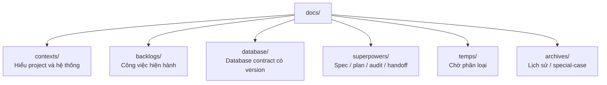
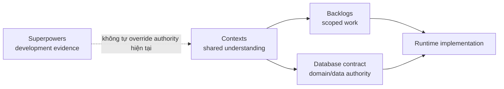

# Tài liệu dự án TrọƠi

`docs/` là hệ thống tài liệu chính của repository. Mục tiêu là để một thành viên hoặc agent mới có thể xác định nhanh: dự án là gì, hiện đang làm gì, nguồn nào có thẩm quyền và tài liệu nào chỉ mang tính lịch sử.

## Cấu trúc

- [`contexts/`](contexts/) — điểm vào để hiểu TrọƠi, product domain, system map, end-to-end flow, integration contract và trách nhiệm Frontend/Backend/Database.
- [`backlogs/`](backlogs/) — backlog đang active theo version; mỗi feature mô tả một vertical slice xuyên Frontend → Backend → Database.
- [`database/`](database/) — database contract được version hóa; chứa canonical, ERD, schema và lịch sử implementation của release.
- [`superpowers/`](superpowers/) — artifact của quá trình phát triển: specs, plans, audits, handoffs và reviews.
- [`designs/v1/android-frontend-architecture.md`](designs/v1/android-frontend-architecture.md) — kiến trúc Android hiện hành, component ownership, guardrails, migration checklist/changelog; [catalog/schema](designs/v1/android-fixture-catalog.md) hướng dẫn scenario Debug. [Round 4](testing/LEGACY_UI_QA_ARCHIVE.md), [Round 5](testing/LEGACY_UI_QA_ARCHIVE.md) và [Round 6](testing/LEGACY_UI_QA_ARCHIVE.md) **PASS**; [Round 7](testing/LEGACY_UI_QA_ARCHIVE.md) **PASS**.
- [`temps/`](temps/) — staging cho tài liệu chưa được review/phân loại. [Draft Android ban đầu](testing/LEGACY_UI_QA_ARCHIVE.md) được giữ làm lịch sử/provenance, không phải authority hiện hành. Source audit: [`Global UI/UX Deep Audit`](testing/LEGACY_UI_QA_ARCHIVE.md).
- [`archives/`](archives/) — tài liệu được chủ động lưu lại dưới dạng lịch sử hoặc special-case; không mặc định là authority hiện tại.
## Thứ tự đọc đề xuất

1. [`contexts/README.md`](contexts/README.md)
2. [`contexts/project-overview.md`](contexts/project-overview.md)
3. [`contexts/product-domain.md`](contexts/product-domain.md)
4. [`contexts/system-map.md`](contexts/system-map.md)
5. [`contexts/end-to-end-flows.md`](contexts/end-to-end-flows.md)
6. [`contexts/integration-contracts.md`](contexts/integration-contracts.md)
7. Chọn layer tương ứng trong [`contexts/layers/`](contexts/layers/)
8. Đọc backlog feature đang thực hiện trong [`backlogs/`](backlogs/)
9. Khi cần authority domain/data, đọc release hiện hành trong [`database/`](database/)

## Nguyên tắc authority

- `contexts/` giải thích và liên kết, không thay thế contract chuyên biệt.
- `backlogs/` mô tả công việc cần đạt, không tự thay đổi canonical/domain authority.
- `database/` là authority versioned cho contract domain/data tương ứng release hiện hành.
- `superpowers/` ghi lại quá trình design/execute/verify/handoff; artifact lịch sử không mặc định là requirement hiện tại.
- `temps/` không phải authority.
- Khi tài liệu mâu thuẫn, xem [`contexts/source-of-truth.md`](contexts/source-of-truth.md) trước khi sửa lower layer.

## Android test and retired presentation artifacts (2026-10-12)

- [Android Kotlin test layouts at repository root](../tests/android/README.md) — unit, Debug and instrumentation source sets configured for AGP 9 built-in Kotlin.
- [UI Redesign QA evidence archive](testing/EVIDENCE_ARCHIVE.md) — full checksum index, 173 curated evidence files and recovery notes.
- [Legacy demo archive](testing/LEGACY_DEMO_ARCHIVE.md) — retired, unreferenced HTML/PNG demo previews preserved outside Git.

## Android current QA

- [Current Android QA](testing/ANDROID_UI_CURRENT_QA.md): 192/192 JVM, Debug/Release/AndroidTest builds and root `tests/android/`.
- [Legacy UI QA archive](testing/LEGACY_UI_QA_ARCHIVE.md): historic Round 2–7 reports, visuals and drafts moved off checkout.
