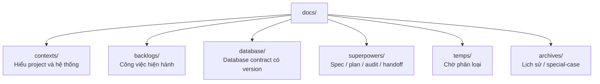
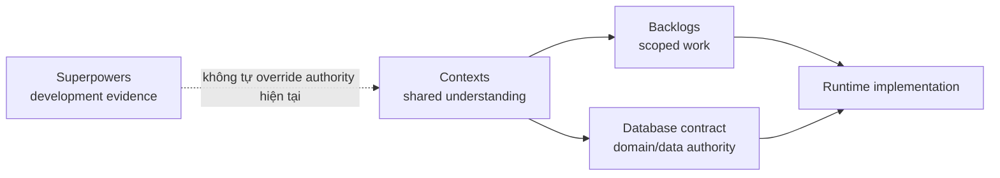

# Tài liệu dự án TrọƠi

`docs/` là hệ thống tài liệu chính của repository. Mục tiêu là để một thành viên hoặc agent mới có thể xác định nhanh: dự án là gì, hiện đang làm gì, nguồn nào có thẩm quyền và tài liệu nào chỉ mang tính lịch sử.

## Cấu trúc

- [`contexts/`](contexts/) — điểm vào để hiểu TrọƠi, product domain, system map, end-to-end flow, integration contract và trách nhiệm Frontend/Backend/Database.
- [`backlogs/`](backlogs/) — backlog đang active theo version; mỗi feature mô tả một vertical slice xuyên Frontend → Backend → Database.
- [`database/`](database/) — database contract được version hóa; chứa canonical, ERD, schema và lịch sử implementation của release.
- [`superpowers/`](superpowers/) — artifact của quá trình phát triển: specs, plans, audits, handoffs và reviews.
- [`temps/`](temps/) — staging cho tài liệu chưa được review/phân loại.
- [`archives/`](archives/) — tài liệu được chủ động lưu lại dưới dạng lịch sử hoặc special-case; không mặc định là authority hiện tại.
## Thứ tự đọc đề xuất

1. [`contexts/README.md`](contexts/README.md)
2. [`contexts/project-overview.md`](contexts/project-overview.md)
3. [`contexts/product-domain.md`](contexts/product-domain.md)
4. [`contexts/system-map.md`](contexts/system-map.md)
5. [`contexts/end-to-end-flows.md`](contexts/end-to-end-flows.md)
6. [`contexts/integration-contracts.md`](contexts/integration-contracts.md)
7. Chọn layer tương ứng trong [`contexts/layers/`](contexts/layers/)
8. Đọc backlog feature đang thực hiện trong [`backlogs/`](backlogs/)
9. Khi cần authority domain/data, đọc release hiện hành trong [`database/`](database/)

## Nguyên tắc authority

- `contexts/` giải thích và liên kết, không thay thế contract chuyên biệt.
- `backlogs/` mô tả công việc cần đạt, không tự thay đổi canonical/domain authority.
- `database/` là authority versioned cho contract domain/data tương ứng release hiện hành.
- `superpowers/` ghi lại quá trình design/execute/verify/handoff; artifact lịch sử không mặc định là requirement hiện tại.
- `temps/` không phải authority.
- Khi tài liệu mâu thuẫn, xem [`contexts/source-of-truth.md`](contexts/source-of-truth.md) trước khi sửa lower layer.
