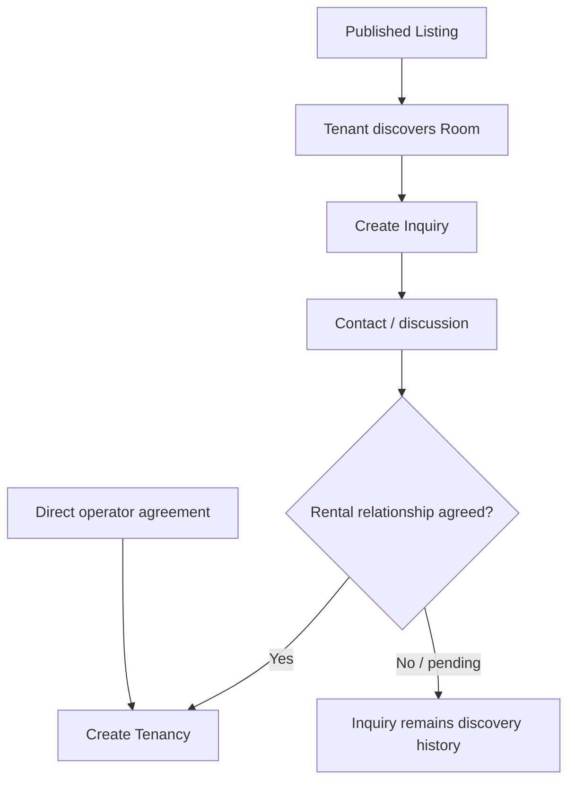

# Inquiry

## Feature

Inquiry is the discovery/contact bridge between a published Listing and a possible rental relationship.

### Use Cases

- Tenant expresses interest in a Listing.
- Tenant provides a contact intent or message.
- Inquiry may be created without forcing a Tenancy to exist.
- Multiple people may inquire about the same Listing.
- Operator can use an Inquiry as context before deciding whether to create a Tenancy.
- A Tenancy may also be created directly from a Room without an Inquiry.

### Usage Cycle

## Dependencies

- Upstream: Listing, Identity when a sender is linked.
- Downstream: Tenancy.
- Inquiry remains independent from booking/reservation flows.

## Verification

- Focused Inquiry behavior tests pass.
- Inquiry can exist independently from Tenancy and Room mutation.
- Multiple inquiries for one Listing are covered.
- Listing reference integrity is covered.
- Listing regression remains green.
- Typecheck and database/domain validators pass.
- Full-repository verification has no unexpected regression.
- Final CI for the delivered commit passes.
