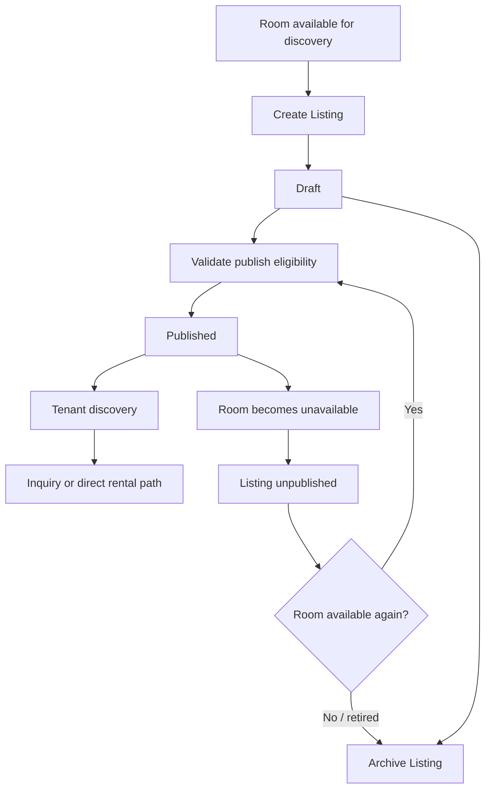

# Listing

## Feature

Listing is the public discovery projection of a Room.

### Use Cases

- Operator creates a Listing for a managed Room.
- Operator edits the current Listing instead of creating parallel current Listings.
- Operator publishes an eligible Listing so tenants can discover the Room.
- A published Listing becomes unavailable when the Room can no longer be offered.
- Operator republishes the existing Listing after the Room becomes eligible again.
- Operator archives a Listing when that discovery record is no longer current.
- Listing status changes remain traceable through lifecycle history.

### Usage Cycle

## Dependencies

- Upstream: Organization, Property, Room.
- Cross-domain: Rental Lifecycle.
- Downstream: Inquiry, Tenancy, Search/Map, Trust.

## Verification

- Focused Listing behavior tests pass.
- Listing domain-contract tests pass.
- Room ↔ Listing lifecycle behavior is covered.
- Listing lifecycle history is covered.
- Core Foundation regression remains green.
- Typecheck and database/domain validators pass.
- Full-repository verification has no unexpected regression.
- Final CI for the delivered commit passes.
