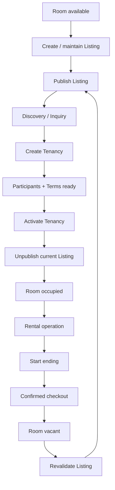

# Rental Lifecycle

## Feature

Rental Lifecycle coordinates commands whose business effect crosses Listing, Room, Property, and Tenancy boundaries.

### Use Cases

- Create and publish a Listing using current Room/Property eligibility.
- Move a Room out of the publicly available state without leaving a stale published Listing.
- Create a Tenancy from the rental-discovery or direct-operator path.
- Activate a Tenancy and transition the Room into occupied operation.
- Unpublish the current Listing when activation makes the Room unavailable.
- Confirm checkout and return the Room to the next rental cycle.
- Keep cross-domain commands consistent without moving entity-local ownership into the coordinator.

### Usage Cycle

## Dependencies

- Upstream: Property, Room, Listing, Tenancy, Tenancy Participant, Tenancy Terms.
- Downstream: Billing, Incident, Review, Trust, future persistence transaction boundaries.

## Verification

- Focused cross-domain rental-lifecycle tests pass.
- Listing ↔ Room invalidation behavior is covered.
- Tenancy activation ↔ Room occupancy behavior is covered.
- Checkout ↔ Room vacancy behavior is covered.
- Rejected commands do not leave known partial in-memory mutations.
- Listing and Tenancy domain-contract tests pass.
- Core Foundation regression remains green.
- Typecheck and database/domain validators pass.
- Full-repository verification has no unexpected regression.
- Final CI for the delivered commit passes.
