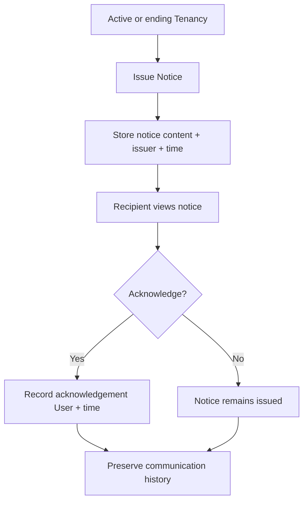

# Tenancy Notice

## Feature

Tenancy Notice records rental-related communication without turning the platform into a legal adjudication system.

### Use Cases

- Operator issues a notice related to a Tenancy.
- Notice content and issue time are preserved as communication history.
- A User may acknowledge that the notice was viewed or received.
- Acknowledgement records the User and timestamp together.
- Historical notices remain available throughout and after the rental lifecycle.

### Usage Cycle

## Dependencies

- Upstream: Tenancy, User identity for issuer/acknowledger.
- Downstream: rental communication history and later notification surfaces.

## Verification

- Focused Notice behavior tests pass.
- Issue/history behavior is covered.
- Acknowledgement pair coherence is covered.
- Notice history remains independent from legal-effect semantics.
- Tenancy support regression remains green.
- Typecheck and database/domain validators pass.
- Full-repository verification has no unexpected regression.
- Final CI for the delivered commit passes.
