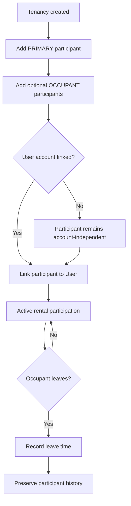

# Tenancy Participant

## Feature

Tenancy Participant records the people who take part in a rental relationship independently from digital account identity.

### Use Cases

- Operator adds a PRIMARY participant to a Tenancy.
- Operator adds additional OCCUPANT participants.
- A participant may exist before being linked to a User account.
- A participant can later be linked to the corresponding User without replacing participant history.
- An occupant may leave while the Tenancy continues.
- Historical participant membership remains available after the relationship changes.

### Usage Cycle

## Dependencies

- Upstream: Tenancy.
- Optional identity link: User.
- Downstream: Tenancy activation, Terms Acknowledgement, Payment Claim, Review.

## Verification

- Focused participant behavior tests pass.
- PRIMARY/OCCUPANT membership behavior is covered.
- Account-independent participant creation is covered.
- User linking preserves participant identity/history.
- Participant leave/history behavior is covered.
- Tenancy regression remains green.
- Typecheck and database/domain validators pass.
- Full-repository verification has no unexpected regression.
- Final CI for the delivered commit passes.
