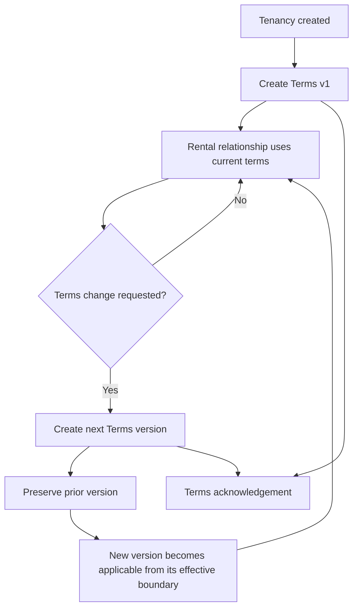

# Tenancy Terms

## Feature

Tenancy Terms stores the agreed rental conditions as versioned historical facts for one Tenancy.

### Use Cases

- Operator records the first agreed rental terms for a Tenancy.
- Later changes create a new Terms version instead of overwriting prior agreement history.
- Rent, deposit requirement, dates, utility arrangements, and rental conditions remain traceable by version.
- Downstream billing can determine which Terms version applies to a cycle.
- Participants can acknowledge a specific Terms version.

### Usage Cycle

## Dependencies

- Upstream: Tenancy.
- Downstream: Terms Acknowledgement, Billing Cycle, Charge, Deposit.

## Verification

- Focused Terms behavior tests pass.
- Versioning and historical immutability are covered.
- Exact monetary values and date ordering are covered.
- Effective-cycle provenance is preserved for downstream billing.
- Tenancy regression remains green.
- Typecheck and database/domain validators pass.
- Full-repository verification has no unexpected regression.
- Final CI for the delivered commit passes.
