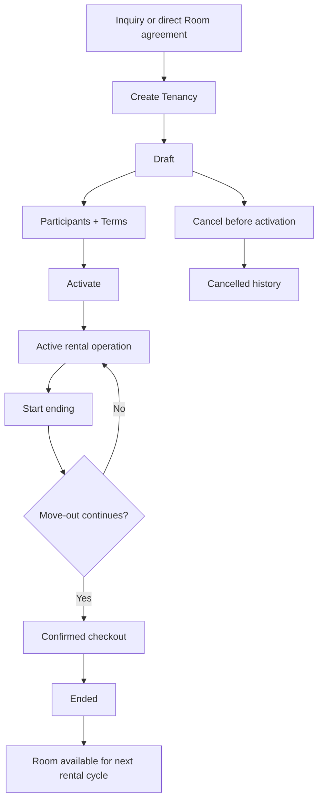

# Tenancy

## Feature

Tenancy represents one rental relationship for one Room over time.

### Use Cases

- Operator creates a rental relationship from a Room, with or without an Inquiry.
- Participants and rental terms are attached before activation.
- Tenancy is activated when the rental relationship becomes operational.
- Operator starts an ending process when move-out begins.
- An ending process may return to active operation when the move-out is cancelled.
- Confirmed checkout ends the Tenancy and returns the Room to the available lifecycle.
- Cancelled or ended Tenancies remain as historical rental records.

### Usage Cycle

## Dependencies

- Upstream: Property, Room, optional Inquiry context.
- Supporting: Tenancy Participant, Tenancy Terms, Terms Acknowledgement, Tenancy Notice.
- Cross-domain: Listing and Rental Lifecycle.
- Downstream: Billing, Payment, Deposit, Incident, Review, Trust.

## Verification

- Focused Tenancy lifecycle tests pass.
- Tenancy domain-contract tests pass.
- Single-current rental relationship behavior is covered.
- Activation and checkout cross-domain behavior is covered.
- Historical terminal Tenancies remain preserved.
- Core Foundation and Listing regressions remain green.
- Typecheck and database/domain validators pass.
- Full-repository verification has no unexpected regression.
- Final CI for the delivered commit passes.
