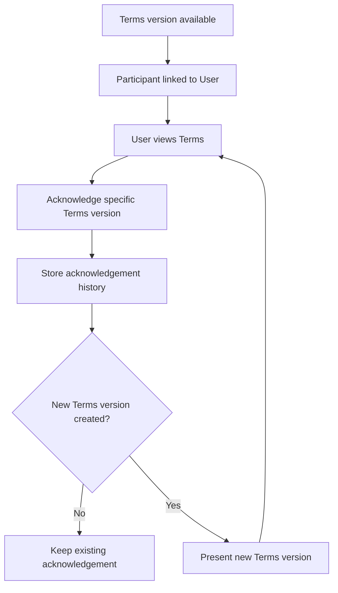

# Terms Acknowledgement

## Feature

Terms Acknowledgement records that a linked participant User acknowledged one specific Tenancy Terms version.

### Use Cases

- A participant linked to a User views a Terms version.
- The User acknowledges that exact version.
- A later Terms version requires its own acknowledgement history.
- Acknowledgement remains tied to the participant, User, and Terms version that produced it.
- Historical acknowledgements remain available after later Terms changes.

### Usage Cycle

## Dependencies

- Upstream: Tenancy, Tenancy Participant, Tenancy Terms, User link.
- Downstream: rental evidence/history consumers.

## Verification

- Focused acknowledgement behavior tests pass.
- Same-Tenancy participant/Terms consistency is covered.
- Unlinked participants cannot create User-backed acknowledgement.
- User identity consistency is covered.
- Version-specific history is preserved.
- Tenancy support regression remains green.
- Typecheck and database/domain validators pass.
- Full-repository verification has no unexpected regression.
- Final CI for the delivered commit passes.
