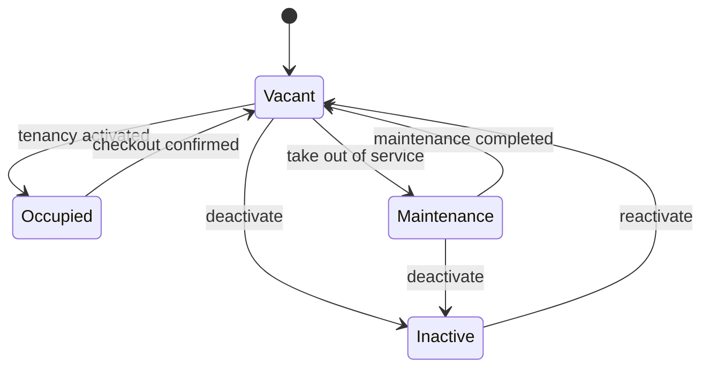
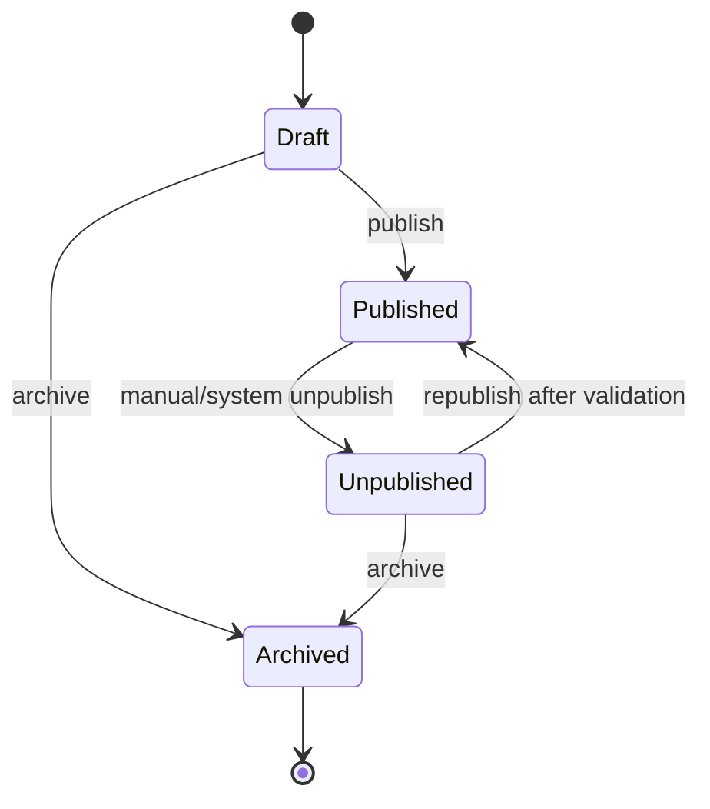
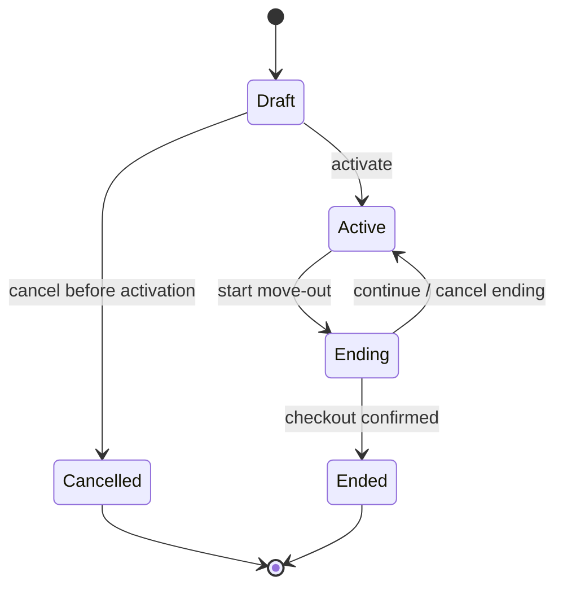
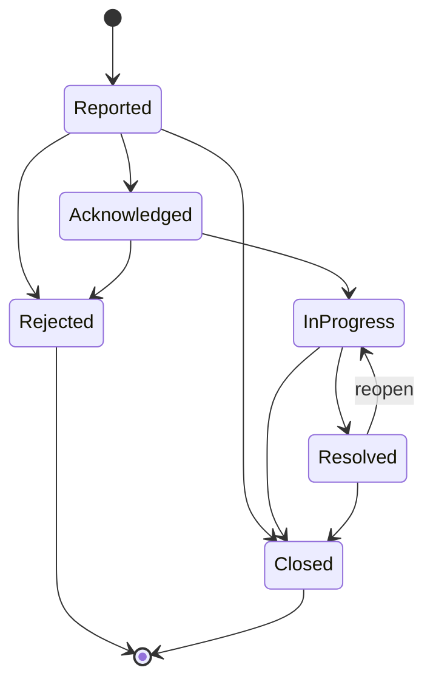
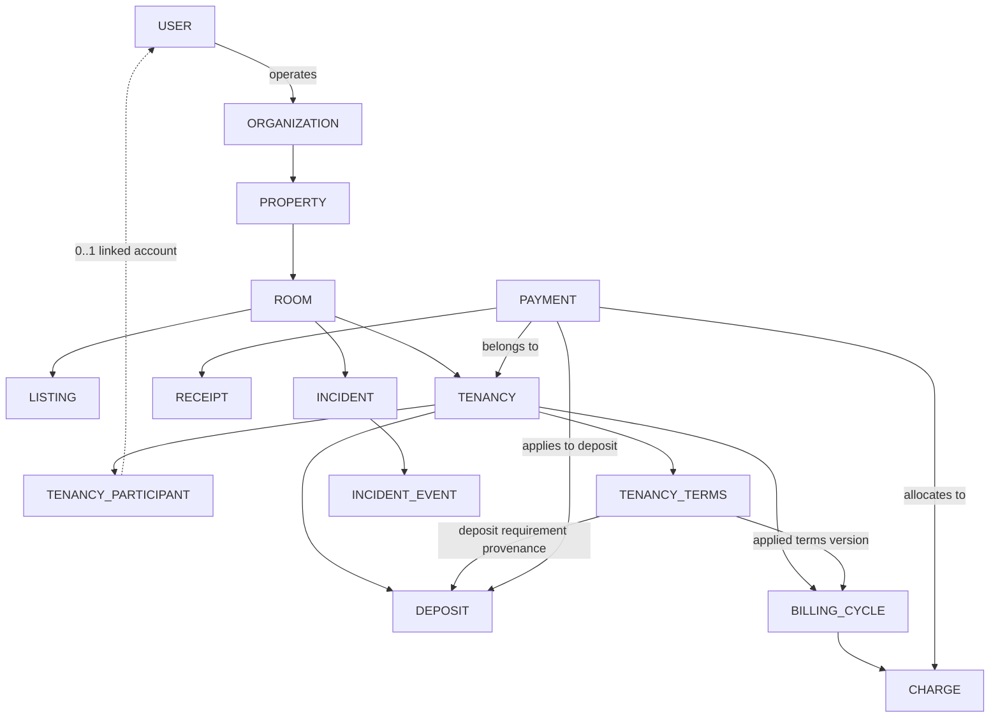

# TrọƠi — Canonical Product & Domain Freeze v3.6
### Trusted Source duy nhất cho Product & Domain Model trước khi dựng ERD LV1 → LV2 → LV3

> **Trạng thái:** Canonical Freeze v3.6 — **TRUSTED SOURCE**  
> **Mục đích:** Chốt phạm vi sản phẩm, ownership, lifecycle, cardinality, state machine, invariant và ranh giới domain để mọi thiết kế ERD, schema và backend phía sau cùng xuất phát từ một business truth thống nhất.
>
> **Ký hiệu**
> - **[FROZEN]**: đã chốt, dùng trực tiếp làm nền thiết kế.
> - **[OPEN]**: capability hoặc hướng đã rõ nhưng policy chi tiết vẫn cần chốt trước khi triển khai phần liên quan.
> - **[FUTURE]**: chủ động không đưa vào MVP hiện tại.

## Quy tắc sử dụng tài liệu

Tài liệu này là **trusted source duy nhất** cho Product & Domain Model của TrọƠi.

```text
Canonical v3.6
→ ERD LV1
→ ERD LV2
→ ERD LV3
→ DBML / schema / migration
→ backend implementation
```

Nếu một thiết kế phía dưới mâu thuẫn với invariant hoặc ownership đã `[FROZEN]` ở đây, thiết kế phía dưới phải được sửa lại. Không tự thay đổi business meaning ở tầng database hoặc code để “cho tiện implement”.

Một thay đổi đối với nội dung `[FROZEN]` được xem là **domain change** và phải được review tác động trước khi cập nhật các tầng phía dưới.

---

# 1. TrọƠi là gì? [FROZEN]

TrọƠi là một **rental lifecycle platform** cho thuê trọ dài hạn.

Lõi của sản phẩm là **sổ vận hành thuê trọ có trạng thái theo thời gian**: một phòng được theo dõi xuyên suốt từ lúc trống, được đăng tin, có người thuê, phát sinh tiền thuê và tiện ích, gặp sự cố, trả phòng, cho đến khi lịch sử thuê được dùng làm dữ liệu đối chiếu và trust signal.

Ba mặt của sản phẩm dùng chung một nguồn dữ liệu:

```text
Landlord / Operator
        ↕
Rental Operations Ledger
        ↕
Tenant / Discovery / Trust
```

Vòng đời tổng quát:

```text
Find
→ Contact
→ Rent
→ Operate
→ Pay
→ Repair
→ Leave
→ Review
→ Find again
```

TrọƠi **không phải**:

```text
OTA / booking ngắn hạn
marketplace dịch vụ mở
phần mềm kế toán độc lập
dịch vụ pháp lý
hệ thống chấm điểm công khai người thuê
```

---

# 2. Ranh giới pháp lý và dữ liệu [FROZEN]

TrọƠi:

```text
ghi nhận
lưu vết
xác nhận thao tác
tạo biên nhận
hỗ trợ đối chiếu dữ liệu
theo dõi trạng thái
```

TrọƠi không:

```text
tư vấn pháp lý
chứng nhận hiệu lực pháp lý của thỏa thuận
phân xử tranh chấp
bảo đảm hoàn cọc
bảo đảm một bên sẽ thực hiện nghĩa vụ
```

Các từ nên dùng:

```text
ghi nhận
lưu vết
xác nhận
biên nhận
lịch sử
dữ liệu đối chiếu
```

Không dùng ngôn ngữ khiến sản phẩm được hiểu là cơ quan phân xử hoặc dịch vụ pháp lý.

---

# 3. Nguyên tắc source of truth [FROZEN]

Mỗi business fact chỉ có **một nơi sở hữu chính**.

```text
USER
→ digital identity

ORGANIZATION
→ rental operating workspace

PROPERTY
→ physical property identity

ROOM
→ rental unit identity + operational state

LISTING
→ public discovery projection

TENANCY
→ rental relationship

TENANCY_TERMS
→ agreed rental terms

BILLING / CHARGE
→ receivable obligation

PAYMENT
→ actual money inflow

DEPOSIT
→ deposit fulfillment / holding / settlement

RECEIPT
→ evidence artifact của confirmed payment

INCIDENT
→ operational repair/problem lifecycle
```

Không tạo hai bảng cùng sở hữu một sự thật chỉ để tiện query.

Read model, dashboard, notification và history projection không được trở thành nguồn business truth thứ hai.

---

# 4. Identity & Operating Workspace [FROZEN]

## 4.1 USER

`USER` là **digital identity**.

Không tồn tại global scalar:

```text
USER.role = LANDLORD
USER.role = TENANT
```

Một User có thể đồng thời:

```text
browse Listing
là tenant hiện tại
là former tenant
vận hành property
```

Role/capability phát sinh từ relationship.

---

## 4.2 ORGANIZATION

`ORGANIZATION` là **rental operating workspace**.

Nó không bắt buộc là pháp nhân hay công ty.

Ví dụ:

```text
Organization: Trọ cô Lan
├── Property A
│   ├── Room A01
│   └── Room A02
└── Property B
    └── Room B01
```

Conceptual relationship:

```text
USER
→ operates
→ ORGANIZATION
→ owns / operates
→ PROPERTY
```

### Cardinality MVP

```text
USER
→ 0..N ORGANIZATION

ORGANIZATION
→ exactly 1 primary owner/operator USER

ORGANIZATION
→ 0..N PROPERTY

PROPERTY
→ exactly 1 ORGANIZATION
```

Một User chỉ là tenant/searcher có thể không vận hành Organization nào.

Trong MVP, mỗi Organization có đúng một primary owner/operator. Multi-operator, staff và delegation không được đưa vào LV1 hiện tại; khi nhu cầu đó xuất hiện, ownership model có thể được mở rộng bằng membership/association mà không đổi meaning của `ORGANIZATION`.

Ở LV1 không cần first-class team/delegation model.

### [FUTURE]

```text
organization membership
staff roles
delegation UI
fine-grained property permissions
```

có thể được thêm ở LV2/LV3 khi sản phẩm thực sự cần.

---

# 5. Property [FROZEN]

`PROPERTY` là controlled-change root chứa các Room.

Các nhóm thay đổi:

```text
Presentation
Operational Configuration
Identity / Location
Structure / Lifecycle
```

Location vận hành và location public không phải cùng một dữ liệu hiển thị.

```text
Property exact location
→ Listing public location projection
→ Search / Map
```

Exact address không mặc định public.

---

## 5.1 Property lifecycle

```text
ACTIVE
ARCHIVED
```

`ARCHIVED` là terminal lifecycle state.

Property chỉ được archive khi:

```text
1. Không có non-terminal Tenancy trong bất kỳ Room con nào
2. Không có Published Listing thuộc Room con
3. Không có Room con ở OCCUPIED
4. Tất cả Room con đã INACTIVE hoặc ARCHIVED
5. Không có Incident đang mở trong bất kỳ Room con nào
```

`Incident đang mở` gồm:

```text
REPORTED
ACKNOWLEDGED
IN_PROGRESS
RESOLVED
```

Muốn archive Property khi còn Incident, operator phải xử lý hoặc đóng Incident bằng một lý do nghiệp vụ rõ ràng trước; archive không tự động biến Incident thành `CLOSED`.

Ancestor guard:

```text
Property = ARCHIVED
→ không reactivate Room con
→ không tạo Tenancy mới
→ không tạo/publish Listing mới
```

---

# 6. Room [FROZEN]

`ROOM` là đơn vị không gian cho thuê vận hành.

Room có **hai chiều trạng thái độc lập**.

## 6.1 Operational State

```text
VACANT
OCCUPIED
MAINTENANCE
INACTIVE
```



### Invariants

```text
OCCUPIED
→ có active operational Tenancy
```

```text
MAINTENANCE
→ không active Tenancy
→ không Published Listing
```

```text
INACTIVE
→ không active Tenancy
→ không Published Listing
```

Không tồn tại:

```text
OCCUPIED → INACTIVE
OCCUPIED → MAINTENANCE
```

trực tiếp.

Muốn decommission Room đang có người thuê:

```text
OCCUPIED
→ checkout confirmed
→ VACANT
→ INACTIVE
```

---

## 6.2 Record Lifecycle

```text
ACTIVE
ARCHIVED
```

Room chỉ được archive khi:

```text
operational_state = INACTIVE
AND no non-terminal Tenancy
AND no open Incident
```

Archive flow:

```text
Archive Room
→ require INACTIVE
→ require no non-terminal Tenancy
→ require no open Incident
→ archive all related Listings
→ lifecycle = ARCHIVED
→ append operational history
```

Archive không tự động đóng Incident. Nếu một vấn đề không còn cần tiếp tục xử lý vì Room bị ngừng sử dụng vĩnh viễn, operator phải đóng Incident trước bằng `closure_reason` phù hợp, ví dụ `ROOM_RETIRED` hoặc `NO_FURTHER_ACTION`.

Room đã archived:

```text
không tạo Tenancy mới
không tạo Listing mới
không reactivate
```

---

## 6.3 Move Room giữa Property

Phải phân biệt hai trường hợp.

### Property assignment correction

Dùng khi Room bị gán sai Property nhưng vẫn là cùng một phòng vật lý.

Nếu chưa có committed history:

```text
correct property relation
→ refresh projection
```

Nếu đã có public Listing:

```text
unpublish Listing
→ correct property relation
→ revalidate public location
→ manual republish
```

Correction phải append history.

### Physical relocation / restructuring

Nếu physical context thay đổi thật:

```text
create new Room under new Property
→ archive old Room
```

Không reuse Room identity cũ.

---

# 7. Listing & Discovery [FROZEN]

`LISTING` là **public discovery projection**, không phải operational truth của Room.

## 7.1 Listing lifecycle

Closed vocabulary:

```text
DRAFT
PUBLISHED
UNPUBLISHED
ARCHIVED
```



`ARCHIVED` là terminal.

---

## 7.2 Publish invariant

```text
Listing = PUBLISHED
→ Room = VACANT
→ Room.lifecycle = ACTIVE
→ Property.lifecycle = ACTIVE
```

Publish-time guard:

```text
Publish command
→ validate Room VACANT
→ validate Room/Property active
→ validate Listing requirements
→ only then PUBLISHED
```

Runtime invalidation:

```text
Room leaves VACANT
→ Published Listing synchronously becomes UNPUBLISHED
```

Reconciliation job chỉ là safety net, không phải business mechanism chính.

---

## 7.3 Listing cardinality

```text
Room
→ 0..N historical archived Listings
→ max 1 current non-archived Listing
```

Landlord chỉnh nội dung Listing hiện tại thay vì tạo Listing song song.

---

## 7.4 Listing Status Event

Mỗi transition quan trọng phải có history.

Concept:

```text
LISTING_STATUS_EVENT
- listing
- from_status
- to_status
- reason
- actor_type
- actor
- trigger
- created_at
- metadata
```

Reason code có thể mở rộng ở LV2.

Các reason đã rõ:

```text
LANDLORD_MANUAL
ROOM_OCCUPIED
ROOM_MAINTENANCE
ROOM_INACTIVE
PROPERTY_CORRECTION
MODERATION
```

---

# 8. Search & Map [FROZEN]

Search/Map chỉ đọc:

```text
PUBLISHED Listing projection
```

MVP filters:

```text
Location
Price range
Room / property type
Availability
```

Infrastructure ban đầu:

```text
PostgreSQL
PostGIS
proper indexes
```

Không cần Elasticsearch/OpenSearch ngay.

### [FUTURE]

```text
advanced recommendation
AI matching
saved search
complex ranking
```

---

# 9. Inquiry / Contact [FROZEN]

Inquiry là bridge giữa Discovery và rental relationship.

Hai path đều hợp lệ:

```text
Listing
→ Inquiry
→ two parties agree
→ Tenancy
```

và:

```text
Room
→ Landlord creates Tenancy directly
```

Inquiry không phải prerequisite của Tenancy.

V1 tối giản:

```text
listing
sender
message / contact intent
created_at
status
```

Có thể chỉ hỗ trợ:

```text
Call
Zalo
"Tôi quan tâm"
```

### [FUTURE]

Full realtime messaging:

```text
typing indicator
reactions
rich media thread
message search
group messaging
```

---

# 10. Tenant identity & linking [FROZEN]

```text
USER
≠
TENANCY_PARTICIPANT
```

Landlord phải có thể tạo rental relationship ngay cả khi tenant:

```text
chưa có account
chưa accept invite
không dùng app
```

Relationship:

```text
TENANCY
→ TENANCY_PARTICIPANT
→ 0..1 USER
```

Participant giữ effective membership:

```text
role
joined_at
left_at
```

Roles:

```text
PRIMARY
OCCUPANT
```

Invariants:

```text
Một active Tenancy phải có active PRIMARY.
Tối đa một active PRIMARY tại một thời điểm.
0..N active OCCUPANT.
```

Policy thay PRIMARY giữa kỳ cần controlled transition và giữ history.

User account bị xoá/không còn link không được xoá Participant history.

---

# 11. Tenancy [FROZEN]

`TENANCY` là một quan hệ thuê cụ thể của một Room theo thời gian.

Core invariant:

```text
One Room
→ at most one non-terminal Tenancy
```

Trong MVP:

```text
non-terminal =
DRAFT | ACTIVE | ENDING
```

Historical terminal states:

```text
ENDED
CANCELLED
```

không bị giới hạn số lượng theo thời gian.

Điều này giữ `TENANCY` đúng nghĩa là rental relationship đã được chọn để tiến tới vận hành, thay vì biến Tenancy thành nơi chứa nhiều candidate agreement song song. Nhiều người quan tâm trước khi chốt vẫn được biểu diễn ở `INQUIRY`.

Activation luôn phải kiểm tra lại invariant này trong cùng transaction để tránh race condition.

## 11.1 Pre-leasing decision [FROZEN]

MVP **không cho phép tạo Draft Tenancy tiếp theo khi Room vẫn còn một Tenancy ở `ENDING`**.

Ví dụ:

```text
Tenancy A = ENDING
Room vẫn chưa checkout
→ không tạo Tenancy B = DRAFT
```

Landlord có thể tiếp tục nhận và quản lý nhiều `INQUIRY` cho người thuê tiềm năng trong thời gian này. Chỉ sau khi:

```text
Tenancy A → ENDED
Room → VACANT
```

mới được tạo Draft Tenancy tiếp theo.

Quyết định này là có chủ đích để giữ MVP đơn giản, tránh pre-leasing/reservation semantics và không tạo hai rental relationships non-terminal song song trên cùng một Room.

Nếu sau này cần pre-leasing, đó là một capability mới với invariant riêng:

```text
ENDING Tenancy + tối đa 1 future Draft
Draft không được activate trước khi Room VACANT
```

Capability đó không thuộc MVP hiện tại.

## 11.2 Lifecycle



### Semantics

```text
Draft
= chưa activate

Active
= rental relationship đang vận hành

Ending
= đã bắt đầu quy trình kết thúc nhưng chưa checkout xong

Ended
= checkout/handover đã được xác nhận

Cancelled
= tenancy chưa từng activate và bị dừng
```

`end_date` không tự chuyển Tenancy sang `Ended`.

Chỉ confirmed checkout/handover mới:

```text
Tenancy → Ended
Room → Vacant
```

Tenant có thể request/indicate move-out nhưng không tự xác nhận Room đã vacant.

## 11.3 End reason

Khi `ENDING → ENDED`, hệ thống ghi nhận một `end_reason` mang tính vận hành/lịch sử.

Vocabulary MVP:

```text
TERM_ENDED
TENANT_INITIATED
OPERATOR_INITIATED
MUTUAL
OTHER
```

`end_reason` chỉ mô tả **ai/hoàn cảnh nào khởi tạo việc kết thúc**, không phải phán quyết ai đúng/sai.

Không dùng các reason kiểu:

```text
TENANT_AT_FAULT
LANDLORD_AT_FAULT
BREACH_CONFIRMED
```

nếu nền tảng không có cơ chế adjudication tương ứng.

`end_reason` không tự động quyết định Review eligibility.

---

# 12. Notice & Move-out [FROZEN capability]

Notice ghi nhận communication.

Ví dụ:

```text
non-renewal
move-out notice
ending reminder
```

Notice không tự tạo legal effect.

Tenant acknowledgement chỉ có nghĩa:

```text
account đã view / acknowledge notice
```

không có nghĩa TrọƠi xác nhận giá trị pháp lý của notice.

Exact `TENANCY_NOTICE` entity được thiết kế ở LV2.

---

# 13. Tenancy Terms [FROZEN]

`TENANCY_TERMS` là first-class, versioned business concept.

Nó sở hữu:

```text
rent amount
agreed deposit requirement
term start/end
billing day / due-date rule
electricity/water arrangement
minimal rental conditions
```

Terms không overwrite version cũ.

```text
Tenancy
→ Terms v1
→ Terms v2
→ Terms v3
```

Acknowledgement phải gắn với **một Terms version cụ thể**.

Không dùng tenancy-level boolean:

```text
terms_accepted = true
```

mơ hồ.

---

## 13.1 Financial effective-date rule

Financial Terms không thay đổi giữa Billing Cycle đang chạy.

```text
change requested mid-cycle
→ effective next billing-cycle boundary
```

Ví dụ:

```text
September Cycle uses Terms v1
Rent changed on 15/09
October Cycle uses Terms v2
```

MVP không có prorating engine.

### [FUTURE]

Proration giữa kỳ có thể được thiết kế bằng charge-level provenance nếu thật sự cần.

---

# 14. Billing [FROZEN]

Billing scope MVP:

```text
RENT
ELECTRICITY
WATER
```

Không có:

```text
service charge
WiFi
parking
generic Other
```

trong current scope.

---

## 14.1 Billing Cycle

`BILLING_CYCLE` thuộc lifecycle của `TENANCY`.

Mỗi cycle phải biết:

```text
TENANCY_TERMS version được áp dụng
period_start
period_end
```

Invariant:

```text
period_end >= period_start
```

Không cho Billing Cycle của cùng Tenancy overlap.

Không giả định mỗi cycle luôn 30 ngày.

---

## 14.2 Charge

`CHARGE` là receivable line item.

```text
Billing Cycle
→ 1..N Charge
```

Charge phải truy ngược được:

```text
Billing Cycle
→ Terms version
```

không tồn tại orphan financial charge.

---

# 15. Utility [FROZEN capability]

Manual path luôn hợp lệ.

Electricity/Water có thể cần:

```text
utility source/provider
meter
start reading
end reading
pricing rule
```

Mức entity cụ thể được hoàn thiện ở LV2.

Automation chỉ được dùng khi source/rule đủ tin cậy.

Không có semi-auto mode.

---

# 16. Payment [FROZEN]

`PAYMENT` là source of truth cho **actual money inflow**.

Payment thuộc đúng một Tenancy.

Sources:

```text
MANUAL_CASH
MANUAL_TRANSFER
GATEWAY
```

Verification:

```text
USER_RECORDED
PROVIDER_VERIFIED
```

Chỉ verified/confirmed business event mới được coi là Payment thực tế.

---

## 16.1 Payment Allocation

Không dùng:

```text
Billing Cycle → Payment
```

Quan hệ đúng:

```text
PAYMENT
→ PAYMENT_ALLOCATION
→ CHARGE
```

Một Payment có thể:

```text
pay part of one Charge
pay multiple Charges
pay Charges from multiple Billing Cycles
```

nhưng tất cả target phải thuộc **cùng Tenancy** với Payment.

Invariant:

```text
sum(charge allocations)
+ sum(deposit applications)
<= Payment.amount
```

Unallocated amount policy: **[OPEN]**.

---

## 16.2 Payment correction

Confirmed Payment không edit destructive.

```text
wrong Payment
→ void / reverse
→ create corrected Payment
```

History phải được giữ.

---

# 17. Payment Claim [FROZEN capability / OPEN policy]

Tenant có thể nộp evidence cho khoản thanh toán bên ngoài hệ thống.

```text
PAYMENT_CLAIM
→ operator reviews
→ Confirm
    → create/confirm PAYMENT
→ Reject / unresolved
    → no PAYMENT
```

Invariant:

```text
PAYMENT_CLAIM
≠
PAYMENT
```

Không dùng:

```text
Payment.status = PENDING_CLAIM
```

Exact evidence format và permission confirm: **[OPEN]**.

---

# 18. Receipt [FROZEN]

Receipt sinh từ confirmed Payment.

```text
Confirmed Payment
→ Receipt
```

Receipt:

```text
không sở hữu debt state
không edit trực tiếp sau issue
correction bằng void/reissue
tenant có thể view/share/download
```

Cardinality:

```text
PAYMENT
→ 0..N RECEIPT historical

PAYMENT
→ max 1 current / non-voided RECEIPT
```

Lifecycle tối thiểu:

```text
ISSUED
VOIDED
```

Reissue không overwrite Receipt cũ:

```text
Receipt R1: ISSUED
→ VOIDED

Receipt R2: ISSUED
→ current
```

Receipt history không biến mất khi void.

---

# 19. Deposit [FROZEN]

`TENANCY_TERMS` sở hữu:

```text
agreed deposit requirement
```

`DEPOSIT` sở hữu:

```text
fulfillment
held amount
settlement
history
```

Không có editable `Deposit.expected_amount` độc lập với Terms.

---

## 19.1 Money inflow vào Deposit

Payment là source of truth của tiền thực nhận.

```text
Confirmed PAYMENT
→ DEPOSIT_PAYMENT_APPLICATION
→ DEPOSIT_EVENT: RECEIVED
```

`RECEIVED` event phải reference Application.

Amount của RECEIVED không được diverge khỏi Application amount.

Manual cash vẫn đi qua:

```text
record Payment(USER_RECORDED)
→ Deposit Application
→ Received Event
```

---

## 19.2 Deposit settlement

Refund không phải inbound Payment.

Settlement có thể tạo:

```text
DEPOSIT_EVENT: REFUNDED
DEPOSIT_EVENT: RETAINED
```

Provenance:

```text
Deposit Settlement Action
→ REFUNDED / RETAINED event
```

không đi qua `DEPOSIT_PAYMENT_APPLICATION`.

Settlement lưu:

```text
refunded_amount
retained_amount
reason / note
actor
timestamp
```

Không claim rằng retained amount là quyết định pháp lý của nền tảng.

---

## 19.3 Deposit state

Deposit state là **derived projection**, không phải field authoritative set tay.

Closed vocabulary:

```text
EXPECTED
PARTIALLY_HELD
HELD
PENDING_SETTLEMENT
SETTLED
```

Semantics:

```text
EXPECTED
→ Terms yêu cầu deposit, chưa nhận

PARTIALLY_HELD
→ received < required

HELD
→ received đủ requirement

PENDING_SETTLEMENT
→ settlement đã bắt đầu nhưng chưa hoàn tất

SETTLED
→ held amount đã được phân bổ thành refunded + retained
```

Tenancy có thể:

```text
ENDED
```

trong khi Deposit vẫn:

```text
PENDING_SETTLEMENT
```

Policy thay deposit requirement khi đã held một phần: **[OPEN]**.

---

# 20. Incident / Ticket [FROZEN]

Incident là operational problem của Room.

Không cần Room Asset Inventory.

Ví dụ:

```text
cửa không khóa được
vòi nước rò
mất điện
máy lạnh không chạy
```

Categories:

```text
ELECTRICAL
PLUMBING
ACCESS_SECURITY
ROOM_FACILITY
APPLIANCE
OTHER
```

## 20.1 Lifecycle



`InProgress → Closed` dùng cho:

```text
duplicate
cancelled
no action required
```

và phải có closure reason.

---

## 20.2 Incident Event

Mọi thay đổi quan trọng append event:

```text
status changed
landlord/operator note
tenant note
attachment added
reopened
closed
```

Không overwrite history.

Open Incident:

```text
REPORTED
ACKNOWLEDGED
IN_PROGRESS
RESOLVED
```

Terminal Incident:

```text
REJECTED
CLOSED
```

Room/Property archive bị chặn khi còn Incident mở. Archive không được dùng như một shortcut để tự động `CLOSED` Incident.

Incident không phải Trust Report.

---

# 21. Tenant Portal [FROZEN capability]

Tenant Portal gồm các capability:

```text
My Rental
Terms
Deposit
Billing
Payment
Receipts
Tickets
Notices
Move-out
History
Find Rooms
```

Tenant có thể:

```text
xem terms
ack Terms version
xem billing
submit payment evidence
xem receipt
create/track ticket
xem notices
request move-out
search phòng khác kể cả khi đang có tenancy
```

Former tenant giữ read-only access vào lịch sử rental của chính họ theo policy access.

---

# 22. Review — Verified Rental Review [FROZEN capability / OPEN policy]

Review phải dựa trên rental history thật.

Baseline eligibility:

```text
Tenancy = ENDED
AND
User linked to eligible Participant
→ candidate for Review
```

`end_reason` không tự động loại một former tenant khỏi quyền review. Lý do kết thúc do một bên ghi nhận không được dùng như cơ chế né review hoặc như kết luận ai có lỗi. Nội dung lạm dụng/gian lận được xử lý bằng moderation policy riêng.

Review target:

```text
Property / Rental Experience
```

không phải public rating con người của landlord.

MVP có thể chỉ cần:

```text
overall rating
comment
```

Public signal:

```text
Verified Rental
```

Một Review có thể có tối đa một landlord/operator response.

### [OPEN]

```text
minimum occupancy duration
edit policy
moderation authority
rating dimensions
```

---

# 23. Trust Report [FROZEN capability / OPEN policy]

Trust Report khác Incident.

```text
INCIDENT
= vấn đề vận hành Room

TRUST REPORT
= vấn đề với public content
```

Targets MVP:

```text
Listing
Review
```

Reasons:

```text
INCORRECT_INFORMATION
MISLEADING_PRICE
WRONG_LOCATION
DUPLICATE_LISTING
INAPPROPRIATE_CONTENT
SUSPECTED_FRAUD
PRIVACY_VIOLATION
SPAM
OTHER
```

Lifecycle:

```text
SUBMITTED
→ UNDER_REVIEW
→ RESOLVED | REJECTED
```

Invariant:

```text
One Report
≠
Automatic Content Removal
```

### [OPEN]

```text
login requirement
rate limit
moderation permissions
evidence policy
```

---

# 24. Operational History & Technical Audit [FROZEN]

Hai concern tách biệt.

## Operational History

Business/read projection.

Ví dụ:

```text
Room status history
Incident timeline
Listing status history
Tenancy history
```

Có thể hiển thị cho tenant/operator theo permission.

## Technical Audit

Cross-cutting infrastructure concern.

Dùng cho:

```text
actor
action
timestamp
security/compliance metadata
```

Technical Audit không phải business source of truth và không phải Operational History.

---

# 25. Dashboard [FROZEN]

Dashboard là read model.

Không sở hữu:

```text
revenue truth
occupancy truth
debt truth
```

Nó derive từ operational tables/events.

Có thể hiển thị:

```text
rooms by state
active tenancy
outstanding receivable
paid
open incidents
expiring tenancy
move-out overdue
recent activity
```

Materialized view được phép nếu có thể rebuild.

---

# 26. Notifications [FROZEN capability]

Notification là side effect/delivery.

Notification:

```text
không mutate business state
không xác nhận payment
không kết thúc tenancy
không resolve incident
```

Có thể dùng cho:

```text
new inquiry
payment due
payment confirmed
new incident
incident status changed
notice
move-out
review/report moderation
```

Exact channels: **[OPEN]**.

---

# 27. Conceptual Domain Map cho LV1



LV1 thể hiện business relationship.

Cardinality tối thiểu phải được ghi trực tiếp khi dựng ERD:

```text
USER 0..N ORGANIZATION
ORGANIZATION exactly 1 primary owner/operator USER
ORGANIZATION 0..N PROPERTY
PROPERTY exactly 1 ORGANIZATION

ROOM max 1 current LISTING
ROOM max 1 non-terminal TENANCY

PAYMENT 0..N RECEIPT historical
PAYMENT max 1 current/non-voided RECEIPT
```

Các junction/supporting entity cần xuất hiện từ LV2:

```text
PAYMENT_ALLOCATION
DEPOSIT_PAYMENT_APPLICATION
LISTING_STATUS_EVENT
TERMS_ACKNOWLEDGEMENT
TENANCY_NOTICE
PAYMENT_CLAIM
UTILITY_CONNECTION / METER_READING
REVIEW
TRUST_REPORT
NOTIFICATION
```

Tùy mức abstraction, Review/Report có thể được đưa vào LV1 nếu team muốn thể hiện đầy đủ Trust surface ngay trên conceptual ERD; việc đó không thay đổi ownership đã chốt ở tài liệu này.

---

# 28. Cross-domain invariants [FROZEN]

1. `USER` không có global landlord/tenant role.
2. `TENANCY_PARTICIPANT` có thể tồn tại mà chưa link `USER`.
3. `ORGANIZATION` là operating workspace, không bắt buộc là legal company.
4. Archived Property không cho phép child Room/Tenancy/Listing hoạt động trở lại.
5. `ROOM.operational_state` và Room lifecycle là hai concept khác nhau.
6. Room chỉ archive khi `INACTIVE`.
7. `OCCUPIED → INACTIVE` trực tiếp không hợp lệ.
8. `OCCUPIED → MAINTENANCE` trực tiếp không hợp lệ.
9. `Listing = PUBLISHED → Room = VACANT`.
10. Published Listing chỉ hợp lệ dưới active Room và active Property.
11. Room rời VACANT → Published Listing phải unpublish đồng bộ.
12. Room archive → mọi Listing liên quan archive.
13. Mỗi Room tối đa một current non-archived Listing.
14. Một Room tối đa một non-terminal Tenancy (`DRAFT | ACTIVE | ENDING`).
15. Khi Room còn Tenancy `ENDING`, không được tạo Draft Tenancy tiếp theo trong MVP; dùng Inquiry cho pre-rental interest cho tới khi Room thực sự `VACANT`.
16. End date không tự kết thúc Tenancy.
17. Chỉ confirmed checkout mới `Ending → Ended` và `Room → VACANT`.
18. `end_reason` là operational-history metadata trung tính và không tự động quyết định Review eligibility.
19. Participant history không overwrite khi occupant thay đổi.
20. Terms luôn versioned.
21. Terms acknowledgement gắn đúng version.
22. Financial Terms change chỉ effective ở billing-cycle boundary tiếp theo trong MVP.
23. Billing Cycle phải biết Terms version được áp dụng.
24. Billing scope MVP chỉ Rent/Electricity/Water.
25. Payment thuộc đúng một Tenancy.
26. Payment allocation/application không được cross-Tenancy.
27. `PAYMENT_CLAIM ≠ PAYMENT`.
28. Confirmed Payment không destructive edit.
29. Receipt chỉ sinh từ confirmed Payment.
30. Một Payment có thể có nhiều Receipt lịch sử nhưng tối đa một Receipt current/non-voided.
31. Agreed deposit requirement thuộc Terms.
32. Deposit fulfillment/settlement thuộc Deposit.
33. Deposit received money phải đi qua Payment + Deposit Application.
34. Refund/Retain không phải inbound Payment.
35. Deposit state là derived projection.
36. `Refunded`/`Retained` là settlement outcome, không phải state.
37. Room/Property archive bị chặn khi còn Incident mở.
38. Incident không phải Trust Report.
39. Incident history append-only.
40. One Trust Report không tự động remove content.
41. Dashboard/History/Notification không phải source of truth.
42. TrọƠi không claim legal adjudication.
---

# 29. Current / Open / Future

## CURRENT / FROZEN

```text
User identity
Organization workspace
Property
Room
Listing
Search
Map
Basic filters
Inquiry / Contact
Tenant Portal
Tenancy
Participants
Terms
Terms acknowledgement
Notice / Move-out capability
Deposit
Billing
Rent / Electricity / Water
Payment
Payment Allocation
Payment Claim capability
Receipt
Incident / Incident Event
Operational History
Dashboard
Notification capability
Verified Review
Trust Report
```

## OPEN policy

```text
Primary replacement workflow giữa kỳ
Payment unallocated amount
Payment Claim evidence format / confirmation permission
Deposit requirement change sau khi đã held
Review minimum occupancy / editing / moderation
Trust Report login / rate limit / moderation permissions
Notification channels
Exact utility adapter/model
```

## FUTURE

```text
Subscription / Pricing tiers / quota gating
CSV / Excel import
advanced team/staff delegation
Room Asset Inventory
Service/WiFi/Parking/Other charge types
Partner marketplace / worker dispatch / commission
AI / OCR / predictive features
full realtime messaging
saved search / advanced favorites
payment gateway as MVP dependency
OTA reservation / instant booking
nightly calendar / dynamic pricing
proration engine
public tenant rating
public personal landlord rating
```

---

# 30. Acceptance checklist trước khi vẽ ERD

- [ ] `USER`, `ORGANIZATION`, `PROPERTY`, `ROOM` có ownership chain rõ.
- [ ] `USER ↔ ORGANIZATION` cardinality đã chốt: User `0..N` Organization; mỗi Organization đúng 1 primary owner/operator ở MVP.
- [ ] Không có global `USER.role`.
- [ ] Room operational state tách khỏi archive lifecycle.
- [ ] Property archive có child/ancestor guard.
- [ ] Listing có đúng 4 state `DRAFT/PUBLISHED/UNPUBLISHED/ARCHIVED`.
- [ ] Một Room tối đa một current Listing.
- [ ] Search/Map chỉ đọc Published Listing.
- [ ] Inquiry không phải prerequisite của Tenancy.
- [ ] `TENANCY_PARTICIPANT` optional-link với User.
- [ ] Tenancy FSM có `ENDING` và `ENDED`, không dùng `COMPLETED`.
- [ ] Một Room tối đa một non-terminal Tenancy (`DRAFT | ACTIVE | ENDING`).
- [ ] Room có Tenancy `ENDING` không được tạo Draft Tenancy kế tiếp trong MVP; pre-rental interest vẫn đi qua Inquiry.
- [ ] Terms versioned và acknowledgement version-specific.
- [ ] Billing Cycle giữ Terms provenance.
- [ ] Charge type hiện tại chỉ Rent/Electricity/Water.
- [ ] Payment thuộc đúng một Tenancy.
- [ ] `PAYMENT_ALLOCATION` hỗ trợ partial/multi-charge/multi-cycle.
- [ ] Allocation/Application không cross-Tenancy.
- [ ] Confirmed Payment correction bằng void/reverse + new.
- [ ] Receipt nằm trong financial chain.
- [ ] Một Payment có `0..N` Receipt lịch sử nhưng tối đa 1 Receipt current/non-voided.
- [ ] Deposit requirement không duplicate ngoài Terms.
- [ ] Deposit received event trace được về Payment Application.
- [ ] Deposit refund/retain trace được về settlement action.
- [ ] Deposit state không là mutable source of truth.
- [ ] Incident và Incident Event có lifecycle rõ.
- [ ] Room/Property archive bị chặn khi còn Incident mở.
- [ ] Tenancy ghi `end_reason` trung tính khi kết thúc.
- [ ] Review eligibility dựa trên rental history thật và không tự động bị chặn bởi `end_reason`.
- [ ] Trust Report không auto-remove content.
- [ ] Dashboard/History/Notification không sở hữu business truth.
- [ ] Không có feature FUTURE nào vô tình lọt vào core schema.

---

# 31. Freeze readiness

Canonical v3.6 đã đủ điều kiện làm **trusted source trực tiếp** cho:

```text
LV1 — Conceptual ERD
→ LV2 — Logical model
→ LV3 — Physical model
```

Các mục `[OPEN]` không chặn LV1 conceptual vì ownership và boundary đã rõ; chúng chỉ cần được chốt trước migration hoặc trước khi triển khai workflow tương ứng.

Từ đây, ERD và backend **không cần một nguồn domain khác để diễn giải lại business logic**. Mọi thay đổi một invariant `[FROZEN]` là domain change và phải được cập nhật có chủ đích vào tài liệu này trước khi propagate xuống LV1/LV2/LV3 và implementation.
