# Backend Tech Stack — TrọƠi

Tài liệu này ghi nhận **tech stack đã chốt cho backend của TrọƠi**.

Backend được phát triển bằng **TypeScript** trên **NestJS**, tổ chức theo kiến trúc **Modular Monolith** và cung cấp API cho ứng dụng Android thông qua HTTP API có contract được mô tả bằng **OpenAPI / Swagger**.

Tài liệu này chỉ mô tả **công nghệ và kiến trúc kỹ thuật của backend application**.

Database, object storage, cache, deployment infrastructure, authentication strategy, ORM và các công cụ chưa được chốt được định nghĩa ở tài liệu riêng.

---

## 1. Tổng quan

| Khu vực | Công nghệ | Vai trò |
| --- | --- | --- |
| Backend Language | TypeScript | Ngôn ngữ chính của backend |
| Backend Framework | NestJS | Framework xây dựng backend application |
| Architecture | Modular Monolith | Tổ chức backend thành các module trong một application |
| API Style | HTTP / REST | Giao tiếp giữa backend và client |
| API Contract | OpenAPI | Định nghĩa contract của API |
| API Documentation | Swagger | Sinh và hiển thị tài liệu OpenAPI |

---

## 2. Kiến trúc tổng quan

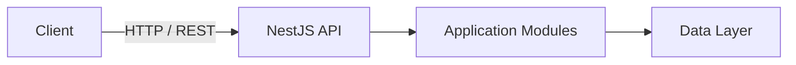

Backend là một application duy nhất nhưng được chia thành các module có boundary rõ ràng.

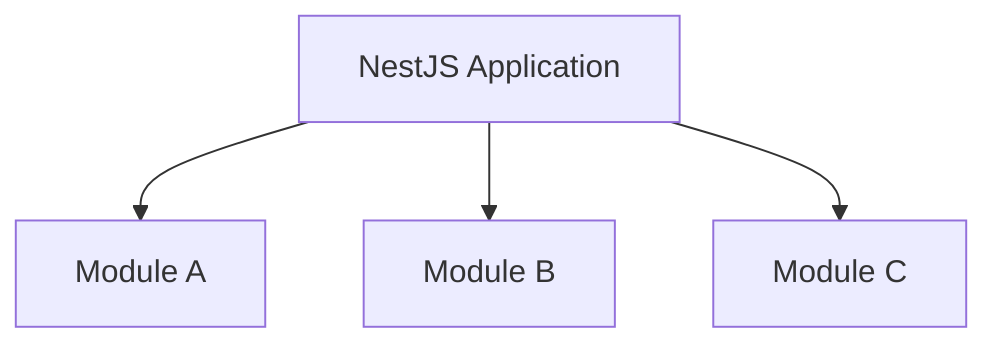

Các module nằm trong cùng một deployable application thay vì được tách thành các microservice độc lập.

---

# 3. TypeScript

**TypeScript** là ngôn ngữ chính của backend TrọƠi.

TypeScript bổ sung static typing cho JavaScript, giúp backend duy trì contract và cấu trúc dữ liệu rõ ràng giữa các thành phần của hệ thống.

TypeScript được sử dụng cho:

- controller;
- service;
- module;
- DTO;
- application model;
- integration layer;
- API contract-related code.

Các đặc điểm quan trọng:

- static typing;
- type inference;
- interface và type alias;
- decorator support;
- compile-time validation;
- tích hợp trực tiếp với NestJS.

Backend không sử dụng JavaScript thuần cho feature mới nếu không có lý do kỹ thuật cụ thể.

---

# 4. NestJS

**NestJS** là framework backend chính của TrọƠi.

NestJS cung cấp một cấu trúc application có convention rõ ràng dựa trên:

- Module;
- Controller;
- Service;
- Dependency Injection;
- DTO;
- middleware;
- guard;
- interceptor;
- exception handling.

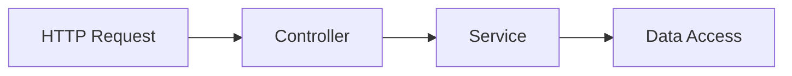

NestJS được chọn để giữ cấu trúc backend nhất quán giữa các phần của hệ thống.

Các feature không nên tự tạo một architecture khác nếu framework đã cung cấp mechanism phù hợp.

---

# 5. Module

**Module** là boundary tổ chức chính trong backend NestJS.

Mỗi module đóng gói các thành phần liên quan với nhau như:

```text
Module
├── Controller
├── Service
├── DTO
└── Providers
```

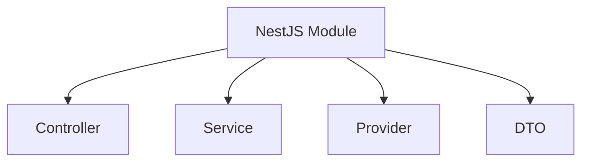

Module giúp backend giữ boundary rõ ràng mà không cần tách application thành nhiều service độc lập.

---

# 6. Controller

**Controller** là HTTP boundary của backend.

Controller chịu trách nhiệm:

- nhận HTTP request;
- đọc request parameter;
- nhận request body;
- gọi application/service layer;
- trả HTTP response.

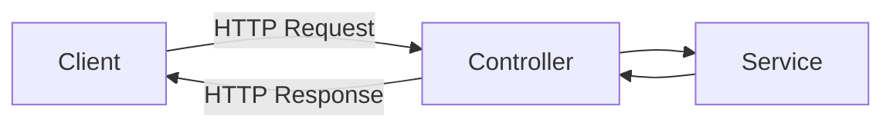

Controller không nên chứa business logic phức tạp.

Business logic được chuyển xuống service hoặc application layer phù hợp.

---

# 7. Service

**Service** chứa application logic và điều phối các dependency cần thiết để xử lý request.

Service có thể giao tiếp với:

- repository hoặc data-access abstraction;
- storage abstraction;
- cache abstraction;
- các service khác trong cùng module hoặc module được phép phụ thuộc.

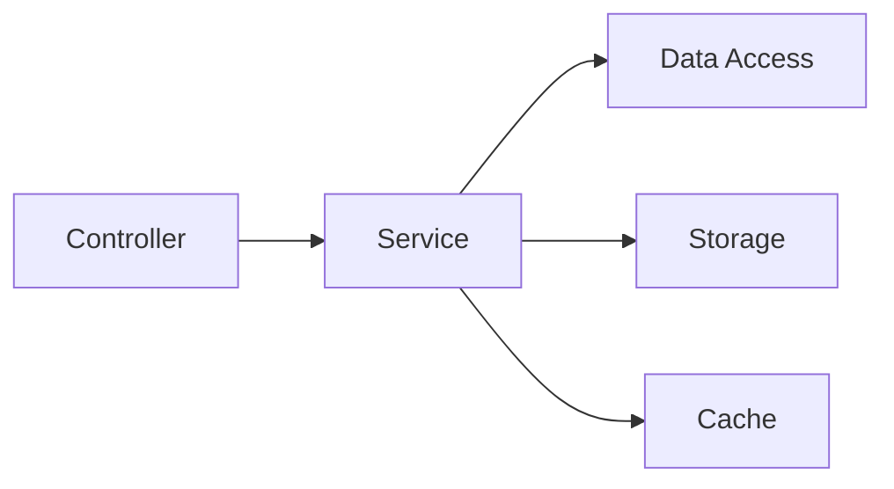

Controller không truy cập trực tiếp database hoặc storage implementation.

---

# 8. Dependency Injection

Backend sử dụng **Dependency Injection container tích hợp của NestJS**.

Dependency được khai báo dưới dạng provider và được NestJS inject vào thành phần cần sử dụng.

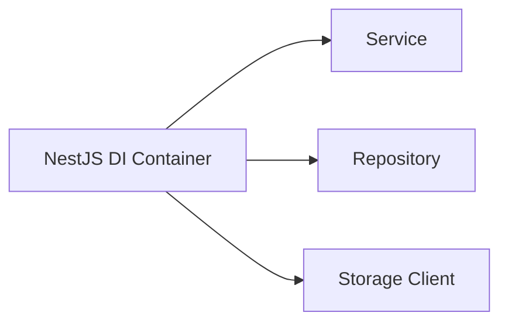

Dependency Injection giúp:

- giảm coupling;
- quản lý lifecycle của dependency;
- thay thế implementation dễ hơn;
- hỗ trợ testing;
- giữ dependency wiring tập trung.

Không cần thêm một Dependency Injection framework khác bên ngoài NestJS.

---

# 9. Modular Monolith

Backend TrọƠi sử dụng kiến trúc **Modular Monolith**.

Toàn bộ backend chạy trong một application nhưng code được chia thành các module có trách nhiệm và boundary riêng.

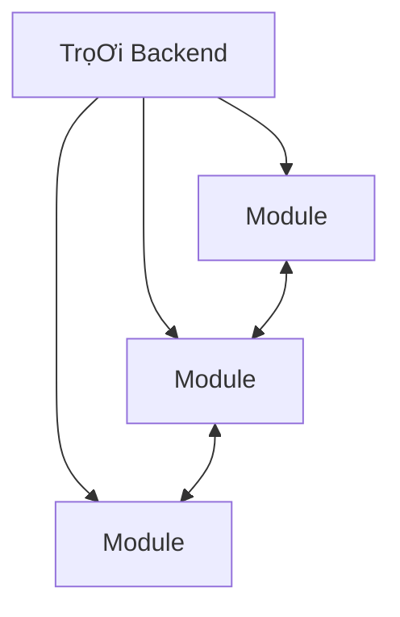

Mục tiêu của kiến trúc này là kết hợp:

- sự đơn giản trong deployment của monolith;
- boundary rõ ràng giữa các module;
- dependency dễ theo dõi;
- transaction đơn giản hơn distributed system;
- codebase dễ phát triển trong giai đoạn MVP.

Backend hiện tại **không sử dụng microservices**.

---

# 10. HTTP / REST API

Backend cung cấp API thông qua **HTTP theo mô hình REST**.

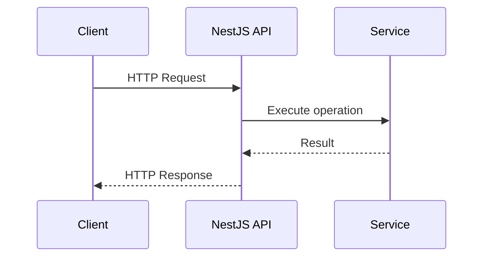

API sử dụng JSON làm format trao đổi dữ liệu chính giữa backend và client.

HTTP API là boundary giữa backend và ứng dụng Android.

---

# 11. DTO

NestJS backend sử dụng **Data Transfer Object (DTO)** tại API boundary.

DTO mô tả cấu trúc dữ liệu được nhận hoặc trả qua API.

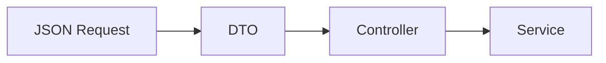

DTO giúp giữ API contract tách khỏi internal implementation của application.

DTO cũng là đầu vào quan trọng để xây dựng OpenAPI specification.

---

# 12. OpenAPI

**OpenAPI** là contract chính thức giữa backend TrọƠi và các client.

OpenAPI mô tả:

- endpoint;
- HTTP method;
- request model;
- response model;
- parameter;
- status code;
- error structure.

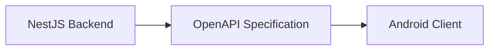

OpenAPI specification là source of truth cho API contract.

Backend và frontend không nên tự định nghĩa hai schema khác nhau cho cùng một API.

---

# 13. Swagger

**Swagger tooling** được sử dụng cùng NestJS để generate và hiển thị OpenAPI specification.

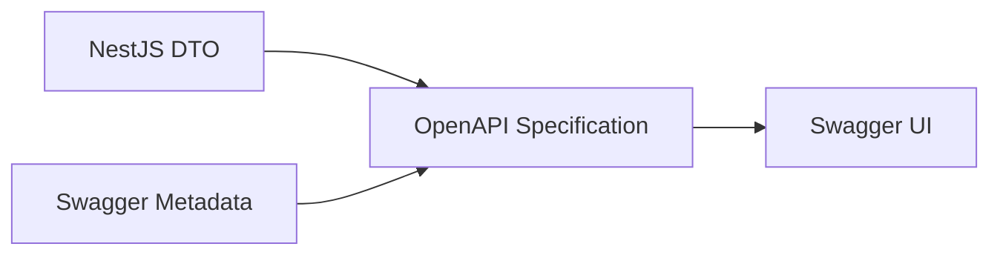

Swagger hỗ trợ:

- generate API specification;
- xem endpoint;
- xem request/response schema;
- kiểm tra contract trong quá trình development.

Swagger không thay thế OpenAPI.

**OpenAPI là specification**, còn Swagger là tooling làm việc với specification đó.

---

# 14. Quan hệ các thành phần backend

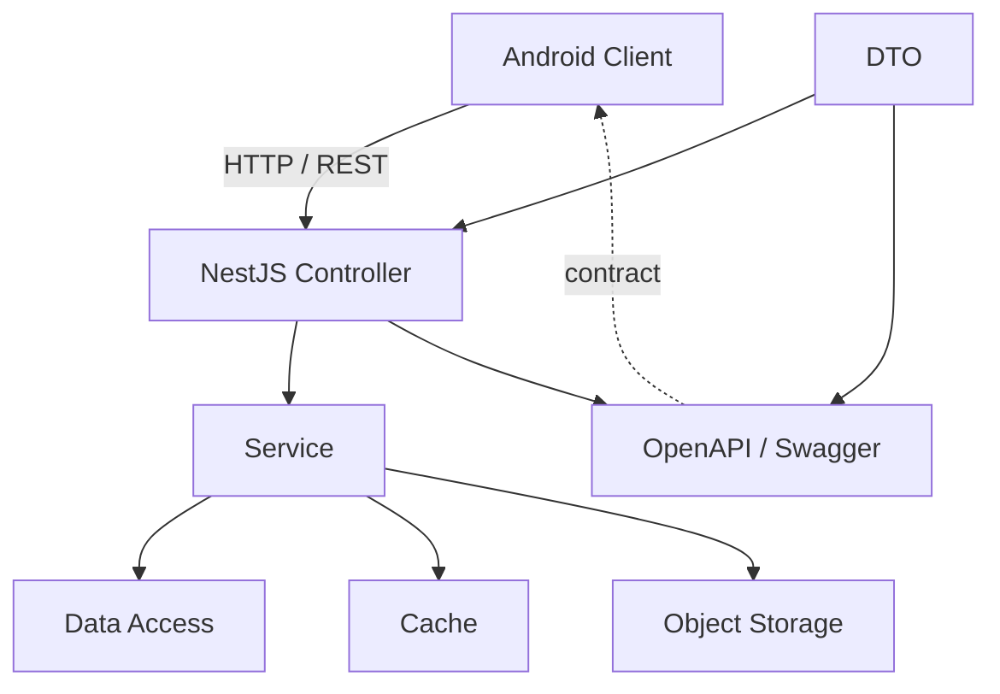

---

# 15. Stack chốt

```text
Backend
│
├── TypeScript
│
├── NestJS
│   ├── Module
│   ├── Controller
│   ├── Service
│   └── Dependency Injection
│
├── Architecture
│   └── Modular Monolith
│
├── API
│   ├── HTTP / REST
│   └── JSON
│
└── API Contract
    ├── OpenAPI
    └── Swagger
```

Backend tech stack hiện tại của TrọƠi được giới hạn ở:

**TypeScript + NestJS + Modular Monolith + HTTP/REST + OpenAPI/Swagger**

Các thành phần chưa được chốt như ORM, authentication implementation, message queue, background job framework hoặc testing framework không được xem là một phần của backend tech stack cho đến khi có quyết định kỹ thuật riêng.
