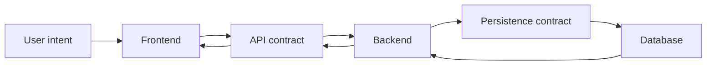

# Backlog v1 — TrọƠi

Backlog v1 mô tả các **vertical slice nghiệp vụ** đang được phát triển cho TrọƠi. Mỗi file phải đủ rõ để Frontend, Backend và Database cùng đọc và hiểu một feature cần đem lại trải nghiệm gì, xử lý business rule nào và lưu/bảo vệ dữ liệu nào.

Backlog **không** mô tả style UI, component cụ thể, class, DTO, SQL hay cách tổ chức code.

## Cách đọc một backlog

Mỗi feature trả lời cùng một chuỗi câu hỏi:

1. Người dùng muốn đạt mục tiêu gì?
2. Người dùng đi vào feature từ đâu?
3. Người dùng có những hành động/nút nghiệp vụ nào?
4. Luồng sử dụng diễn ra như thế nào?
5. Frontend phải hiển thị và cho phép thao tác gì?
6. Backend phải kiểm tra và điều phối gì?
7. Database phải lưu fact và bảo vệ invariant gì?
8. Ba layer phối hợp với nhau theo flow nào?
9. Khi nào feature được xem là hoàn thành?

## Nguyên tắc liên kết ba layer

## Bộ feature hiện tại

- [`listing.md`](listing.md) — tạo, đăng, ngừng đăng, đăng lại và lưu trữ tin phòng.
- [`inquiry.md`](inquiry.md) — người thuê thể hiện quan tâm và liên hệ về một Listing.
- [`tenancy.md`](tenancy.md) — vòng đời một quan hệ thuê phòng.
- [`tenancy-participant.md`](tenancy-participant.md) — người tham gia trong một Tenancy.
- [`tenancy-terms.md`](tenancy-terms.md) — điều khoản thuê có version.
- [`terms-acknowledgement.md`](terms-acknowledgement.md) — xác nhận một version điều khoản cụ thể.
- [`tenancy-notice.md`](tenancy-notice.md) — thông báo liên quan tới quan hệ thuê.
- [`rental-lifecycle.md`](rental-lifecycle.md) — orchestration xuyên Listing, Room và Tenancy.

## Tài liệu nền bắt buộc

Backlog không tự tạo business truth. Khi có mâu thuẫn, phải quay về authority và context chung:

- [`../../contexts/README.md`](../../contexts/README.md)
- [`../../contexts/product-domain.md`](../../contexts/product-domain.md)
- [`../../contexts/end-to-end-flows.md`](../../contexts/end-to-end-flows.md)
- [`../../contexts/integration-contracts.md`](../../contexts/integration-contracts.md)
- [`../../contexts/source-of-truth.md`](../../contexts/source-of-truth.md)
- [`../../database/v1/canonical.md`](../../database/v1/canonical.md)

Các mục Canonical đánh dấu `OPEN` vẫn là `OPEN`. Các mục `FUTURE` không trở thành backlog hiện tại chỉ vì đã có scaffold hoặc code cũ.

## Tiêu chuẩn hoàn thành chung

Một feature chỉ được xem là hoàn thành khi:

- Frontend thể hiện đúng flow và business state, không tự tạo lifecycle riêng;
- Backend thực thi đúng rule, authorization và orchestration của feature;
- Database lưu đúng fact, bảo vệ integrity/concurrency cần thiết;
- contract giữa các layer thống nhất;
- flow chính và các failure path quan trọng được kiểm chứng;
- không làm thay đổi ngầm các mục `OPEN` hoặc `FUTURE`.
