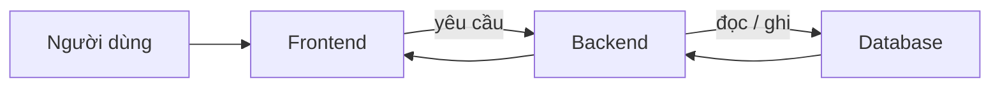

# Backlog v1 — TrọƠi

`backlogs/v1/` mô tả **những phần sản phẩm đang thuộc phạm vi hiện tại** theo cách cả Frontend, Backend và Database cùng đọc được.

Mỗi file bắt đầu từ việc người dùng muốn làm gì, sau đó mới nói ba layer phải phối hợp ra sao. Backlog không đi vào màu sắc, layout, tên class, DTO, SQL hay cách tổ chức source code.

## Cách đọc một feature

Một backlog tốt phải trả lời được:

1. Người dùng vào feature từ đâu?
2. Họ cần bấm/thực hiện những thao tác nghiệp vụ nào?
3. Frontend phải hiển thị gì và chờ kết quả nào?
4. Backend phải kiểm tra rule nào?
5. Database phải lưu/bảo vệ fact nào?
6. Khi nào feature được xem là hoàn thành?

## Bản đồ feature

### Bắt đầu và quản lý nơi cho thuê

- [`identity-access.md`](identity-access.md) — tài khoản, đăng nhập và quyền dựa trên quan hệ.
- [`organization.md`](organization.md) — workspace vận hành của chủ trọ.
- [`property-room.md`](property-room.md) — Property, Room và vòng đời vận hành.

### Tìm phòng

- [`listing.md`](listing.md) — tạo và quản lý tin đăng.
- [`search-map.md`](search-map.md) — tìm phòng, filter và bản đồ.
- [`inquiry.md`](inquiry.md) — gửi nhu cầu liên hệ/quan tâm.

### Hình thành và vận hành quan hệ thuê

- [`tenancy.md`](tenancy.md)
- [`tenancy-participant.md`](tenancy-participant.md)
- [`tenancy-terms.md`](tenancy-terms.md)
- [`terms-acknowledgement.md`](terms-acknowledgement.md)
- [`tenancy-notice.md`](tenancy-notice.md)
- [`rental-lifecycle.md`](rental-lifecycle.md)
- [`tenant-portal.md`](tenant-portal.md)

### Tiền và cọc

- [`billing.md`](billing.md) — kỳ tính tiền và khoản phải thu.
- [`payment.md`](payment.md) — tiền thực nhận và phân bổ.
- [`payment-claim.md`](payment-claim.md) — người thuê gửi bằng chứng về khoản đã thanh toán bên ngoài hệ thống.
- [`deposit.md`](deposit.md) — cọc đã nhận và settlement.
- [`receipt.md`](receipt.md) — biên nhận từ Payment đã xác nhận.

### Vận hành hằng ngày

- [`incident.md`](incident.md) — báo và xử lý sự cố.
- [`operational-history.md`](operational-history.md) — lịch sử nghiệp vụ để đối chiếu.
- [`dashboard.md`](dashboard.md) — tổng quan vận hành dạng read model.
- [`notification.md`](notification.md) — thông báo đi theo business event.

### Trust

- [`review.md`](review.md) — review dựa trên lịch sử thuê thật.
- [`trust-report.md`](trust-report.md) — báo vấn đề với Listing/Review.

## Những điều backlog không được tự quyết

- Không đổi rule đã `[FROZEN]` trong Canonical.
- Mục `OPEN` vẫn để `OPEN` cho tới khi có quyết định riêng.
- Mục `FUTURE` không được kéo vào feature hiện tại chỉ vì code/scaffold cũ có tồn tại.
- Một file backlog không được biến UI thành nơi tự quyết business state.

## Tài liệu nền

- [`../../contexts/README.md`](../../contexts/README.md)
- [`../../contexts/product-domain.md`](../../contexts/product-domain.md)
- [`../../contexts/end-to-end-flows.md`](../../contexts/end-to-end-flows.md)
- [`../../contexts/integration-contracts.md`](../../contexts/integration-contracts.md)
- [`../../contexts/source-of-truth.md`](../../contexts/source-of-truth.md)
- [`../../database/v1/canonical.md`](../../database/v1/canonical.md)

Một feature chỉ được xem là xong khi **trải nghiệm người dùng, Backend rule, Database integrity và contract giữa ba layer khớp nhau**.
