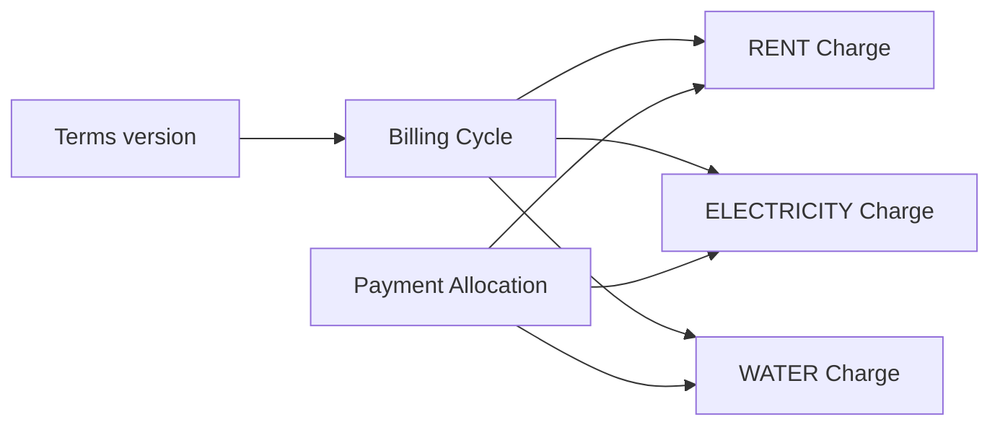

# Billing — Kỳ tính tiền và khoản phải thu

## 1. Mục tiêu

Billing tạo ra **các khoản người thuê phải thanh toán** theo từng kỳ của Tenancy. Nó không phải Payment: Billing nói “phải thu bao nhiêu”, còn Payment nói “đã nhận bao nhiêu tiền”.

Phạm vi charge hiện tại chỉ gồm `RENT | ELECTRICITY | WATER`.

## 2. Người dùng cần làm được gì?

Chủ trọ/người vận hành:

- **Tạo kỳ tính tiền** cho Tenancy.
- Ghi/kiểm tra dữ liệu điện, nước theo flow hiện tại.
- Xem các khoản `RENT`, `ELECTRICITY`, `WATER` của kỳ.
- Xem khoản nào còn chưa được thanh toán đủ dựa trên Payment Allocation.

Người thuê:

- xem kỳ tính tiền, khoảng thời gian, khoản phải thu và trạng thái thanh toán được tính từ dữ liệu thật.

## 3. Frontend cần làm gì?

- Phân biệt kỳ tính tiền, charge và payment.
- Hiển thị Terms version/period liên quan khi cần đối chiếu.
- Không thêm Service/WiFi/Parking/Other vào current billing vì các charge type đó đang FUTURE.
- Manual utility path luôn phải dùng được; không giả định automation bắt buộc.

## 4. Backend cần làm gì?

- Billing Cycle phải thuộc đúng Tenancy và biết Terms version áp dụng.
- Không cho cycle cùng Tenancy overlap.
- Financial Terms thay đổi giữa kỳ chỉ có hiệu lực ở billing-cycle boundary tiếp theo trong MVP.
- Tạo Charge đúng type và utility provenance theo contract.
- Không tự thêm prorating engine.

## 5. Database cần bảo vệ gì?

- `period_end >= period_start`.
- Cycle cùng Tenancy không overlap, kể cả request đồng thời.
- Charge thuộc đúng Billing Cycle và truy ngược được Terms provenance.
- Utility reference phải nhất quán với Room/type khi có dữ liệu utility.

## 6. Khi nào xem là hoàn thành?

- Một kỳ tính tiền luôn truy được Terms version dùng để tính.
- Không tạo được cycle overlap.
- Người dùng phân biệt rõ khoản phải thu với tiền đã nhận.

## Tài liệu liên quan

- [`tenancy-terms.md`](tenancy-terms.md)
- [`payment.md`](payment.md)
- [`../../database/v1/canonical.md`](../../database/v1/canonical.md)
