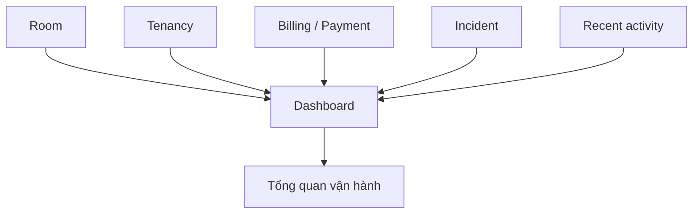

# Dashboard — Tổng quan vận hành

## 1. Mục tiêu

Dashboard giúp chủ trọ/người vận hành nhìn nhanh tình hình hiện tại. Đây là **phần tổng hợp để đọc**, không phải nơi sở hữu doanh thu, công nợ hay trạng thái phòng.

## 2. Người dùng cần xem được gì?

Theo Canonical, Dashboard có thể tổng hợp những nhóm như:

- số Room theo trạng thái;
- Tenancy đang active;
- khoản phải thu còn outstanding;
- tiền đã ghi nhận;
- Incident đang mở;
- Tenancy sắp hết hạn;
- move-out quá hạn;
- hoạt động gần đây.

Người dùng có thể **mở chi tiết** từ dữ liệu tổng hợp để đi tới feature gốc.

## 3. Frontend cần làm gì?

- Hiển thị số liệu Backend trả về và link tới feature gốc.
- Không cho chỉnh một con số tổng hợp như thể đó là business record.
- Khi dữ liệu nguồn thay đổi, refresh/read lại projection phù hợp.

## 4. Backend cần làm gì?

- Tính/tổng hợp Dashboard từ các fact nghiệp vụ thật.
- Không ghi business state thông qua Dashboard.
- Nếu dùng cache/materialized view, phải có cách rebuild/reconcile từ source data.

## 5. Database cần hỗ trợ gì?

- Query/read projection hiệu quả từ source tables/events.
- Dashboard projection không được trở thành source of truth riêng.

## 6. Khi nào xem là hoàn thành?

- Người vận hành nhìn được tình trạng chính và đi tới chi tiết tương ứng.
- Số liệu Dashboard có thể truy về nguồn.
- Không có write flow nghiệp vụ chỉ tồn tại trên Dashboard.

## Tài liệu liên quan

- [`operational-history.md`](operational-history.md)
- [`billing.md`](billing.md)
- [`incident.md`](incident.md)
