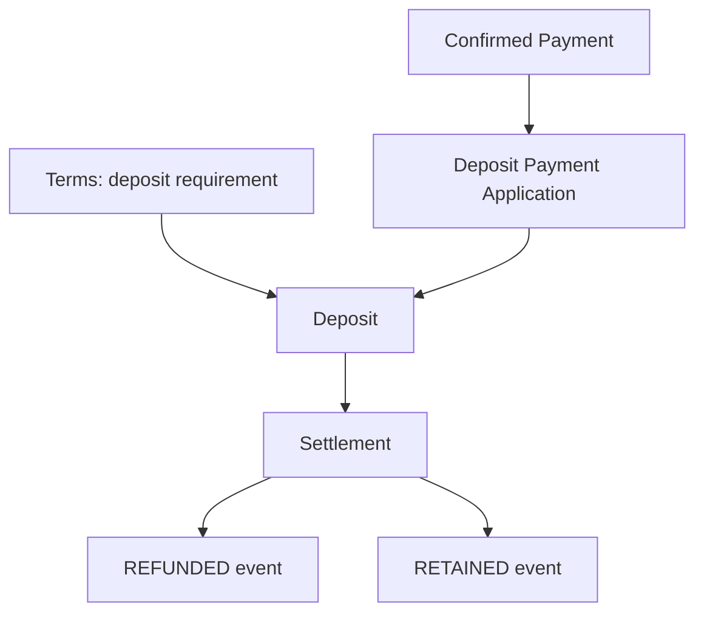

# Deposit — Tiền cọc trong một Tenancy

## 1. Mục tiêu

Deposit theo dõi **tiền cọc đã được nhận, đang giữ và quá trình settlement**. Số tiền cọc yêu cầu nằm trong Tenancy Terms; Deposit không tự giữ một expected amount khác để sửa tay.

## 2. Người dùng cần làm được gì?

Chủ trọ/người vận hành:

- xem yêu cầu cọc từ Terms;
- **áp dụng một confirmed Payment vào Deposit**;
- xem số tiền đã nhận/đang giữ;
- khi kết thúc, **ghi nhận settlement** gồm phần hoàn lại và phần giữ lại cùng reason/note phù hợp.

Người thuê:

- xem requirement, số tiền đã được ghi nhận và trạng thái settlement của cọc.

## 3. Frontend cần làm gì?

- Không cho nhập “đã nhận cọc” trực tiếp nếu không có Payment/Application tương ứng.
- Hiển thị state Deposit như dữ liệu được tính từ events/facts, không coi state là field người dùng sửa tay.
- Không gọi retained amount là phán quyết ai đúng/sai.
- Policy thay requirement khi đã held một phần vẫn `OPEN`.

## 4. Backend cần làm gì?

- Money inflow vào Deposit luôn đi qua confirmed Payment + Deposit Application.
- `RECEIVED` event phải trace về Application và cùng amount.
- Refund/Retain là outbound settlement, không tạo inbound Payment âm.
- Settlement không vượt số tiền thực sự đã funded/held.

## 5. Database cần bảo vệ gì?

- Deposit Application cùng Tenancy với Payment/Deposit.
- Sum application không vượt Payment capacity.
- Settlement không vượt held amount, kể cả khi request chạy đồng thời.
- Event/provenance giữ nguyên lịch sử.

## 6. Khi nào xem là hoàn thành?

- Requirement, số tiền đã nhận và settlement không bị trộn.
- Mọi tiền cọc đã nhận truy được về Payment.
- Refund/retain có lịch sử và không phá amount cap.

## Tài liệu liên quan

- [`tenancy-terms.md`](tenancy-terms.md)
- [`payment.md`](payment.md)
- [`tenant-portal.md`](tenant-portal.md)
