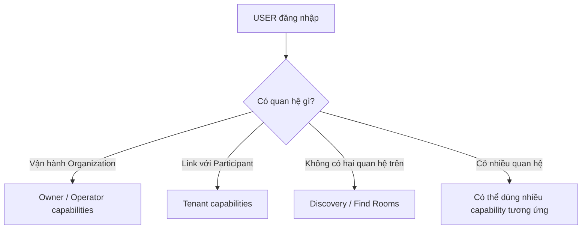

# Identity & Access — Tài khoản và quyền truy cập

## 1. Mục tiêu

`USER` là tài khoản số dùng để đăng nhập và gắn một người với những quan hệ thật trong hệ thống. TrọƠi **không dùng một global role** kiểu `LANDLORD` hoặc `TENANT` để quyết định mọi quyền.

Một User có thể cùng lúc tìm phòng, là người thuê ở một Tenancy và vận hành một Organization khác.

## 2. Người dùng cần làm được gì?

- **Đăng nhập / xác thực tài khoản** theo cơ chế được Backend hỗ trợ.
- Vào những Organization/Tenancy mà tài khoản thực sự có quan hệ.
- Dùng discovery ngay cả khi không có quan hệ thuê.
- Khi một Participant được link với User, truy cập đúng phần Tenant Portal của Tenancy đó.

## 3. Frontend cần làm gì?

- Có flow đăng nhập/đăng xuất và trạng thái xác thực rõ ràng.
- Không hardcode `User.role = landlord/tenant` để quyết định toàn bộ navigation/quyền.
- Hiển thị capability dựa trên dữ liệu quyền/quan hệ Backend trả về.
- Khi quyền thay đổi, refresh/reconcile từ server thay vì tự giữ role cũ.

## 4. Backend cần làm gì?

- Xác thực identity.
- Kiểm tra quyền theo ownership/resource relationship hoặc Tenancy Participant link.
- Không thêm global landlord/tenant role trái Canonical.
- Giữ ranh giới giữa authentication (bạn là ai) và authorization (bạn được làm gì với tài nguyên này).

## 5. Database cần bảo vệ gì?

- Lưu USER identity và các reference ownership/link theo contract.
- Giữ User ↔ Participant là optional link; xóa/unlink account không được xóa Participant history.
- Giữ Organization primary owner reference đúng contract.

## 6. Khi nào xem là hoàn thành?

- User đăng nhập được và chỉ thấy/được làm những việc gắn với quan hệ thật.
- Một người có thể vừa có capability owner vừa có capability tenant mà không cần đổi global role.
- Participant chưa có User vẫn tồn tại bình thường trong Tenancy.

## Tài liệu liên quan

- [`organization.md`](organization.md)
- [`tenant-portal.md`](tenant-portal.md)
- [`tenancy-participant.md`](tenancy-participant.md)
- [`../../contexts/product-domain.md`](../../contexts/product-domain.md)
