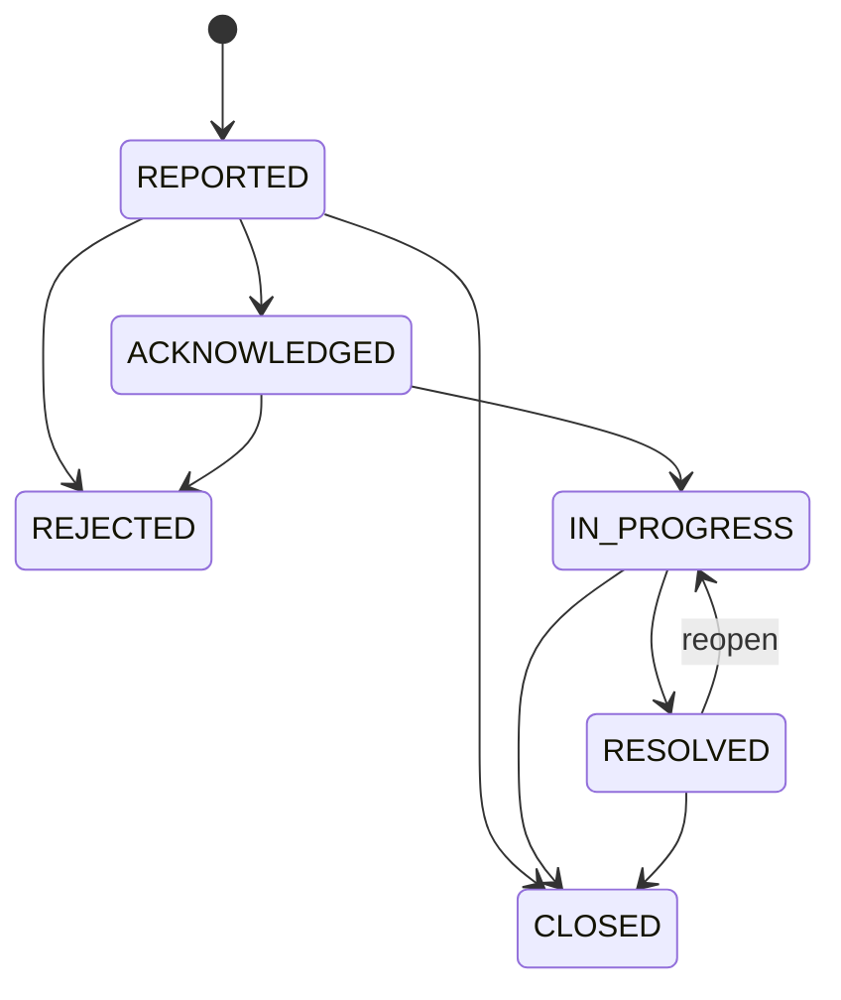

# Incident — Báo và xử lý sự cố phòng

## 1. Mục tiêu

Incident theo dõi một vấn đề vận hành của Room từ lúc được báo tới khi đóng. Mỗi thay đổi quan trọng được ghi thành Incident Event để giữ lịch sử.

## 2. Người dùng cần làm được gì?

Người thuê/người có quyền:

- **Báo sự cố**.
- chọn category phù hợp (`ELECTRICAL | PLUMBING | ACCESS_SECURITY | ROOM_FACILITY | APPLIANCE | OTHER`).
- xem trạng thái và timeline xử lý.
- thêm thông tin/note/attachment theo capability đã implement.

Chủ trọ/người vận hành:

- **Xác nhận đã nhận** (`ACKNOWLEDGED`).
- **Từ chối** (`REJECTED`) khi hợp lệ.
- **Bắt đầu xử lý** (`IN_PROGRESS`).
- **Đánh dấu đã xử lý** (`RESOLVED`).
- **Mở lại** `RESOLVED → IN_PROGRESS`.
- **Đóng** (`CLOSED`) với reason phù hợp khi transition cho phép.

## 3. Frontend cần làm gì?

- Chỉ hiện action hợp lệ với state và quyền hiện tại.
- Hiển thị timeline từ Incident Event, không chỉ state cuối.
- Khi đóng từ `IN_PROGRESS`, yêu cầu reason theo rule hiện hành.
- Không biến Incident thành Trust Report.

## 4. Backend cần làm gì?

- Giữ đúng state machine.
- Mỗi thay đổi quan trọng append Incident Event.
- Room/Property archive phải bị chặn khi còn Incident mở (`REPORTED | ACKNOWLEDGED | IN_PROGRESS | RESOLVED`).
- Archive không tự đóng Incident.

## 5. Database cần bảo vệ gì?

- Incident thuộc đúng Room.
- Incident Event là append-only history.
- State/event/closure reason nhất quán.
- Archive guard nhìn thấy open Incident kể cả khi command chạy đồng thời.

## 6. Khi nào xem là hoàn thành?

- Tenant báo và theo dõi được sự cố.
- Operator xử lý đúng lifecycle.
- Timeline không bị ghi đè/mất.
- Archive không né được Incident còn mở.

## Tài liệu liên quan

- [`property-room.md`](property-room.md)
- [`operational-history.md`](operational-history.md)
- [`notification.md`](notification.md)
