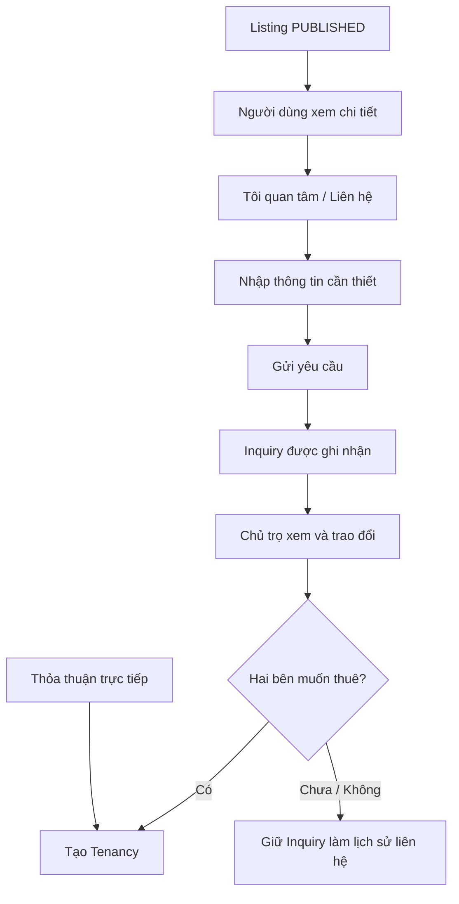

# Inquiry — Nhu cầu liên hệ về phòng

## 1. Mục tiêu

Inquiry giúp một người đang xem Listing gửi nhu cầu liên hệ/quan tâm tới chủ trọ. Nó là cầu nối từ discovery sang trao đổi, **không phải booking và không bắt buộc phải có trước khi tạo Tenancy**.

## 2. Người dùng cần làm được gì?

Người tìm phòng:

- bấm **Tôi quan tâm / Liên hệ**;
- nhập nội dung hoặc thông tin liên hệ cần thiết;
- bấm **Gửi yêu cầu**;
- biết yêu cầu đã gửi thành công hay thất bại.

Chủ trọ/người vận hành:

- xem danh sách Inquiry liên quan tới Listing/Room mình quản lý;
- mở chi tiết một Inquiry;
- dùng thông tin đó để tiếp tục trao đổi;
- có thể đi tiếp sang **Tạo lượt thuê** nếu hai bên đã thống nhất.

## 3. Frontend cần làm gì?

- Cho phép gửi Inquiry từ Listing đang công khai.
- Hiển thị trạng thái gửi thành công/thất bại từ Backend.
- Cho chủ trọ xem danh sách/chi tiết Inquiry của tài nguyên họ quản lý.
- Không biến Inquiry thành reservation UI.
- Không ép flow tạo Tenancy phải đi qua Inquiry.

## 4. Backend cần làm gì?

- Kiểm tra Listing reference hợp lệ khi tạo Inquiry.
- Ghi nhận nội dung/contact intent đúng contract.
- Không tự đổi Room/Tenancy state khi có Inquiry.
- Cho phép nhiều Inquiry cùng liên quan tới một Listing.
- Khi tạo Tenancy, Inquiry chỉ là context tùy chọn.

## 5. Database cần bảo vệ gì?

- Lưu Inquiry đúng Listing.
- Giữ reference integrity với Listing và optional User.
- Cho phép nhiều Inquiry trên cùng Listing.
- Không tạo constraint khiến Inquiry thành điều kiện bắt buộc của Tenancy.

## 6. Khi nào xem là hoàn thành?

- Người tìm phòng gửi được Inquiry từ Listing hợp lệ.
- Chủ trọ xem được Inquiry liên quan.
- Direct tenancy path vẫn hoạt động không cần Inquiry.
- Inquiry không làm thay đổi business state ngoài chính nó.

## Tài liệu liên quan

- [`listing.md`](listing.md)
- [`tenancy.md`](tenancy.md)
- [`../../contexts/end-to-end-flows.md`](../../contexts/end-to-end-flows.md)
- [`../../database/v1/canonical.md`](../../database/v1/canonical.md)
