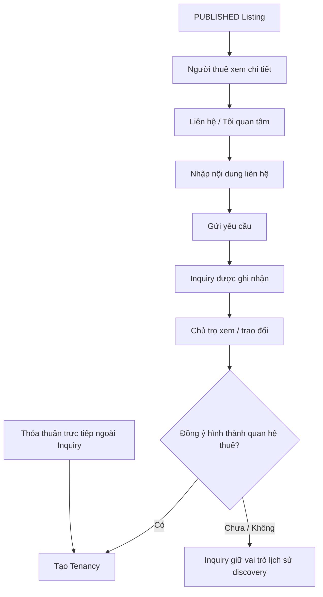
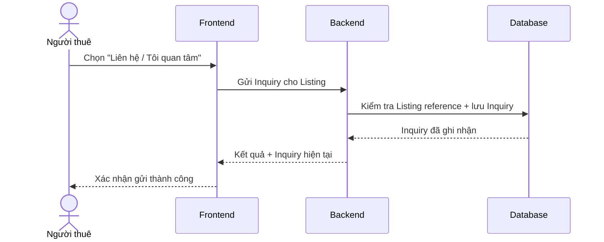

# Inquiry — Quan tâm / liên hệ về tin đăng

## 1. Mục tiêu

Inquiry là cầu nối giữa một `PUBLISHED` Listing và khả năng hình thành quan hệ thuê. Feature cho phép người thuê thể hiện nhu cầu liên hệ về một Listing mà **không bắt buộc phải tạo Tenancy**.

## 2. Người dùng tham gia

- Người thuê: gửi yêu cầu liên hệ hoặc nội dung quan tâm tới một Listing.
- Chủ trọ / người vận hành: xem Inquiry để tiếp tục trao đổi và quyết định có đi tới quan hệ thuê hay không.

## 3. Điểm vào trên sản phẩm

- Từ chi tiết một `PUBLISHED` Listing.
- Từ kết quả tìm kiếm/bản đồ khi người dùng mở chi tiết phòng.
- Chủ trọ/người vận hành đi vào từ danh sách Inquiry liên quan tới Listing/Room mình quản lý.

## 4. Hành động người dùng

Phía người thuê:

- **Liên hệ / Tôi quan tâm**.
- Nhập nội dung hoặc thông tin liên hệ cần thiết theo contract.
- **Gửi yêu cầu**.

Phía chủ trọ/người vận hành:

- **Xem yêu cầu**.
- Dùng Inquiry làm context để tiếp tục trao đổi.
- Có thể đi tiếp sang **Tạo lượt thuê** khi hai bên đã thống nhất, nhưng Inquiry không phải điều kiện bắt buộc để tạo Tenancy.

## 5. Luồng sử dụng

## 6. Frontend phải làm gì

- Cho phép người thuê gửi Inquiry từ một Listing đang công khai.
- Hiển thị trạng thái gửi thành công/thất bại theo response từ Backend.
- Cho chủ trọ/người vận hành xem danh sách và chi tiết Inquiry liên quan tới Listing/Room của mình.
- Không biến Inquiry thành booking/reservation UI nếu authority chưa định nghĩa capability đó.
- Không ép flow tạo Tenancy phải đi qua Inquiry.

## 7. Backend phải làm gì

- Xác nhận Listing reference hợp lệ khi tạo Inquiry.
- Ghi nhận sender/contact intent theo contract hiện hành.
- Không mutate Room hoặc Tenancy chỉ vì có Inquiry mới.
- Cho phép nhiều Inquiry cùng tham chiếu một Listing.
- Khi tạo Tenancy, Inquiry chỉ là optional context; Backend vẫn cho phép direct-operator path.

## 8. Database phải làm gì

- Lưu Inquiry và liên kết đúng Listing.
- Bảo vệ reference integrity với Listing và optional User identity khi có link.
- Cho phép nhiều Inquiry cho cùng một Listing.
- Không tạo constraint khiến Inquiry trở thành prerequisite của Tenancy.
- Giữ Inquiry như discovery/contact history độc lập với booking/reservation semantics.

## 9. Luồng xuyên hệ thống

## 10. Business rules

- Inquiry chỉ là discovery/contact bridge.
- Một Listing có thể có nhiều Inquiry.
- Inquiry không tự thay đổi Room state hoặc Tenancy state.
- Tenancy có thể được tạo từ Inquiry hoặc trực tiếp từ Room.
- Booking/reservation không được suy ra từ Inquiry nếu authority chưa định nghĩa.

## 11. Phụ thuộc

- Upstream: Listing, optional User identity.
- Downstream: Tenancy như một flow tùy chọn.

## 12. Tiêu chí hoàn thành

**Frontend**
- Người thuê gửi được Inquiry từ Listing hợp lệ.
- Chủ trọ/người vận hành xem được Inquiry liên quan.

**Backend**
- Inquiry độc lập với Tenancy lifecycle và Room mutation.
- Direct tenancy path vẫn hoạt động không cần Inquiry.

**Database**
- Listing reference integrity và multiple-Inquiry behavior được bảo vệ.

## 13. Tài liệu liên quan

- [`listing.md`](listing.md)
- [`tenancy.md`](tenancy.md)
- [`../../contexts/end-to-end-flows.md`](../../contexts/end-to-end-flows.md)
- [`../../contexts/integration-contracts.md`](../../contexts/integration-contracts.md)
- [`../../database/v1/canonical.md`](../../database/v1/canonical.md)
