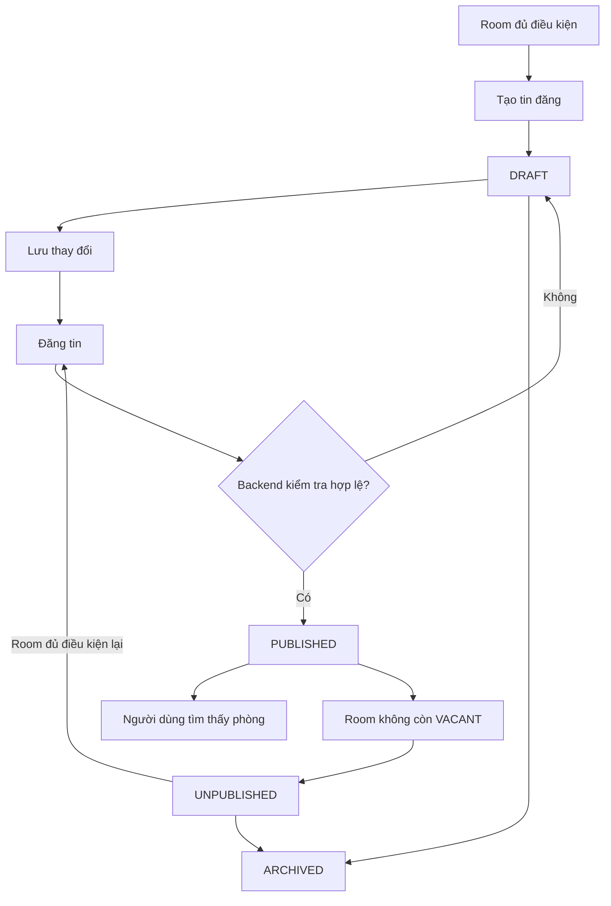

# Listing — Tin đăng phòng

## 1. Mục tiêu

Listing là phần thông tin được đưa ra cho người tìm phòng xem. Nó giúp một Room đang đủ điều kiện xuất hiện trên tìm kiếm/bản đồ, nhưng **không thay thế hồ sơ vận hành thật của Room**.

## 2. Người dùng đi vào từ đâu?

- Chủ trọ/người vận hành: từ chi tiết Room hoặc khu quản lý tin đăng.
- Người tìm phòng: từ danh sách, bản đồ hoặc kết quả tìm kiếm.

## 3. Người dùng cần làm được gì?

Phía chủ trọ/người vận hành:

- **Tạo tin đăng**.
- **Lưu thay đổi**.
- **Đăng tin**.
- **Ngừng đăng**.
- **Đăng lại** khi phòng đủ điều kiện.
- **Lưu trữ tin đăng** khi không còn dùng.

Phía người tìm phòng:

- xem Listing đang `PUBLISHED`;
- đi tiếp sang Inquiry hoặc các luồng discovery khác.

## 4. Frontend cần làm gì?

- Hiển thị đúng trạng thái `DRAFT | PUBLISHED | UNPUBLISHED | ARCHIVED`.
- Chỉ đưa những thao tác phù hợp với trạng thái hiện tại cho người dùng.
- Khi người dùng bấm **Đăng tin**, gửi yêu cầu lên Backend và chờ kết quả; không tự đổi state trước.
- Nếu publish bị từ chối, hiển thị lý do dễ hiểu.
- Discovery chỉ hiển thị Listing đang `PUBLISHED`.

## 5. Backend cần làm gì?

- Kiểm tra Property còn `ACTIVE`, Room còn active và `VACANT` trước khi publish.
- Giữ đúng lifecycle Listing.
- Khi Room rời `VACANT`, ngừng công khai Listing hiện tại trong cùng workflow.
- Lưu lịch sử thay đổi trạng thái.
- Không cho một Room có nhiều Listing hiện hành cùng lúc.

## 6. Database cần bảo vệ gì?

- Lưu Listing và lịch sử `LISTING_STATUS_EVENT`.
- Bảo đảm một Room không thể có hai Listing hiện hành, kể cả khi hai request chạy gần như đồng thời.
- Giữ quan hệ Listing ↔ Room ↔ Property hợp lệ.
- Chỉ hỗ trợ public location theo contract; không làm lộ vị trí vận hành chính xác.

## 7. Khi nào xem là hoàn thành?

- Chủ trọ có đủ các thao tác nghiệp vụ ở trên.
- Người tìm phòng chỉ thấy Listing đang public.
- Backend từ chối đúng các trường hợp Room/Property không đủ điều kiện.
- Database giữ được uniqueness/history khi có request đồng thời.

## Tài liệu liên quan

- [`../../contexts/product-domain.md`](../../contexts/product-domain.md)
- [`../../contexts/end-to-end-flows.md`](../../contexts/end-to-end-flows.md)
- [`../../contexts/integration-contracts.md`](../../contexts/integration-contracts.md)
- [`../../database/v1/canonical.md`](../../database/v1/canonical.md)
