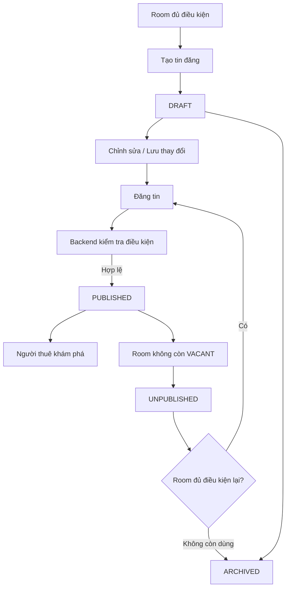
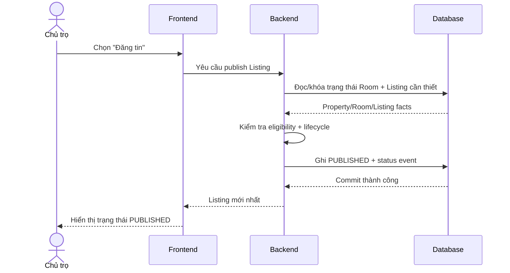

# Listing — Tin đăng phòng

## 1. Mục tiêu

Listing là **projection công khai để khám phá một Room**, không phải bản ghi vận hành của Room. Feature này cho phép chủ trọ/người vận hành tạo và quản lý tin đăng của một phòng đủ điều kiện, đồng thời cho người thuê nhìn thấy các phòng đang thực sự có thể thuê.

## 2. Người dùng tham gia

- Chủ trọ / người vận hành: tạo, chỉnh sửa, đăng, ngừng đăng, đăng lại, lưu trữ Listing.
- Người thuê: xem Listing đang `PUBLISHED`, từ đó đi tiếp sang Inquiry hoặc luồng thuê.

## 3. Điểm vào trên sản phẩm

- Từ chi tiết Room hoặc khu vực quản lý Listing của một Room.
- Từ danh sách phòng đang trống và đủ điều kiện đăng.
- Người thuê đi vào qua tìm kiếm, bản đồ hoặc danh sách phòng công khai.

## 4. Hành động người dùng

Phía chủ trọ/người vận hành cần có các hành động nghiệp vụ sau khi phù hợp với state hiện tại:

- **Tạo tin đăng**.
- **Lưu thay đổi** nội dung tin đăng hiện tại.
- **Đăng tin**.
- **Ngừng đăng**.
- **Đăng lại** khi Room đủ điều kiện trở lại.
- **Lưu trữ tin đăng** khi bản ghi discovery này không còn được sử dụng.

Frontend không tự quyết transition. Nếu action không hợp lệ theo business state, UI phải phản ánh trạng thái đó thay vì tự tạo state mới.

## 5. Luồng sử dụng

## 6. Frontend phải làm gì

- Hiển thị Listing hiện tại của Room và trạng thái `DRAFT | PUBLISHED | UNPUBLISHED | ARCHIVED`.
- Chỉ hiển thị các action phù hợp với state và quyền của người dùng.
- Khi người dùng chọn **Đăng tin**, gửi intent lên Backend và chờ kết quả kiểm tra eligibility.
- Nếu Backend từ chối publish, hiển thị lý do nghiệp vụ thay vì tự sửa state.
- Ở phía người thuê, chỉ đưa `PUBLISHED` Listing vào discovery/search/map.
- Khi Listing bị unpublish do Room không còn khả dụng, cập nhật UI theo state trả về từ hệ thống.

## 7. Backend phải làm gì

- Sở hữu lifecycle Listing và các transition hợp lệ.
- Kiểm tra publish eligibility: Property còn `ACTIVE`, Room còn active và `VACANT`.
- Bảo đảm một Room không có nhiều Listing hiện hành song song.
- Khi Room rời `VACANT`, đồng bộ việc chuyển current Listing sang `UNPUBLISHED`.
- Ghi nhận lịch sử thay đổi trạng thái Listing.
- Cung cấp dữ liệu discovery/search chỉ từ Listing đủ điều kiện công khai.

## 8. Database phải làm gì

- Lưu Listing và status hiện tại.
- Lưu `LISTING_STATUS_EVENT` làm lịch sử lifecycle.
- Bảo vệ invariant **tối đa một current/non-archived Listing cho mỗi Room**.
- Bảo vệ integrity giữa Listing, Room và Property.
- Hỗ trợ public location projection/search mà không làm lộ operational location ngoài contract.
- Các thay đổi Listing–Room có nguy cơ race phải được thực hiện trong transaction/guard phù hợp.

## 9. Luồng xuyên hệ thống

## 10. Business rules

- Lifecycle chính xác: `DRAFT | PUBLISHED | UNPUBLISHED | ARCHIVED`.
- Publish chỉ hợp lệ khi Room còn `VACANT`, Room record còn active và Property còn `ACTIVE`.
- Một Room chỉ có tối đa một Listing hiện hành/non-archived.
- Room rời `VACANT` phải làm current Listing không còn công khai.
- Listing không thay thế Room, Tenancy hoặc operational history.

## 11. Phụ thuộc

- Upstream: Organization, Property, Room.
- Cross-domain: Rental Lifecycle.
- Downstream: Inquiry, Tenancy, Search/Map, Trust.

## 12. Tiêu chí hoàn thành

**Frontend**
- Có đầy đủ các action nghiệp vụ đã nêu và phản ánh đúng state.
- Discovery không hiển thị Listing ngoài `PUBLISHED`.

**Backend**
- Lifecycle, eligibility và Room–Listing coupling đúng authority.
- Rejected command không để lại state trung gian sai.

**Database**
- Current Listing uniqueness, reference integrity và status history được bảo vệ.
- Race liên quan publish/unpublish không phá invariant.

## 13. Tài liệu liên quan

- [`../../contexts/product-domain.md`](../../contexts/product-domain.md)
- [`../../contexts/end-to-end-flows.md`](../../contexts/end-to-end-flows.md)
- [`../../contexts/integration-contracts.md`](../../contexts/integration-contracts.md)
- [`../../database/v1/canonical.md`](../../database/v1/canonical.md)
