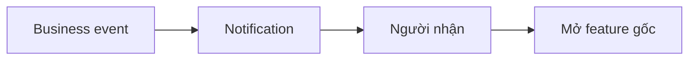

# Notification — Thông báo theo sự kiện nghiệp vụ

## 1. Mục tiêu

Notification giúp đưa thông tin tới người dùng sau khi một business event đã xảy ra, ví dụ có Inquiry mới, tới hạn thanh toán, Payment được xác nhận hoặc Incident đổi trạng thái.

Notification **không được tự thay đổi business state**.

## 2. Người dùng cần làm được gì?

- nhận/xem thông báo mình có quyền nhận;
- mở thông báo để đi tới bản ghi/feature liên quan;
- xem trạng thái delivery/read nếu capability hiện tại hỗ trợ.

> Exact notification channels vẫn là `OPEN`. Không mặc định push/email/SMS/Zalo là channel chính thức cho tới khi policy được chốt.

## 3. Frontend cần làm gì?

- Hiển thị notification từ Backend/delivery layer.
- Khi người dùng mở, điều hướng tới nguồn dữ liệu thật.
- Không đổi Payment/Tenancy/Incident state chỉ vì notification đã đọc.

## 4. Backend cần làm gì?

- Trigger notification sau event phù hợp.
- Xác định người nhận theo quyền/quan hệ.
- Giữ notification như side effect, không dùng nó để xác nhận Payment, kết thúc Tenancy hay resolve Incident.
- Giữ channel policy `OPEN`.

## 5. Database cần hỗ trợ gì?

- Lưu delivery/notification fact nếu implementation cần.
- Không dùng notification record thay cho event/source business record.

## 6. Khi nào xem là hoàn thành?

- Người đúng quyền nhận được thông tin phù hợp.
- Mở notification dẫn tới feature gốc.
- Việc gửi/đọc notification không tự mutate business state.

## Tài liệu liên quan

- [`inquiry.md`](inquiry.md)
- [`billing.md`](billing.md)
- [`incident.md`](incident.md)
- [`tenancy-notice.md`](tenancy-notice.md)
