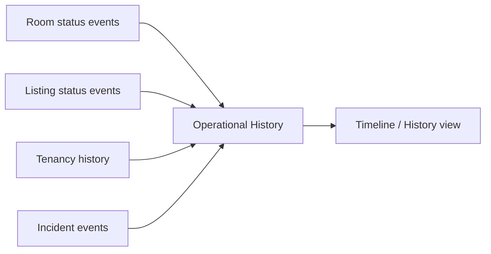

# Operational History — Lịch sử vận hành để đối chiếu

## 1. Mục tiêu

Operational History giúp người dùng nhìn lại những thay đổi nghiệp vụ đã xảy ra: Room đổi trạng thái, Listing đổi trạng thái, Incident được xử lý, Tenancy bắt đầu/kết thúc, v.v.

Nó khác Technical Audit. History phục vụ việc hiểu vận hành; Technical Audit phục vụ hạ tầng/security/compliance metadata.

## 2. Người dùng cần làm được gì?

- **Xem lịch sử** của Room/Tenancy hoặc khu vực được phép truy cập.
- xem thời điểm, loại thay đổi và dữ liệu giải thích phù hợp với quyền.
- từ một history item, mở lại bản ghi gốc nếu còn quyền.

## 3. Frontend cần làm gì?

- Hiển thị history theo thứ tự thời gian và theo quyền.
- Không biến history item thành form sửa dữ liệu quá khứ.
- Không trộn technical audit log vào UI nghiệp vụ nếu không có use case rõ.

## 4. Backend cần làm gì?

- Tổng hợp history từ các nguồn nghiệp vụ gốc.
- Giữ permission của từng record.
- Không tạo một history projection rồi dùng nó ngược lại để quyết định source state.

## 5. Database cần bảo vệ gì?

- Giữ các event/history source theo contract (ví dụ Listing Status Event, Incident Event).
- Projection/materialized view nếu có phải rebuild được từ source facts.

## 6. Khi nào xem là hoàn thành?

- Người dùng có thể đối chiếu các thay đổi chính mà không cần đọc technical logs.
- History không trở thành nguồn ghi business state thứ hai.

## Tài liệu liên quan

- [`incident.md`](incident.md)
- [`listing.md`](listing.md)
- [`tenancy.md`](tenancy.md)
- [`dashboard.md`](dashboard.md)
