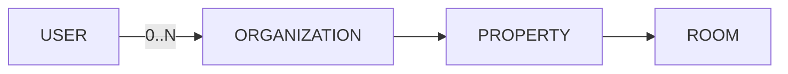

# Organization — Không gian vận hành của chủ trọ

## 1. Mục tiêu

Organization là workspace để một chủ trọ/người vận hành gom các Property mình quản lý. Nó không bắt buộc là pháp nhân hay công ty.

Trong MVP, mỗi Organization có đúng một primary owner/operator. Team/staff/delegation nâng cao là FUTURE.

## 2. Người dùng cần làm được gì?

- **Tạo Organization** khi bắt đầu quản lý một nhóm Property.
- **Xem các Organization** mình đang vận hành.
- **Mở một Organization** để đi tiếp sang Property/Room.
- Cập nhật thông tin cơ bản thuộc phạm vi hiện tại.

## 3. Frontend cần làm gì?

- Cho User tạo/chọn Organization mình có quyền vận hành.
- Không hiển thị team/staff/delegation nâng cao như capability hiện tại.
- Khi mở Organization, dùng nó làm context cho Property/Room management.

## 4. Backend cần làm gì?

- Khi tạo Organization, gắn đúng primary owner/operator.
- Kiểm tra quyền trước khi đọc/sửa tài nguyên thuộc Organization.
- Không tự mở rộng membership/team model khi capability còn FUTURE.

## 5. Database cần bảo vệ gì?

- Một User có thể vận hành `0..N` Organization.
- Mỗi Organization trong MVP có đúng một primary owner/operator User.
- Property phải thuộc đúng một Organization.

## 6. Khi nào xem là hoàn thành?

- User tạo/mở được workspace mình sở hữu.
- Tài nguyên của Organization khác không bị truy cập chỉ vì biết ID.
- Organization là điểm gốc rõ ràng trước khi đi xuống Property/Room.

## Tài liệu liên quan

- [`identity-access.md`](identity-access.md)
- [`property-room.md`](property-room.md)
- [`../../database/v1/canonical.md`](../../database/v1/canonical.md)
