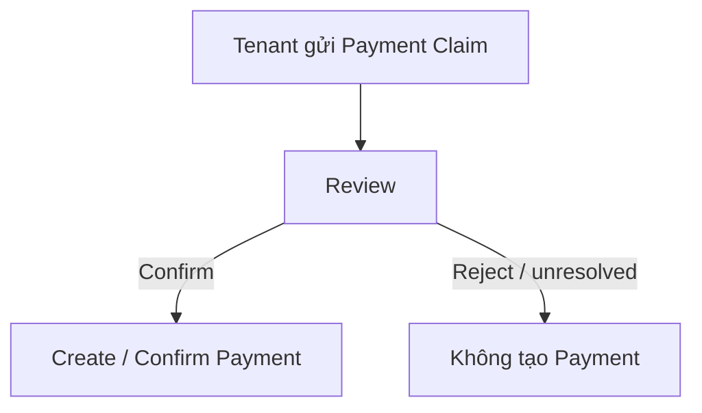

# Payment Claim — Người thuê báo một khoản đã thanh toán

## 1. Mục tiêu

Payment Claim cho phép người thuê gửi thông tin/bằng chứng về một khoản họ đã thanh toán **bên ngoài hệ thống** để người có quyền kiểm tra.

`PAYMENT_CLAIM ≠ PAYMENT`: gửi claim không có nghĩa hệ thống đã xác nhận tiền thực nhận.

## 2. Người dùng cần làm được gì?

Người thuê:

- **Gửi thông tin/bằng chứng thanh toán** cho Tenancy phù hợp.
- xem trạng thái claim theo flow Backend hỗ trợ.

Người review claim:

- xem claim;
- **Xác nhận** nếu đủ điều kiện → tạo/xác nhận Payment;
- **Từ chối** nếu không hợp lệ.

> Exact evidence format và ai có quyền Confirm vẫn là `OPEN`. Frontend chỉ hiển thị action theo quyền/contract Backend trả về, không hardcode policy mới.

## 3. Frontend cần làm gì?

- Cho tenant gửi claim trong phạm vi evidence format đã được contract chốt ở thời điểm triển khai.
- Phân biệt rõ Claim với Payment đã xác nhận.
- Chỉ hiện nút Confirm/Reject cho người Backend xác định có quyền.
- Không hiển thị claim mới gửi như “đã thanh toán”.

## 4. Backend cần làm gì?

- Kiểm tra Claim thuộc đúng Tenancy/User/Participant context.
- Chỉ tạo/confirm Payment sau bước review hợp lệ.
- Giữ evidence format/confirmation permission ở trạng thái `OPEN` cho tới khi có authority mới.

## 5. Database cần bảo vệ gì?

- Claim là entity riêng với Payment.
- Khi Confirm, provenance từ Claim sang Payment phải rõ và cùng Tenancy.
- Claim bị Reject/unresolved không được tạo Payment.

## 6. Khi nào xem là hoàn thành?

- Tenant gửi được claim mà không làm debt tự biến mất.
- Confirm mới tạo tiền thực nhận.
- OPEN policy không bị UI/Backend tự chốt ngầm.

## Tài liệu liên quan

- [`payment.md`](payment.md)
- [`tenant-portal.md`](tenant-portal.md)
- [`../../database/v1/canonical.md`](../../database/v1/canonical.md)
