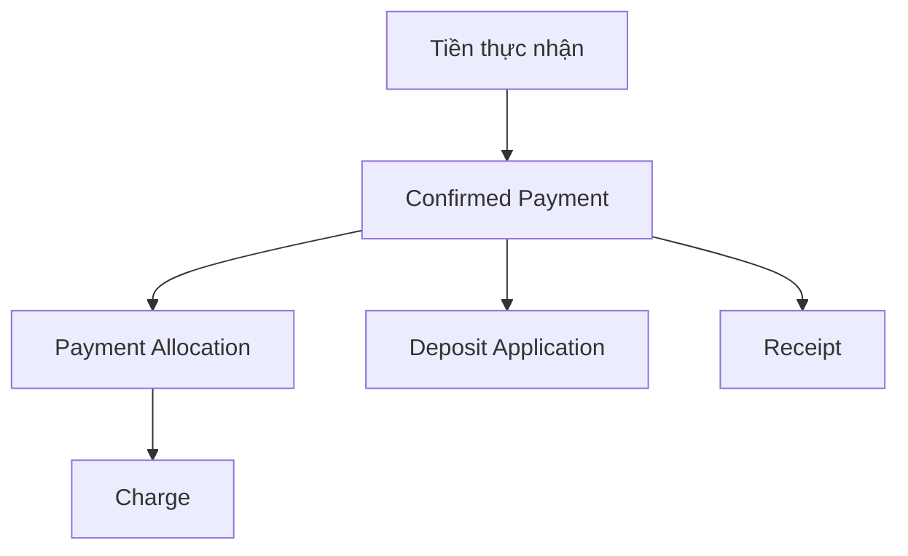

# Payment — Ghi nhận tiền thực nhận

## 1. Mục tiêu

Payment là nguồn ghi cho **tiền thực tế đã nhận** của một Tenancy. Một Payment có thể được phân bổ vào nhiều Charge và/hoặc áp dụng vào Deposit, nhưng tất cả phải ở cùng Tenancy.

## 2. Người dùng cần làm được gì?

Chủ trọ/người vận hành:

- **Ghi nhận khoản tiền đã nhận** theo source/verification được hệ thống hỗ trợ.
- **Phân bổ Payment** vào một hoặc nhiều Charge.
- **Áp dụng Payment vào Deposit** khi phù hợp.
- **Sửa sai Payment** bằng void/reverse + tạo bản ghi đúng, không sửa phá lịch sử.
- xem phần tiền đã phân bổ và phần còn chưa phân bổ.

Người thuê:

- xem Payment đã được xác nhận thuộc Tenancy của mình;
- nếu trả tiền bên ngoài hệ thống nhưng chưa được ghi nhận, đi qua [`payment-claim.md`](payment-claim.md).

## 3. Frontend cần làm gì?

- Không gọi một Payment chưa confirmed là “đã nhận tiền”.
- Hiển thị amount, source/verification và allocation/application theo response Backend.
- Không cho sửa trực tiếp confirmed Payment như một form thông thường; dùng correction flow Backend hỗ trợ.
- Policy cho unallocated amount vẫn `OPEN`, UI không tự quyết cách xử lý cuối cùng.

## 4. Backend cần làm gì?

- Payment thuộc đúng một Tenancy.
- Chỉ verified/confirmed event mới thành actual money inflow.
- Allocation/Application chỉ được trỏ tới target cùng Tenancy.
- Tổng allocation + deposit application không vượt Payment amount.
- Confirmed Payment correction giữ history bằng void/reverse + new Payment.
- Charge over-allocation policy đang `OPEN`; không tự chốt default ngoài authority.

## 5. Database cần bảo vệ gì?

- Exact money values.
- Cross-Tenancy reference bị chặn.
- Capacity của Payment không bị vượt khi request đồng thời.
- Correction giữ predecessor/history.

## 6. Khi nào xem là hoàn thành?

- Hệ thống phân biệt rõ tiền thực nhận với khoản phải thu và Payment Claim.
- Không over-apply một Payment.
- Correction không xóa lịch sử.

## Tài liệu liên quan

- [`billing.md`](billing.md)
- [`payment-claim.md`](payment-claim.md)
- [`deposit.md`](deposit.md)
- [`receipt.md`](receipt.md)

## Approved optional MoMo V1 boundary — 2026-10-05

MoMo is optional current V1, not an MVP dependency; unconfigured/unavailable provider must not stop manual finance. General provider/platform expansion remains FUTURE. Billing/Charge != Payment != Payment Claim != Deposit != Receipt != GatewayCheckout. Operator-only manual POST /finance/payments accepts MANUAL_CASH / MANUAL_TRANSFER with server-derived USER_RECORDED; client-supplied GATEWAY / PROVIDER_VERIFIED provenance is rejected before insert and at the service boundary. Only a fully verified payment-success IPN creates GATEWAY / PROVIDER_VERIFIED Payment. Signed create-response handoff and redirect do not confirm money. No automatic allocation, Deposit funding or Receipt issuance.

Replay POST /finance/checkouts with the same Idempotency-Key and immutable requestId/orderId; no separate retry endpoint. Android reads backend checkout/Payment after identity/context validation. Payment Claim evidence/confirmation remains gated. Completion requires fresh database, backend, Android and MoMo sandbox/IPN evidence; this scope promotion proves no runtime delivery.
