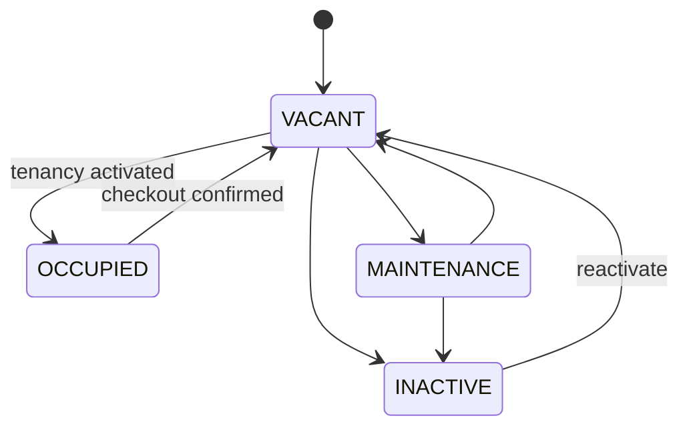

# Property & Room — Quản lý nơi cho thuê và từng phòng

## 1. Mục tiêu

Property là một cơ sở/địa điểm quản lý. Room là đơn vị cho thuê cụ thể bên trong Property. Đây là nền để Listing, Tenancy, Incident và các dữ liệu vận hành khác bám vào.

## 2. Người dùng cần làm được gì?

Chủ trọ/người vận hành cần có các thao tác nghiệp vụ:

- **Tạo Property**.
- **Thêm Room** vào Property.
- Xem danh sách/chi tiết Property và Room.
- Cập nhật thông tin vận hành được phép thay đổi.
- Đưa Room vào **Bảo trì** (`MAINTENANCE`) khi hợp lệ.
- Đưa Room về **Trống** (`VACANT`) sau bảo trì.
- **Ngừng sử dụng Room** (`INACTIVE`) khi hợp lệ.
- **Kích hoạt lại Room** (`INACTIVE → VACANT`) nếu Property còn hoạt động.
- **Lưu trữ Room/Property** khi đủ điều kiện.

## 3. Vòng đời Room

Room có thêm record lifecycle `ACTIVE | ARCHIVED`. `ARCHIVED` là khác với `INACTIVE`.

## 4. Frontend cần làm gì?

- Hiển thị rõ operational state và record lifecycle, không trộn hai thứ thành một.
- Chỉ đưa action hợp lệ theo state hiện tại.
- Không cho UI trực tiếp chuyển `OCCUPIED → INACTIVE/MAINTENANCE`; người dùng phải hoàn tất checkout trước.
- Khi archive bị từ chối vì còn Tenancy/Incident/Listing liên quan, hiển thị lý do từ Backend.
- Với location, tách thông tin vận hành và dữ liệu được phép public.

## 5. Backend cần làm gì?

- Giữ đúng Room state machine.
- Property archive chỉ thành công khi các Room/Tenancy/Listing/Incident con đều đáp ứng điều kiện Canonical.
- Room archive chỉ khi `INACTIVE`, không còn non-terminal Tenancy và không còn open Incident; các Listing liên quan phải được archive theo workflow.
- Archived Property không cho child Room/Tenancy/Listing hoạt động lại.
- Khi chỉnh sai Property assignment của cùng một Room vật lý, giữ history và xử lý Listing/public location theo Canonical.
- Nếu là relocation vật lý thật, tạo Room mới thay vì reuse identity cũ.

## 6. Database cần bảo vệ gì?

- Property thuộc đúng Organization; Room thuộc đúng Property.
- State/lifecycle values đúng vocabulary.
- Archive/ancestor guard và reference integrity.
- Những thay đổi chạm nhiều bảng phải chạy trong transaction phù hợp.

## 7. Khi nào xem là hoàn thành?

- Người vận hành quản lý được Property/Room xuyên vòng đời bình thường.
- Không có transition trái Canonical.
- Archive không được dùng để “né” Tenancy/Incident còn mở.
- Location public/private không bị trộn.

## Tài liệu liên quan

- [`organization.md`](organization.md)
- [`listing.md`](listing.md)
- [`tenancy.md`](tenancy.md)
- [`incident.md`](incident.md)
- [`../../database/v1/canonical.md`](../../database/v1/canonical.md)
