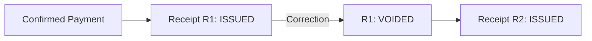

# Receipt — Biên nhận cho Payment đã xác nhận

## 1. Mục tiêu

Receipt là bằng chứng được phát hành từ một confirmed Payment. Receipt **không phải Payment** và không sở hữu trạng thái công nợ.

## 2. Người dùng cần làm được gì?

Chủ trọ/người vận hành:

- **Phát hành biên nhận** cho Payment đủ điều kiện.
- **Void biên nhận** khi cần correction.
- **Phát hành lại** biên nhận mới thay vì sửa trực tiếp biên nhận cũ.

Người thuê:

- **Xem biên nhận**.
- **Chia sẻ / tải xuống** khi capability client hỗ trợ.
- xem lịch sử biên nhận đã void/reissue.

## 3. Frontend cần làm gì?

- Chỉ cho issue khi Backend nói Payment đủ điều kiện.
- Hiển thị `ISSUED | VOIDED` và lịch sử reissue.
- Không dùng Receipt để quyết định Payment đã tồn tại hay debt đã hết; đọc dữ liệu nguồn tương ứng.

## 4. Backend cần làm gì?

- Receipt chỉ sinh từ confirmed Payment.
- Correction bằng void/reissue, không destructive edit.
- Một Payment có thể có nhiều Receipt lịch sử nhưng tối đa một Receipt current/non-voided.

## 5. Database cần bảo vệ gì?

- Receipt reference đúng Payment.
- Tối đa một current/non-voided Receipt cho mỗi Payment.
- Lịch sử Receipt cũ không bị xóa khi void.

## 6. Khi nào xem là hoàn thành?

- Issue/void/reissue giữ nguyên provenance.
- Tenant xem được lịch sử.
- Không thể có hai Receipt current cùng lúc cho một Payment.

## Tài liệu liên quan

- [`payment.md`](payment.md)
- [`tenant-portal.md`](tenant-portal.md)
- [`../../database/v1/canonical.md`](../../database/v1/canonical.md)
