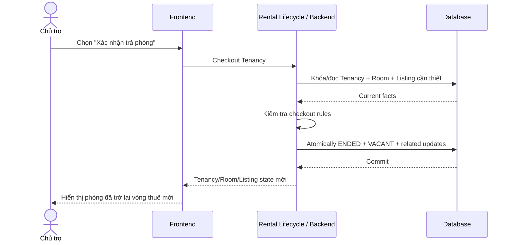

# Rental Lifecycle — Vòng đời thuê xuyên domain

## 1. Mục tiêu

Rental Lifecycle là **cross-feature orchestration** nối Property, Room, Listing và Tenancy để một thay đổi nghiệp vụ không làm các domain lệch state với nhau.

Đây **không phải một màn hình riêng** và Frontend không cần tạo nút tên “Rental Lifecycle”. Frontend chỉ gọi các action nghiệp vụ thật như **Đăng tin**, **Kích hoạt lượt thuê**, **Bắt đầu trả phòng**, **Xác nhận trả phòng**; Backend dùng Rental Lifecycle để điều phối các domain liên quan.

## 2. Người dùng tham gia

- Chủ trọ / người vận hành: thực hiện các action làm thay đổi vòng đời cho thuê.
- Người thuê: đi qua discovery, tenancy và move-out flow tương ứng.

## 3. Điểm vào trên sản phẩm

Feature này được kích hoạt gián tiếp từ nhiều nơi:

- Room/Listing management khi đăng hoặc ngừng đăng phòng.
- Inquiry hoặc Room khi tạo Tenancy.
- Tenancy khi kích hoạt thuê.
- Tenancy khi bắt đầu hoặc xác nhận trả phòng.

## 4. Hành động người dùng liên quan

- **Tạo tin đăng / Đăng tin**.
- **Tạo lượt thuê**.
- **Kích hoạt lượt thuê**.
- **Bắt đầu trả phòng**.
- **Hủy trả phòng / Tiếp tục thuê**.
- **Xác nhận trả phòng**.
- **Đăng lại tin** khi Room trở về trạng thái đủ điều kiện.

## 5. Luồng sử dụng

```mermaid
flowchart LR
    A["Room VACANT"] --> B["Tạo / duy trì Listing"]
    B --> C["Đăng tin"]
    C --> D["Discovery / Inquiry"]
    D --> E["Tạo Tenancy"]
    E --> F["Participant + Terms"]
    F --> G["Kích hoạt lượt thuê"]
    G --> H["Listing UNPUBLISHED"]
    H --> I["Room OCCUPIED"]
    I --> J["Vận hành thuê"]
    J --> K["Bắt đầu trả phòng"]
    K --> L["Xác nhận trả phòng"]
    L --> M["Tenancy ENDED + Room VACANT"]
    M --> N["Revalidate Listing"]
    N --> C
```

## 6. Frontend phải làm gì

- Gửi đúng business intent từ các feature cụ thể; không gọi một “rental lifecycle screen” giả định.
- Sau mỗi action, cập nhật UI từ state hệ thống trả về cho cả Listing, Room và Tenancy liên quan.
- Không tự suy luận rằng Room đã `OCCUPIED` chỉ vì người dùng bấm kích hoạt; phải chờ Backend commit thành công.
- Không tự coi Room `VACANT` khi Tenancy mới `ENDING`; chỉ checkout thành công mới hoàn tất coupling đó.
- Khi action thất bại, giữ UI nhất quán với state authoritative gần nhất.

## 7. Backend phải làm gì

- Điều phối cross-domain command mà không lấy ownership entity-local khỏi module sở hữu.
- Kích hoạt Tenancy phải phối hợp Tenancy → `ACTIVE`, Room → `OCCUPIED`, current Listing → `UNPUBLISHED` khi áp dụng.
- Checkout phải phối hợp Tenancy `ENDING → ENDED` và Room → `VACANT` atomically.
- Room rời `VACANT` phải làm Listing công khai hiện tại không còn public.
- Rejected command không được để lại known partial mutation.

## 8. Database phải làm gì

- Cung cấp transaction boundary/locking để các invariant xuyên bảng không bị race.
- Bảo vệ one-current-listing và one-nonterminal-tenancy khi command chạy đồng thời.
- Bảo đảm activation/checkout cập nhật các fact liên quan atomically.
- Giữ history riêng của Listing/Tenancy thay vì collapse chúng thành một record chung.

## 9. Luồng xuyên hệ thống

## 10. Business rules

- Rental Lifecycle là orchestration, không phải source business state riêng.
- Room rời `VACANT` phải làm current Listing không còn `PUBLISHED`.
- Activate Tenancy và checkout phải giữ Room/Tenancy/Listing nhất quán.
- Checkout là workflow xác nhận `ENDING → ENDED` cùng Room → `VACANT`.
- Application pre-check không thay thế database transaction guard cho race-prone invariant.

## 11. Phụ thuộc

- Upstream: Property, Room, Listing, Tenancy, Tenancy Participant, Tenancy Terms.
- Downstream: Billing, Incident, Review, Trust và các flow vận hành tiếp theo.

## 12. Tiêu chí hoàn thành

**Frontend**
- Các action ở Listing/Tenancy phản ánh state xuyên domain sau response.

**Backend**
- Cross-domain command không để partial state và giữ ownership đúng module.

**Database**
- Các transition cần atomicity/concurrency guard được bảo vệ trong transaction.

## 13. Tài liệu liên quan

- [`listing.md`](listing.md)
- [`tenancy.md`](tenancy.md)
- [`../../contexts/end-to-end-flows.md`](../../contexts/end-to-end-flows.md)
- [`../../contexts/integration-contracts.md`](../../contexts/integration-contracts.md)
- [`../../database/v1/canonical.md`](../../database/v1/canonical.md)
