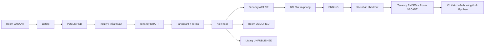

# Rental Lifecycle — Giữ Room, Listing và Tenancy đi cùng nhau

## 1. Mục tiêu

Rental Lifecycle không phải một màn hình và cũng không phải một nút riêng. Đây là phần Backend dùng để **điều phối những thao tác làm thay đổi nhiều nghiệp vụ cùng lúc**, để Room, Listing và Tenancy không lệch state.

Frontend chỉ cần đưa cho người dùng các action thật như **Đăng tin**, **Kích hoạt lượt thuê**, **Bắt đầu trả phòng**, **Xác nhận trả phòng**.

## 2. Người dùng đi qua flow nào?

## 3. Frontend cần làm gì?

- Gửi đúng thao tác từ feature cụ thể; không tạo “Rental Lifecycle screen”.
- Sau command, cập nhật UI từ state Backend trả về cho các phần liên quan.
- Không tự coi Room `OCCUPIED` chỉ vì user vừa bấm Activate.
- Không tự coi Room `VACANT` khi Tenancy mới chỉ `ENDING`.
- Nếu command thất bại, giữ UI theo state authoritative gần nhất.

## 4. Backend cần làm gì?

- Kích hoạt Tenancy phải phối hợp Tenancy → `ACTIVE`, Room → `OCCUPIED` và Listing → không còn public khi áp dụng.
- Checkout phải phối hợp Tenancy `ENDING → ENDED` và Room → `VACANT` trong một transaction phù hợp.
- Room rời `VACANT` thì Listing public hiện tại phải được xử lý ngay.
- Command bị từ chối không để lại partial mutation.

## 5. Database cần bảo vệ gì?

- Transaction/locking cho các thay đổi xuyên nhiều bản ghi.
- One-current-listing và one-nonterminal-tenancy khi request chạy đồng thời.
- Activation/checkout phải commit hoặc rollback nhất quán.
- Giữ history của Listing/Tenancy riêng, không gom thành một record chung.

## 6. Khi nào xem là hoàn thành?

- Sau Activate/Checkout, Room + Listing + Tenancy luôn khớp nhau.
- Không có partial state khi lỗi.
- Concurrency không phá uniqueness/invariant.

## Tài liệu liên quan

- [`listing.md`](listing.md)
- [`tenancy.md`](tenancy.md)
- [`../../contexts/end-to-end-flows.md`](../../contexts/end-to-end-flows.md)
- [`../../contexts/integration-contracts.md`](../../contexts/integration-contracts.md)
- [`../../database/v1/canonical.md`](../../database/v1/canonical.md)
