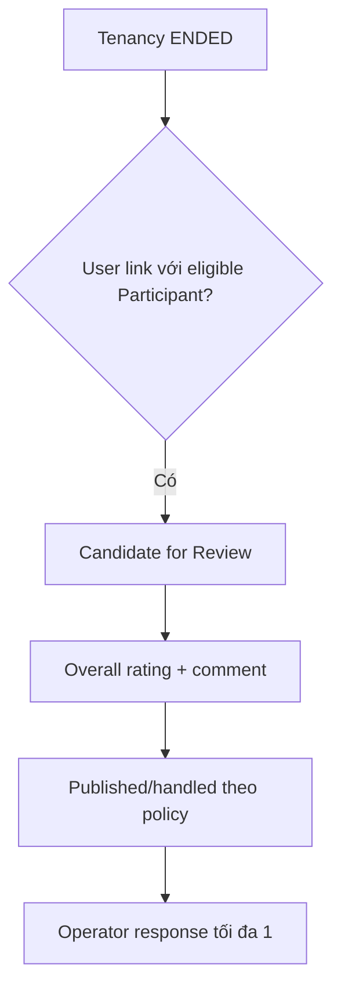

# Review — Đánh giá dựa trên lịch sử thuê thật

## 1. Mục tiêu

Review cho phép người có lịch sử thuê đủ điều kiện chia sẻ trải nghiệm về Property/Rental Experience. Review không phải public rating con người của landlord hay tenant.

Baseline eligibility:

`Tenancy = ENDED` và `User` đã link với Participant đủ điều kiện.

## 2. Người dùng cần làm được gì?

Former tenant đủ điều kiện:

- **Viết đánh giá**.
- ghi overall rating và comment theo phạm vi MVP.
- xem review mình đã gửi theo policy hiện tại.

Chủ trọ/người vận hành:

- xem Review liên quan.
- có thể **phản hồi**; một Review có tối đa một landlord/operator response.

> Minimum occupancy, edit policy, moderation authority, rating dimensions và số Review tối đa cho mỗi Participant/Tenancy vẫn là `OPEN`.

## 3. Frontend cần làm gì?

- Chỉ hiển thị action Review khi Backend cho biết User đủ điều kiện.
- Không tự loại quyền Review chỉ vì `end_reason` mang một lý do bất lợi.
- Không hardcode các policy còn `OPEN`.
- Không biến Review thành personal score công khai.

## 4. Backend cần làm gì?

- Kiểm tra Tenancy đã `ENDED` và User/Participant link phù hợp.
- `end_reason` không tự quyết review eligibility.
- Giữ các policy `OPEN` chưa chốt.
- Bảo vệ tối đa một operator response cho một Review.

## 5. Database cần bảo vệ gì?

- Review trace được về rental history đủ điều kiện.
- User/Participant/Tenancy consistency.
- Response cardinality theo contract.

## 6. Khi nào xem là hoàn thành?

- Chỉ người có lịch sử thuê thật đủ điều kiện mới đi vào flow.
- Review không trở thành public personal rating.
- OPEN policy không bị tự chốt trong UI/DB.

## Tài liệu liên quan

- [`tenancy.md`](tenancy.md)
- [`trust-report.md`](trust-report.md)
- [`../../database/v1/canonical.md`](../../database/v1/canonical.md)
