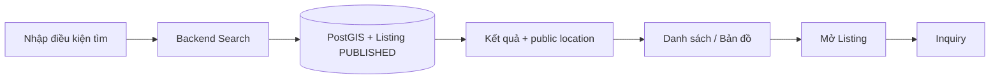

# Search & Map — Tìm phòng đang có thể thuê

## 1. Mục tiêu

Search/Map giúp người tìm phòng khám phá các Listing đang thực sự được công khai. Đây là phần đọc dữ liệu; nó không tự thay đổi Room, Listing hay Tenancy.

## 2. Người dùng cần làm được gì?

- **Tìm phòng** theo khu vực.
- Xem kết quả dạng danh sách hoặc bản đồ.
- Lọc theo **vị trí, khoảng giá, loại phòng/property và availability** trong phạm vi contract hiện tại.
- Mở chi tiết một Listing.
- Đi tiếp sang **Tôi quan tâm / Liên hệ**.

> Owner/vocabulary chính xác cho filter “room/property type” vẫn là `OPEN`. Frontend không được tự chốt enum mới chỉ để làm filter.

## 3. Frontend cần làm gì?

- Hiển thị chỉ dữ liệu public Backend trả về.
- Không tự expose exact operational location.
- Giữ filter UI map đúng contract; mục `OPEN` phải chờ policy thay vì hardcode vocabulary lâu dài.
- Không đưa saved search/advanced favorites vào current flow vì đang FUTURE.

## 4. Backend cần làm gì?

- Chỉ trả Listing đang `PUBLISHED`.
- Query theo public location projection qua persistence.
- Áp dụng filter đã được authority cho phép.
- Không dùng Search index/read model để thay đổi source business state.

## 5. Database cần bảo vệ/hỗ trợ gì?

- Lưu public location projection riêng với operational location.
- Hỗ trợ spatial query/index phù hợp qua PostGIS.
- Query không được trả Listing ngoài `PUBLISHED`.

## 6. Khi nào xem là hoàn thành?

- Người dùng tìm và mở được phòng đang public.
- Vị trí riêng tư không rò ra kết quả.
- Filter hoạt động trong vocabulary đã chốt, còn policy `OPEN` không bị tự đóng.

## Tài liệu liên quan

- [`listing.md`](listing.md)
- [`inquiry.md`](inquiry.md)
- [`../../contexts/end-to-end-flows.md`](../../contexts/end-to-end-flows.md)
- [`../../database/v1/canonical.md`](../../database/v1/canonical.md)
