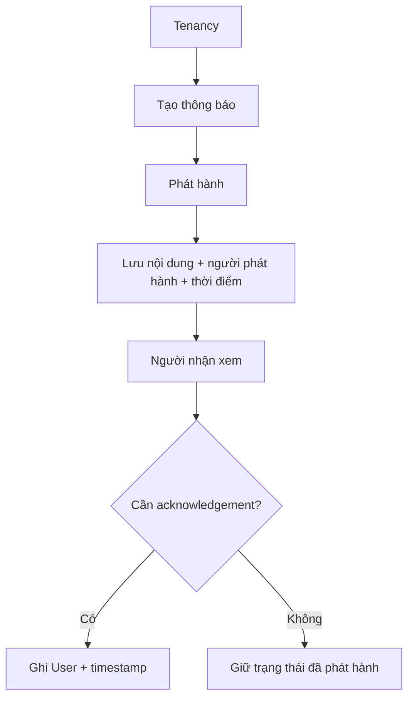

# Tenancy Notice — Thông báo trong một lần thuê

## 1. Mục tiêu

Notice lưu một thông báo liên quan tới Tenancy và lịch sử người nhận đã xem/xác nhận nếu flow cần.

Nó phục vụ việc giao tiếp và đối chiếu lịch sử, **không biến TrọƠi thành nơi phán quyết pháp lý**.

## 2. Người dùng cần làm được gì?

Chủ trọ/người vận hành:

- **Tạo thông báo**.
- **Phát hành thông báo**.
- xem lịch sử thông báo đã phát hành.

Người thuê/participant:

- **Xem thông báo**.
- **Xác nhận đã xem/đã nhận** khi capability đó áp dụng.

## 3. Frontend cần làm gì?

- Cho người có quyền tạo/phát hành Notice từ đúng Tenancy.
- Hiển thị danh sách, nội dung, người phát hành và thời điểm.
- Cho người nhận gửi acknowledgement khi flow áp dụng.
- Không dùng wording khiến Notice bị hiểu là quyết định/phán quyết pháp lý.

## 4. Backend cần làm gì?

- Kiểm tra quyền trước khi phát hành.
- Lưu nội dung, issuer và thời điểm.
- Khi acknowledgement được gửi, kiểm tra đúng User/recipient và ghi timestamp.
- Giữ Notice history sau khi Tenancy kết thúc.

## 5. Database cần bảo vệ gì?

- Notice phải thuộc đúng Tenancy.
- issuer/issue time phải được lưu.
- acknowledgement User và timestamp phải nhất quán.
- Lịch sử không bị mất khi Tenancy thay đổi state.

## 6. Khi nào xem là hoàn thành?

- Chủ trọ phát hành được Notice đúng Tenancy/quyền.
- Người thuê xem và xác nhận được khi cần.
- Lịch sử phát hành/xác nhận được giữ nguyên.

## Tài liệu liên quan

- [`tenancy.md`](tenancy.md)
- [`notification.md`](notification.md)
- [`../../contexts/end-to-end-flows.md`](../../contexts/end-to-end-flows.md)
- [`../../database/v1/canonical.md`](../../database/v1/canonical.md)
