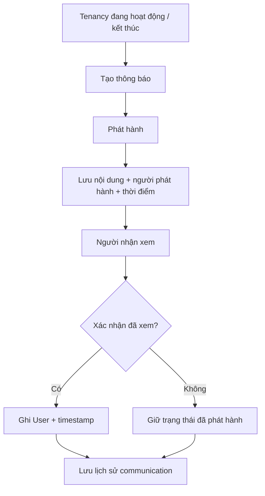
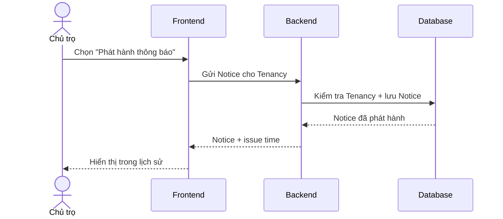

# Tenancy Notice — Thông báo trong quan hệ thuê

## 1. Mục tiêu

Tenancy Notice ghi nhận thông báo liên quan tới một Tenancy và lịch sử người dùng đã xem/xác nhận thông báo. Feature này phục vụ communication history; không biến TrọƠi thành hệ thống phán quyết pháp lý.

## 2. Người dùng tham gia

- Chủ trọ / người vận hành: phát hành thông báo liên quan tới Tenancy.
- Người thuê/participant có quyền: xem thông báo và xác nhận đã nhận/xem khi flow yêu cầu.

## 3. Điểm vào trên sản phẩm

- Từ chi tiết Tenancy.
- Từ Tenant Portal / khu vực thông báo của quan hệ thuê.

## 4. Hành động người dùng

Phía chủ trọ/người vận hành:

- **Tạo thông báo**.
- **Phát hành thông báo**.
- Xem lịch sử thông báo đã phát hành.

Phía người thuê:

- **Xem thông báo**.
- **Xác nhận đã xem / đã nhận** khi capability đó áp dụng.

Không có action “phán quyết”, “xác nhận pháp lý” hoặc semantics tương tự nếu authority không định nghĩa.

## 5. Luồng sử dụng

## 6. Frontend phải làm gì

- Cho người có quyền tạo/phát hành Notice từ đúng Tenancy.
- Hiển thị danh sách và chi tiết Notice theo thời gian.
- Cho người nhận xem Notice và gửi acknowledgement khi action này áp dụng.
- Hiển thị issuer, thời điểm phát hành và acknowledgement state do Backend trả về.
- Không gán thêm legal effect cho Notice ngoài wording đã được product/domain chốt.

## 7. Backend phải làm gì

- Kiểm tra quyền trên Tenancy trước khi phát hành Notice.
- Ghi nội dung, issuer và issue time như communication fact.
- Khi acknowledgement được gửi, kiểm tra User/recipient consistency và ghi timestamp.
- Giữ Notice history độc lập với legal adjudication.

## 8. Database phải làm gì

- Lưu Notice gắn đúng Tenancy.
- Lưu issuer và issue timestamp.
- Lưu acknowledgement User + timestamp theo contract.
- Bảo vệ coherence của cặp acknowledgement identity/timestamp.
- Giữ historical Notice sau khi Tenancy thay đổi hoặc kết thúc.

## 9. Luồng xuyên hệ thống

## 10. Business rules

- Notice thuộc một Tenancy cụ thể.
- Nội dung, issuer và thời điểm phát hành phải được lưu vết.
- Acknowledgement ghi User và timestamp cùng nhau theo contract.
- Notice không tự tạo legal effect ngoài phạm vi sản phẩm đã chốt.

## 11. Phụ thuộc

- Upstream: Tenancy, User identity cho issuer/acknowledger.
- Downstream: communication history và notification surface.

## 12. Tiêu chí hoàn thành

**Frontend**
- Tạo/xem/xác nhận Notice đúng quyền và đúng Tenancy.

**Backend**
- Issue/acknowledgement flow giữ đúng communication semantics.

**Database**
- Notice history và acknowledgement coherence được bảo vệ.

## 13. Tài liệu liên quan

- [`tenancy.md`](tenancy.md)
- [`../../contexts/end-to-end-flows.md`](../../contexts/end-to-end-flows.md)
- [`../../contexts/integration-contracts.md`](../../contexts/integration-contracts.md)
- [`../../database/v1/canonical.md`](../../database/v1/canonical.md)
