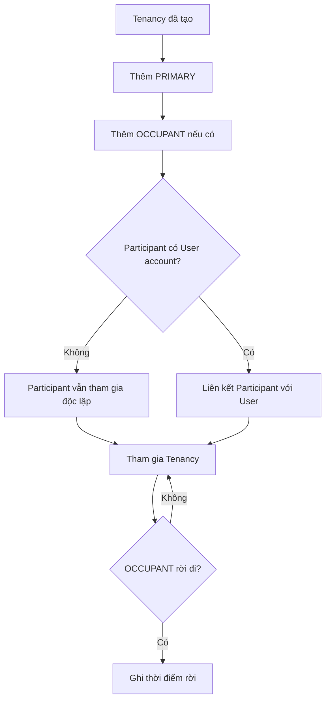

# Tenancy Participant — Người tham gia một lần thuê

## 1. Mục tiêu

Participant ghi nhận **người thực sự tham gia Tenancy**. Participant không phải User account: một người có thể đã ở trong quan hệ thuê dù chưa đăng ký app.

## 2. Người dùng cần làm được gì?

Chủ trọ/người vận hành:

- **Thêm người thuê chính** (`PRIMARY`).
- **Thêm người ở cùng** (`OCCUPANT`).
- **Liên kết tài khoản** nếu participant có User tương ứng.
- **Ghi nhận người ở cùng rời đi** khi họ không còn tham gia.
- xem lịch sử người từng tham gia Tenancy.

## 3. Frontend cần làm gì?

- Hiển thị `PRIMARY` và `OCCUPANT` trong phạm vi Tenancy.
- Cho phép tạo Participant dù chưa có account.
- Hiển thị trạng thái đã/chưa link User nhưng không biến hai entity thành một.
- Khi activation bị từ chối vì participant chưa hợp lệ, hiển thị lý do từ Backend.

## 4. Backend cần làm gì?

- Giữ `USER ≠ TENANCY_PARTICIPANT`.
- Cho phép User link optional `0..1`.
- Active Tenancy phải có đúng một active `PRIMARY` và có thể có nhiều `OCCUPANT`.
- Link User sau này không được làm mất participant history.
- Kiểm tra consistency khi participant được dùng cho Acknowledgement/Review/Payment Claim.

## 5. Database cần bảo vệ gì?

- Lưu Participant độc lập với User.
- User reference là optional.
- Giữ lịch sử join/leave.
- Bảo vệ active PRIMARY invariant và các reference với Tenancy/User.

## 6. Khi nào xem là hoàn thành?

- Người chưa có account vẫn có thể nằm trong Tenancy đúng cách.
- Một active Tenancy không thể có hai active PRIMARY.
- Link/unlink account không làm mất lịch sử participant.

## Tài liệu liên quan

- [`tenancy.md`](tenancy.md)
- [`terms-acknowledgement.md`](terms-acknowledgement.md)
- [`../../contexts/product-domain.md`](../../contexts/product-domain.md)
- [`../../database/v1/canonical.md`](../../database/v1/canonical.md)
