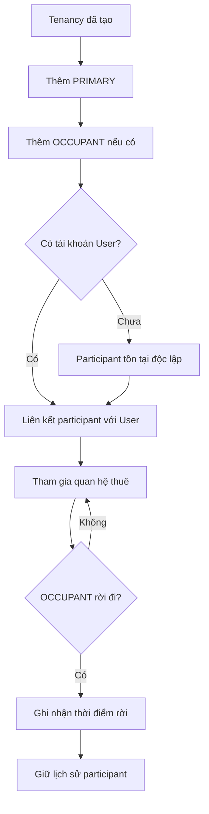
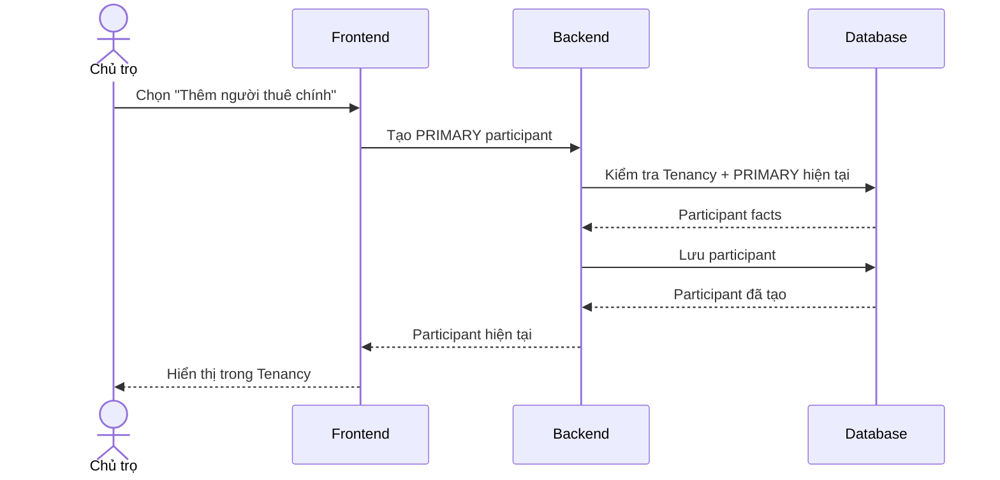

# Tenancy Participant — Người tham gia quan hệ thuê

## 1. Mục tiêu

Tenancy Participant ghi nhận **người thực sự tham gia một quan hệ thuê**, tách biệt khỏi digital identity `USER`. Một participant có thể tồn tại trước khi có tài khoản và được link với User sau đó mà không làm mất lịch sử.

## 2. Người dùng tham gia

- Chủ trọ / người vận hành: thêm PRIMARY và OCCUPANT vào Tenancy, cập nhật việc một occupant rời đi.
- Người thuê: có thể được liên kết với participant thông qua User để sử dụng tenant-facing capability.

## 3. Điểm vào trên sản phẩm

- Từ Tenancy `DRAFT` khi chuẩn bị kích hoạt.
- Từ chi tiết Tenancy đang hoạt động để xem hoặc quản lý participant.

## 4. Hành động người dùng

- **Thêm người thuê chính** (`PRIMARY`).
- **Thêm người ở cùng** (`OCCUPANT`).
- **Liên kết tài khoản** khi participant có User tương ứng.
- **Ghi nhận rời khỏi lượt thuê** cho OCCUPANT khi họ không còn tham gia.
- Xem lịch sử participant đã tham gia trước đây.

Frontend không được coi User và Participant là cùng một entity.

## 5. Luồng sử dụng

## 6. Frontend phải làm gì

- Hiển thị participant theo vai trò `PRIMARY` hoặc `OCCUPANT` trong phạm vi Tenancy.
- Cho phép tạo participant dù chưa có User account.
- Hiển thị trạng thái đã/chưa liên kết tài khoản mà không biến User thành participant mới.
- Chỉ cho action rời đi phù hợp với participant và state hiện tại.
- Khi Tenancy activation bị từ chối vì participant chưa hợp lệ, hiển thị lý do từ Backend.

## 7. Backend phải làm gì

- Tách identity `USER` khỏi `TENANCY_PARTICIPANT`.
- Cho phép optional User link `0..1` cho participant.
- Bảo đảm active Tenancy có đúng một active `PRIMARY` và có thể có nhiều active `OCCUPANT`.
- Khi link User, giữ nguyên participant identity/history.
- Kiểm tra consistency giữa participant, User và Tenancy cho các flow phụ thuộc như acknowledgement/review/payment claim.

## 8. Database phải làm gì

- Lưu participant độc lập với User.
- Lưu optional User reference mà không bắt buộc participant phải có account.
- Bảo vệ uniqueness/invariant của active PRIMARY theo contract.
- Lưu join/leave history cần thiết để không mất historical membership.
- Bảo vệ reference integrity giữa Tenancy, Participant và optional User.

## 9. Luồng xuyên hệ thống

## 10. Business rules

- `USER ≠ TENANCY_PARTICIPANT`.
- Participant có thể không liên kết User.
- Active Tenancy có đúng một active `PRIMARY` và zero-or-more active `OCCUPANT`.
- Link User không thay thế hoặc xóa participant history.

## 11. Phụ thuộc

- Upstream: Tenancy.
- Optional identity link: User.
- Downstream: Tenancy activation, Terms Acknowledgement, Payment Claim, Review.

## 12. Tiêu chí hoàn thành

**Frontend**
- Phân biệt rõ participant với User account và thể hiện đúng vai trò trong Tenancy.

**Backend**
- Participant creation/link/leave đúng rule và giữ lịch sử.

**Database**
- PRIMARY invariant, optional User link và historical membership được bảo vệ.

## 13. Tài liệu liên quan

- [`tenancy.md`](tenancy.md)
- [`terms-acknowledgement.md`](terms-acknowledgement.md)
- [`../../contexts/product-domain.md`](../../contexts/product-domain.md)
- [`../../database/v1/canonical.md`](../../database/v1/canonical.md)
