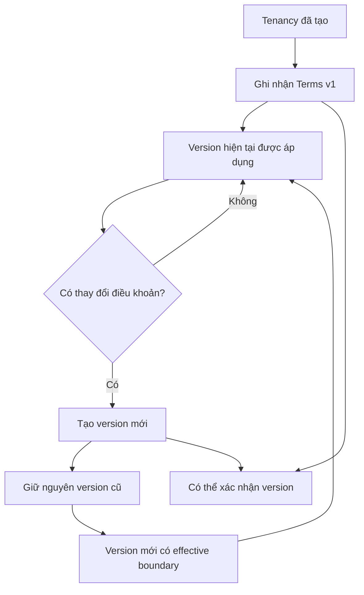
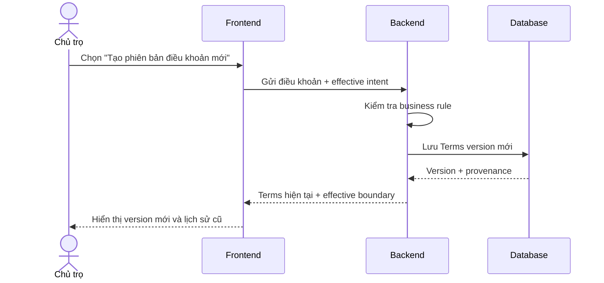

# Tenancy Terms — Điều khoản thuê

## 1. Mục tiêu

Tenancy Terms lưu các **điều kiện thuê đã được ghi nhận theo từng version** cho một Tenancy. Khi điều khoản thay đổi, hệ thống tạo version mới thay vì ghi đè lịch sử cũ.

## 2. Người dùng tham gia

- Chủ trọ / người vận hành: ghi nhận điều khoản ban đầu và các lần thay đổi sau đó.
- Người thuê/participant: xem điều khoản áp dụng và có thể xác nhận một version cụ thể thông qua Terms Acknowledgement.

## 3. Điểm vào trên sản phẩm

- Từ Tenancy `DRAFT` trước khi kích hoạt.
- Từ chi tiết Tenancy khi cần xem lịch sử hoặc tạo version điều khoản mới.

## 4. Hành động người dùng

- **Ghi nhận điều khoản** ban đầu.
- **Tạo phiên bản điều khoản mới** khi hai bên thay đổi thỏa thuận.
- **Xem lịch sử điều khoản**.
- Đi tiếp sang **Xác nhận điều khoản** cho một version cụ thể.

Các action chỉ mô tả intent nghiệp vụ; Frontend không tự quyết version nào áp dụng cho billing.

## 5. Luồng sử dụng

## 6. Frontend phải làm gì

- Hiển thị version điều khoản hiện tại và lịch sử version trước đó.
- Cho phép nhập/gửi intent tạo version mới khi người dùng có quyền.
- Hiển thị các nhóm dữ liệu nghiệp vụ như giá thuê, cọc, ngày hiệu lực, billing/utility rule theo contract.
- Không overwrite version cũ trên UI như thể lịch sử chưa từng tồn tại.
- Khi version mới có hiệu lực từ billing boundary kế tiếp, UI phải phản ánh effective date do Backend trả về.

## 7. Backend phải làm gì

- Tạo Terms version mới thay vì destructive update version cũ.
- Kiểm tra date ordering, monetary value và consistency với Tenancy.
- Xác định effective boundary theo rule hiện hành.
- Cung cấp provenance để downstream Billing biết version nào áp dụng cho cycle nào.
- Không tự thêm proration nếu authority vẫn để FUTURE.

## 8. Database phải làm gì

- Lưu từng Terms version như historical fact.
- Bảo vệ quan hệ Terms ↔ Tenancy và version ordering/provenance cần thiết.
- Giữ exact monetary/date semantics.
- Hỗ trợ downstream Billing truy được đúng Terms version áp dụng.
- Không mất version cũ khi version mới được tạo.

## 9. Luồng xuyên hệ thống

## 10. Business rules

- Terms là versioned historical facts, không overwrite version cũ.
- Rent/deposit/dates/billing/utility conditions thuộc Terms, không thuộc Room.
- Financial change áp dụng theo effective boundary đã chốt; MVP không tự prorate.
- Acknowledgement gắn với đúng Terms version.

## 11. Phụ thuộc

- Upstream: Tenancy.
- Downstream: Terms Acknowledgement, Billing Cycle, Charge, Deposit.

## 12. Tiêu chí hoàn thành

**Frontend**
- Xem được version hiện tại, lịch sử và tạo version mới theo quyền.

**Backend**
- Versioning, effective boundary và validation đúng authority.

**Database**
- Historical immutability/provenance và exact values được bảo vệ.

## 13. Tài liệu liên quan

- [`tenancy.md`](tenancy.md)
- [`terms-acknowledgement.md`](terms-acknowledgement.md)
- [`../../contexts/product-domain.md`](../../contexts/product-domain.md)
- [`../../database/v1/canonical.md`](../../database/v1/canonical.md)
