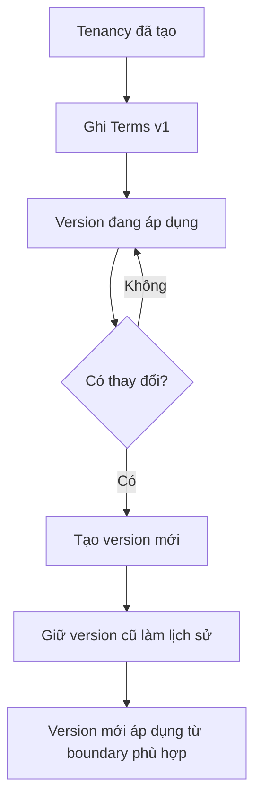

# Tenancy Terms — Điều khoản của một lần thuê

## 1. Mục tiêu

Terms lưu **điều kiện thuê theo từng phiên bản**. Khi điều khoản thay đổi, hệ thống tạo version mới thay vì sửa mất lịch sử cũ.

Terms là nơi giữ các dữ liệu như giá thuê, yêu cầu cọc, thời gian thuê, rule kỳ thanh toán và cách tính điện/nước.

## 2. Người dùng cần làm được gì?

Chủ trọ/người vận hành:

- **Ghi nhận điều khoản** ban đầu.
- **Tạo phiên bản điều khoản mới** khi hai bên thay đổi thỏa thuận.
- **Xem lịch sử điều khoản**.

Người thuê/participant:

- xem version đang áp dụng;
- xem lịch sử version;
- đi tiếp sang **Xác nhận phiên bản điều khoản** khi cần.

## 3. Frontend cần làm gì?

- Hiển thị version hiện tại và lịch sử.
- Cho người có quyền tạo version mới.
- Hiển thị rõ giá thuê, cọc, ngày và rule billing/utility theo contract.
- Không trình bày như thể version cũ bị sửa/xóa.
- Dùng effective date/boundary do Backend trả về; không tự quyết version nào áp dụng cho một Billing Cycle.

## 4. Backend cần làm gì?

- Tạo version mới thay vì destructive update.
- Kiểm tra ngày, monetary values và quan hệ với Tenancy.
- Xác định effective boundary đúng rule.
- Cung cấp provenance để Billing biết cycle nào dùng Terms version nào.
- Không tự thêm proration vì capability đó đang FUTURE.

## 5. Database cần bảo vệ gì?

- Lưu từng version và không làm mất version cũ.
- Giữ quan hệ Terms ↔ Tenancy, version ordering và exact money/date semantics.
- Cho Billing truy được Terms version đã áp dụng.

## 6. Khi nào xem là hoàn thành?

- Có thể xem version hiện tại và lịch sử.
- Tạo version mới không sửa mất version cũ.
- Billing có thể xác định đúng Terms version áp dụng.

## Tài liệu liên quan

- [`tenancy.md`](tenancy.md)
- [`terms-acknowledgement.md`](terms-acknowledgement.md)
- [`billing.md`](billing.md)
- [`../../database/v1/canonical.md`](../../database/v1/canonical.md)
