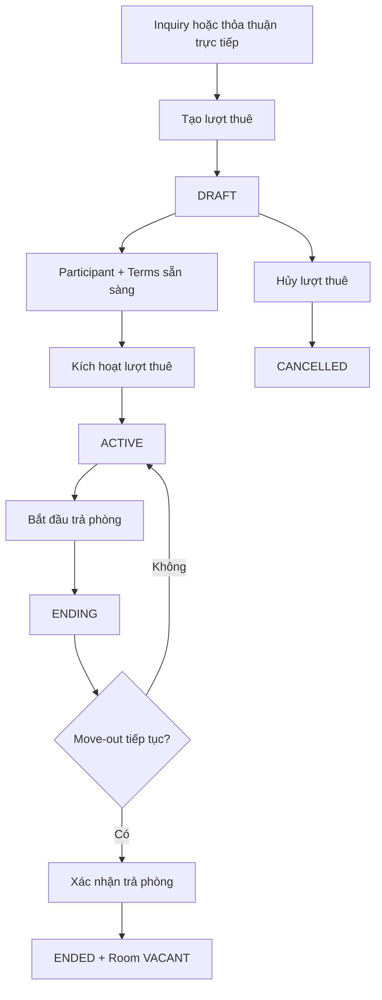
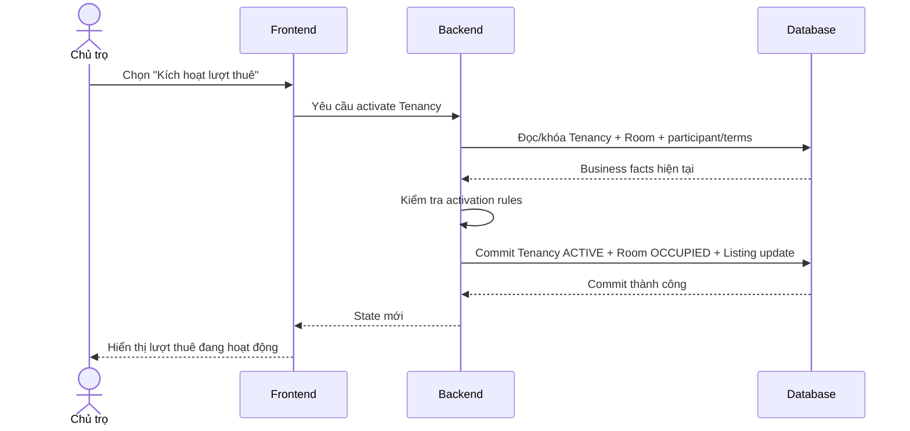

# Tenancy — Quan hệ thuê

## 1. Mục tiêu

Tenancy đại diện cho **một quan hệ thuê của một Room theo thời gian**. Feature này cho phép tạo quan hệ thuê, chuẩn bị participant + terms, kích hoạt thuê, bắt đầu trả phòng, hoàn tác việc trả phòng khi cần, xác nhận checkout và lưu lịch sử sau khi kết thúc.

## 2. Người dùng tham gia

- Chủ trọ / người vận hành: tạo và quản lý vòng đời Tenancy.
- Người thuê/participant: tham gia quan hệ thuê và sử dụng tenant-facing flow theo quyền liên kết.

## 3. Điểm vào trên sản phẩm

- Từ Room đang đủ điều kiện để bắt đầu một quan hệ thuê.
- Từ Inquiry khi hai bên đã thống nhất.
- Từ direct operator agreement mà không cần Inquiry.
- Sau khi Tenancy tồn tại, đi vào từ hồ sơ Room hoặc khu vực quản lý thuê.

## 4. Hành động người dùng

Chủ trọ/người vận hành cần có các action nghiệp vụ phù hợp với state:

- **Tạo lượt thuê**.
- **Thêm người tham gia**.
- **Ghi nhận điều khoản**.
- **Kích hoạt lượt thuê**.
- **Bắt đầu trả phòng**.
- **Hủy trả phòng / Tiếp tục thuê** khi đang `ENDING` và move-out bị hủy.
- **Xác nhận trả phòng** để kết thúc thuê.
- **Hủy lượt thuê** khi còn `DRAFT`.

## 5. Luồng sử dụng

## 6. Frontend phải làm gì

- Hiển thị lifecycle `DRAFT | ACTIVE | ENDING | ENDED | CANCELLED`.
- Chỉ hiển thị action phù hợp với state hiện tại và quyền của người dùng.
- Khi kích hoạt, yêu cầu Backend xác nhận participant/terms và Room eligibility thay vì tự suy luận ở UI.
- Khi bắt đầu trả phòng, phản ánh `ENDING` nhưng chưa coi Room là `VACANT`.
- Khi xác nhận checkout, cập nhật cả Tenancy và Room state theo response từ Backend.
- Giữ Tenancy đã `ENDED`/`CANCELLED` như lịch sử, không xóa khỏi UI chỉ vì đã terminal.

## 7. Backend phải làm gì

- Sở hữu state machine Tenancy và transition hợp lệ.
- Chặn tạo Tenancy mới nếu Room đã có non-terminal Tenancy.
- Khi activate, kiểm tra participant/terms và phối hợp Room → `OCCUPIED` cùng Listing unpublish cần thiết.
- Cho phép `ENDING → ACTIVE` khi move-out bị hủy.
- Checkout phải điều phối atomically `ENDING → ENDED` và Room → `VACANT`.
- Không cho direct `ACTIVE → ENDED`.

## 8. Database phải làm gì

- Lưu Tenancy lifecycle và quan hệ với Room.
- Bảo vệ invariant tối đa một non-terminal Tenancy (`DRAFT | ACTIVE | ENDING`) cho mỗi Room.
- Lưu participant/terms qua bảng/domain riêng, không nhúng semantics cũ vào Tenancy.
- Hỗ trợ transaction-safe activation/checkout và các cross-row guard cần thiết.
- Giữ terminal Tenancy làm historical record.

## 9. Luồng xuyên hệ thống

## 10. Business rules

- Lifecycle: `DRAFT → ACTIVE`, `DRAFT → CANCELLED`, `ACTIVE → ENDING`, `ENDING → ACTIVE`, `ENDING → ENDED`.
- Không có direct `ACTIVE → ENDED`.
- Mỗi Room có tối đa một non-terminal Tenancy.
- Khi Tenancy `ENDING`, không được tạo next `DRAFT` Tenancy cho cùng Room.
- Active Tenancy cần đúng participant/terms preconditions theo authority.

## 11. Phụ thuộc

- Upstream: Property, Room, optional Inquiry.
- Supporting: Tenancy Participant, Tenancy Terms, Terms Acknowledgement, Tenancy Notice.
- Cross-domain: Listing, Rental Lifecycle.
- Downstream: Billing, Payment, Deposit, Incident, Review, Trust.

## 12. Tiêu chí hoàn thành

**Frontend**
- Flow state/action đúng lifecycle và không tự kết thúc Tenancy.

**Backend**
- Activation, ending, reversal, checkout và cancellation đúng rule.
- Rejected command không để state partial.

**Database**
- Non-terminal tenancy uniqueness và transaction guards được bảo vệ.
- Terminal history được giữ nguyên.

## 13. Tài liệu liên quan

- [`rental-lifecycle.md`](rental-lifecycle.md)
- [`tenancy-participant.md`](tenancy-participant.md)
- [`tenancy-terms.md`](tenancy-terms.md)
- [`../../contexts/end-to-end-flows.md`](../../contexts/end-to-end-flows.md)
- [`../../database/v1/canonical.md`](../../database/v1/canonical.md)
