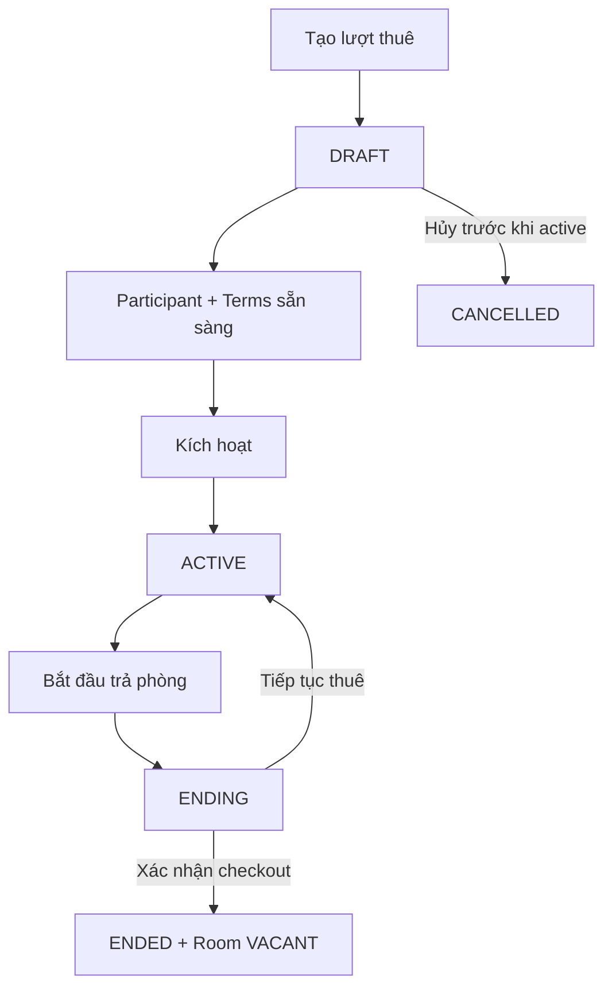

# Tenancy — Một lần thuê phòng

## 1. Mục tiêu

Tenancy là bản ghi cho **một quan hệ thuê cụ thể của một Room theo thời gian**. Nó đi từ lúc chuẩn bị thuê, bắt đầu thuê, bắt đầu trả phòng cho tới khi checkout hoàn tất.

## 2. Người dùng cần làm được gì?

Chủ trọ/người vận hành:

- **Tạo lượt thuê**.
- **Thêm người tham gia**.
- **Ghi nhận điều khoản**.
- **Kích hoạt lượt thuê**.
- **Bắt đầu trả phòng**.
- **Hủy trả phòng / Tiếp tục thuê** khi đang `ENDING`.
- **Xác nhận trả phòng**.
- **Hủy lượt thuê** khi còn `DRAFT`.

Người thuê/participant:

- xem quan hệ thuê của mình qua Tenant Portal theo quyền thực tế;
- đi qua Terms, Billing, Payment, Notice, Incident và Move-out theo các backlog tương ứng.

## 3. Frontend cần làm gì?

- Hiển thị đúng `DRAFT | ACTIVE | ENDING | ENDED | CANCELLED`.
- Chỉ hiển thị action phù hợp với state và quyền.
- Khi activate hoặc checkout, chờ Backend trả kết quả rồi mới cập nhật Room/Tenancy như đã thay đổi.
- `ENDING` chưa được hiển thị như “phòng đã trống”.
- Tenancy đã kết thúc vẫn phải xem được như lịch sử.

## 4. Backend cần làm gì?

- Giữ đúng state machine.
- Không cho tạo Tenancy mới khi Room còn một Tenancy chưa kết thúc.
- Activation phải kiểm tra Participant/Terms và phối hợp Room + Listing liên quan.
- Cho phép `ENDING → ACTIVE` khi move-out bị hủy.
- Checkout phải đưa Tenancy `ENDING → ENDED` và Room → `VACANT` trong một workflow nhất quán.
- Không cho direct `ACTIVE → ENDED`.

## 5. Database cần bảo vệ gì?

- Tối đa một Tenancy chưa kết thúc (`DRAFT | ACTIVE | ENDING`) cho mỗi Room.
- Lưu terminal Tenancy làm lịch sử.
- Hỗ trợ transaction-safe activation/checkout và các guard cần thiết.

## 6. Khi nào xem là hoàn thành?

- Toàn bộ action trên hoạt động đúng state.
- Không có partial state giữa Tenancy/Room/Listing khi command thất bại.
- Hai request đồng thời không tạo được hai Tenancy chưa kết thúc cho cùng Room.

## Tài liệu liên quan

- [`rental-lifecycle.md`](rental-lifecycle.md)
- [`tenancy-participant.md`](tenancy-participant.md)
- [`tenancy-terms.md`](tenancy-terms.md)
- [`../../contexts/end-to-end-flows.md`](../../contexts/end-to-end-flows.md)
- [`../../database/v1/canonical.md`](../../database/v1/canonical.md)
