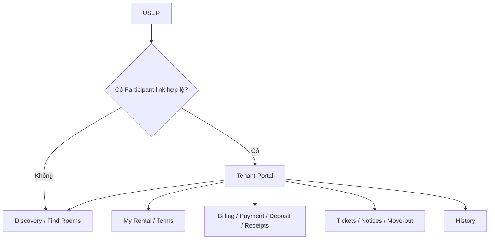

# Tenant Portal — Khu vực của người thuê

## 1. Mục tiêu

Tenant Portal gom những capability người thuê cần sau khi tài khoản của họ được link với một Tenancy Participant phù hợp.

Portal **không sở hữu dữ liệu riêng**; nó đưa dữ liệu từ Tenancy, Terms, Billing, Payment, Deposit, Receipt, Incident, Notice và History về một nơi dễ sử dụng.

## 2. Người thuê cần làm được gì?

Các capability hiện tại gồm:

- **My Rental** — xem lần thuê hiện tại.
- **Terms** — xem/xác nhận phiên bản điều khoản.
- **Deposit** — xem tình trạng cọc.
- **Billing** — xem khoản phải thu.
- **Payment** — xem tiền đã ghi nhận và gửi payment evidence qua Payment Claim khi áp dụng.
- **Receipts** — xem/chia sẻ/tải biên nhận.
- **Tickets** — báo và theo dõi Incident.
- **Notices** — xem/xác nhận Notice.
- **Move-out** — gửi yêu cầu/ý định trả phòng; không tự xác nhận Room đã trống.
- **History** — xem lịch sử thuê của chính mình theo quyền.
- **Find Rooms** — vẫn có thể tìm phòng khác khi đang thuê.

## 3. Frontend cần làm gì?

- Chỉ hiển thị dữ liệu của Tenancy mà User có quan hệ hợp lệ.
- Mỗi khu vực link sang feature/backlog gốc thay vì tự giữ một bản sao business state.
- Former tenant chỉ có read-only access tới lịch sử của mình theo policy access.
- Move-out request không được hiển thị như đã checkout cho tới khi workflow hoàn tất.

## 4. Backend cần làm gì?

- Authorize theo User ↔ Participant ↔ Tenancy relationship.
- Tổng hợp dữ liệu portal từ các domain gốc.
- Không tạo một “tenant role” toàn cục.
- Giữ source business rule ở module gốc; Portal chỉ là cách truy cập/đọc và gửi command phù hợp.

## 5. Database cần bảo vệ gì?

- Participant/User/Tenancy references chính xác.
- Historical Tenancy/Terms/Finance/Incident/Notice không bị mất khi Tenancy kết thúc.
- Query portal không vượt quyền sang Tenancy khác.

## 6. Khi nào xem là hoàn thành?

- Tenant có thể đi từ Portal tới đầy đủ capability CURRENT của mình.
- Không có dữ liệu chéo Tenancy/User.
- Portal không tạo source of truth mới.

## Tài liệu liên quan

- [`tenancy.md`](tenancy.md)
- [`billing.md`](billing.md)
- [`deposit.md`](deposit.md)
- [`incident.md`](incident.md)
- [`operational-history.md`](operational-history.md)
