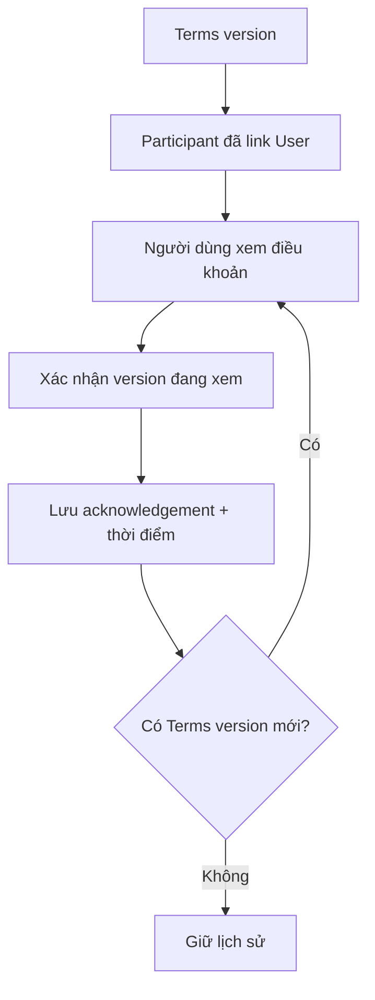

# Terms Acknowledgement — Xác nhận phiên bản điều khoản

## 1. Mục tiêu

Feature này ghi nhận rằng một participant đã liên kết với `USER` **xác nhận một Terms version cụ thể**.

Đây là lịch sử xác nhận thao tác trong sản phẩm. Nó không phải chữ ký số, dịch vụ pháp lý hay cơ chế để TrọƠi tự xác nhận hiệu lực pháp lý của điều khoản.

## 2. Người dùng cần làm được gì?

Người thuê/participant đã link User:

- **Xem điều khoản**.
- **Xác nhận phiên bản điều khoản** đang hiển thị.
- xem mình đã xác nhận version nào và thời điểm nào.

Chủ trọ/người vận hành:

- xem trạng thái xác nhận của participant khi cần theo dõi flow thuê.

## 3. Frontend cần làm gì?

- Luôn cho người dùng biết mình đang xem/xác nhận version nào.
- Chỉ cho xác nhận khi participant đã link đúng User theo rule hiện tại.
- Sau khi xác nhận, hiển thị trạng thái và timestamp từ Backend.
- Version mới không được dùng lại acknowledgement của version cũ.

## 4. Backend cần làm gì?

- Kiểm tra Participant thuộc đúng Tenancy và link đúng User.
- Kiểm tra Terms version thuộc cùng Tenancy.
- Lưu acknowledgement theo Participant + User + Terms version + thời điểm.
- Không thêm legal effect ngoài phạm vi đã chốt.

## 5. Database cần bảo vệ gì?

- Giữ reference giữa acknowledgement, Participant, User và Terms version.
- Bảo đảm chúng thuộc cùng Tenancy.
- Giữ lịch sử theo từng version.

## 6. Khi nào xem là hoàn thành?

- Người dùng luôn biết version mình xác nhận.
- Acknowledgement không thể trỏ nhầm Tenancy/User/Participant.
- Version mới có lịch sử xác nhận riêng.

## Tài liệu liên quan

- [`tenancy-participant.md`](tenancy-participant.md)
- [`tenancy-terms.md`](tenancy-terms.md)
- [`../../contexts/product-domain.md`](../../contexts/product-domain.md)
- [`../../database/v1/canonical.md`](../../database/v1/canonical.md)
