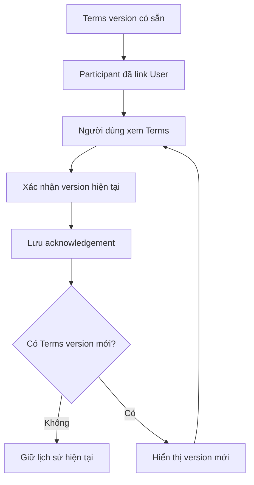
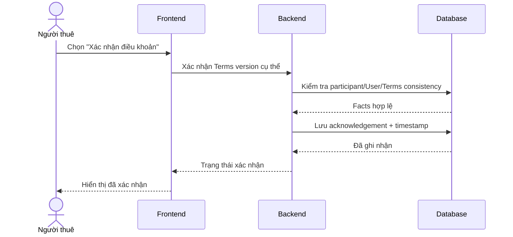

# Terms Acknowledgement — Xác nhận điều khoản

## 1. Mục tiêu

Terms Acknowledgement ghi nhận việc một participant đã liên kết với `USER` **xác nhận đúng một Tenancy Terms version cụ thể**. Đây là lịch sử xác nhận thao tác, không phải dịch vụ pháp lý hay cơ chế tự động biến điều khoản thành hợp đồng pháp lý.

## 2. Người dùng tham gia

- Người thuê/participant đã liên kết User: xem và xác nhận một Terms version.
- Chủ trọ/người vận hành: xem trạng thái xác nhận của participant khi cần theo dõi flow thuê.

## 3. Điểm vào trên sản phẩm

- Từ chi tiết điều khoản của Tenancy.
- Từ Tenant Portal khi có Terms version cần xem/xác nhận.

## 4. Hành động người dùng

- **Xem điều khoản**.
- **Xác nhận đã xem / đồng ý ghi nhận** cho version đang hiển thị theo wording sản phẩm.
- Xem lịch sử những version đã xác nhận trước đó.

Frontend phải luôn cho người dùng biết họ đang xác nhận version nào; không dùng một acknowledgement cũ để đại diện cho version mới.

## 5. Luồng sử dụng

## 6. Frontend phải làm gì

- Hiển thị rõ Terms version đang được xem.
- Chỉ cho phép action xác nhận khi participant đã liên kết User theo rule hiện hành.
- Sau khi xác nhận, hiển thị trạng thái/timestamp do Backend trả về.
- Khi có Terms version mới, không reuse acknowledgement của version cũ.
- Cho phép xem lịch sử acknowledgement theo version khi cần.

## 7. Backend phải làm gì

- Kiểm tra participant thuộc đúng Tenancy và đã liên kết đúng User.
- Kiểm tra Terms version thuộc cùng Tenancy.
- Ghi acknowledgement gắn với participant + User + Terms version + timestamp.
- Không biến acknowledgement thành legal adjudication hoặc tự thêm legal effect ngoài authority.

## 8. Database phải làm gì

- Lưu reference giữa acknowledgement, participant, User và Terms version.
- Bảo vệ same-Tenancy consistency.
- Giữ lịch sử version-specific acknowledgement.
- Không cho unlinked participant tạo User-backed acknowledgement.

## 9. Luồng xuyên hệ thống

## 10. Business rules

- Acknowledgement luôn gắn với đúng một Terms version.
- Participant phải thuộc cùng Tenancy với Terms version.
- User-backed acknowledgement chỉ hợp lệ khi participant đã link đúng User.
- Version mới cần acknowledgement riêng nếu flow yêu cầu.

## 11. Phụ thuộc

- Upstream: Tenancy, Tenancy Participant, Tenancy Terms, User link.
- Downstream: rental evidence/history consumers.

## 12. Tiêu chí hoàn thành

**Frontend**
- Người dùng luôn biết đang xác nhận version nào và xem được trạng thái sau xác nhận.

**Backend**
- Identity/participant/Terms consistency được kiểm tra trước khi ghi.

**Database**
- Version-specific history và reference integrity được bảo vệ.

## 13. Tài liệu liên quan

- [`tenancy-participant.md`](tenancy-participant.md)
- [`tenancy-terms.md`](tenancy-terms.md)
- [`../../contexts/product-domain.md`](../../contexts/product-domain.md)
- [`../../database/v1/canonical.md`](../../database/v1/canonical.md)
