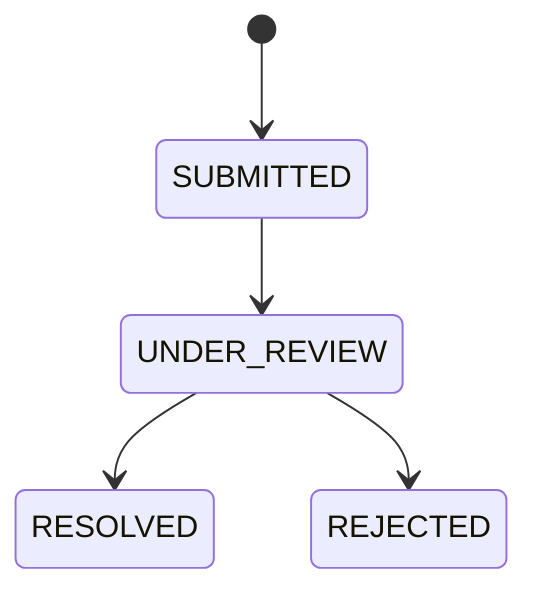

# Trust Report — Báo vấn đề với nội dung công khai

## 1. Mục tiêu

Trust Report dùng để báo vấn đề với **Listing hoặc Review**. Nó tách biệt với Incident: Incident là vấn đề vận hành của Room, còn Trust Report là vấn đề với nội dung công khai.

## 2. Người dùng cần làm được gì?

- từ Listing/Review, chọn **Báo cáo nội dung**;
- chọn reason phù hợp:
  - `INCORRECT_INFORMATION`
  - `MISLEADING_PRICE`
  - `WRONG_LOCATION`
  - `DUPLICATE_LISTING`
  - `INAPPROPRIATE_CONTENT`
  - `SUSPECTED_FRAUD`
  - `PRIVACY_VIOLATION`
  - `SPAM`
  - `OTHER`
- gửi report;
- người có quyền moderation xử lý report theo lifecycle.

> Login requirement, rate limit, moderation permission và evidence policy vẫn là `OPEN`.

## 3. Frontend cần làm gì?

- Gửi đúng target (Listing hoặc Review) và reason.
- Không tự ẩn/xóa nội dung chỉ vì một Report vừa được gửi.
- Chỉ hiển thị moderation action theo quyền Backend trả về.
- Không tự chốt evidence/login/rate-limit policy đang `OPEN`.

## 4. Backend cần làm gì?

- Mỗi Report target đúng một Listing hoặc Review.
- Giữ lifecycle `SUBMITTED → UNDER_REVIEW → RESOLVED | REJECTED`.
- Một Report không tự động remove content.
- Các policy `OPEN` phải giữ nguyên cho tới khi có authority mới.

## 5. Database cần bảo vệ gì?

- Target/reference đúng loại và tồn tại.
- Lifecycle/report history nhất quán.
- Không có trigger ngầm “1 report = content removed”.

## 6. Khi nào xem là hoàn thành?

- Người dùng gửi report đúng target/reason.
- Moderator xử lý được theo lifecycle khi có quyền.
- Nội dung không bị tự động xóa chỉ vì report tồn tại.

## Tài liệu liên quan

- [`listing.md`](listing.md)
- [`review.md`](review.md)
- [`incident.md`](incident.md)
- [`../../database/v1/canonical.md`](../../database/v1/canonical.md)
