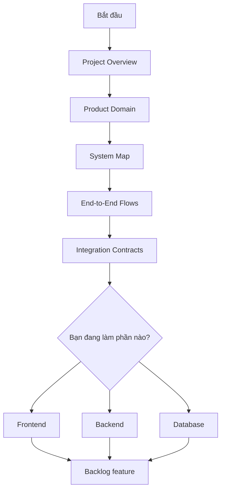
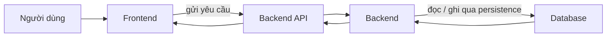

# Context TrọƠi

`docs/contexts/` là nơi nên đọc đầu tiên khi một thành viên hoặc agent mới bắt đầu làm việc với TrọƠi.

Mục tiêu rất đơn giản: đọc xong bộ này phải hiểu **TrọƠi là gì, project gồm những phần nào, người dùng đi qua các luồng nào, Frontend/Backend/Database chia trách nhiệm ra sao và khi có mâu thuẫn thì phải quay về nguồn nào**.

> Context giúp mọi người hiểu cùng một hệ thống. Nó không thay thế Canonical, API contract, Database contract hay code đang chạy.

## Đọc theo thứ tự này

1. [`project-overview.md`](project-overview.md) — TrọƠi đang giải quyết bài toán gì.
2. [`product-domain.md`](product-domain.md) — các phần nghiệp vụ chính và cách chúng nối với nhau.
3. [`system-map.md`](system-map.md) — Frontend, Backend và Database nằm ở đâu trong hệ thống.
4. [`end-to-end-flows.md`](end-to-end-flows.md) — một thao tác của người dùng đi xuyên hệ thống như thế nào.
5. [`integration-contracts.md`](integration-contracts.md) — ba layer trao đổi với nhau theo nguyên tắc nào.
6. Chọn phần đang làm trong [`layers/`](layers/).
7. Mở [`../backlogs/`](../backlogs/) để biết feature hiện tại cần hoàn thành những gì.

## Trạng thái integration hiện tại

Bộ tài liệu này được dựng trước khi toàn bộ runtime của ba lane hội tụ hoàn toàn trên `integration/full-stack-sync`.

- **Docs:** đã được gom và chuẩn hóa trên branch integration.
- **Backend core:** đã có một phần runtime trên branch hiện tại.
- **Backend + Database persistence baseline:** đã có implementation/evidence ở source baseline nhưng chưa nên mặc định rằng mọi file runtime đã hiện diện trên HEAD chỉ vì docs ghi `IMPLEMENTED`.
- **Frontend app baseline:** cũng cần được kiểm tra trên đúng branch/commit trước khi kết luận đã tích hợp end-to-end.

Khi câu hỏi là **“hệ thống đúng ra phải hoạt động thế nào?”**, đọc Context + Canonical/contract.

Khi câu hỏi là **“code trên HEAD hiện đã làm tới đâu?”**, kiểm tra đúng runtime tree, tests và Git evidence của HEAD đó.

## Bản đồ tài liệu

| Tài liệu | Đọc để trả lời câu hỏi |
| --- | --- |
| [`project-overview.md`](project-overview.md) | Project này là gì và đang xây cái gì? |
| [`product-domain.md`](product-domain.md) | Các nghiệp vụ chính là gì và liên quan với nhau thế nào? |
| [`system-map.md`](system-map.md) | Frontend, Backend và Database làm phần nào? |
| [`end-to-end-flows.md`](end-to-end-flows.md) | Người dùng thao tác thì dữ liệu đi đâu? |
| [`integration-contracts.md`](integration-contracts.md) | Hai layer gặp nhau ở contract nào? |
| [`tech-stack.md`](tech-stack.md) | Công nghệ nào đã có, đang dự kiến hay để sau? |
| [`source-of-truth.md`](source-of-truth.md) | Khi tài liệu/code nói khác nhau thì tin nguồn nào? |
| [`glossary.md`](glossary.md) | Các thuật ngữ dễ nhầm khác nhau ở đâu? |
| [`layers/frontend.md`](layers/frontend.md) | Frontend cần biết gì trước khi làm feature? |
| [`layers/backend.md`](layers/backend.md) | Backend chịu trách nhiệm rule và điều phối gì? |
| [`layers/database.md`](layers/database.md) | Database giữ và bảo vệ dữ liệu gì? |

## Cách ba layer làm việc cùng nhau

Frontend không tự quyết nghiệp vụ. Backend không tự bẻ ràng buộc dữ liệu. Database không tự tạo rule sản phẩm mới. Ba phần dùng cùng một vocabulary và cùng quay về nguồn chuẩn khi có thay đổi.

## Quy tắc sử dụng

- Đọc context trước khi sửa một feature chạm nhiều layer.
- Không lấy spec/plan/handoff cũ làm requirement hiện tại.
- Không suy ra business rule chỉ từ UI hoặc chỉ từ shape của database.
- `OPEN` vẫn là `OPEN`; `FUTURE` không tự trở thành current chỉ vì code cũ từng có scaffold.
- Dashboard, Notification, cache và các dữ liệu để hiển thị không được trở thành nguồn ghi nghiệp vụ chính.

Database contract hiện tại nằm tại [`../database/v1/`](../database/v1/). Khi cần xác định nguồn nào có quyền quyết định, đọc [`source-of-truth.md`](source-of-truth.md).
