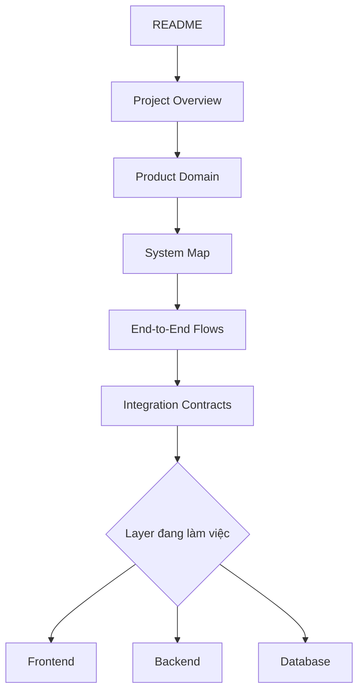
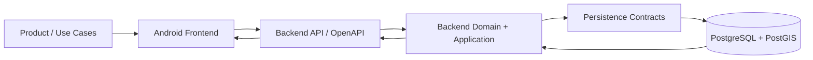
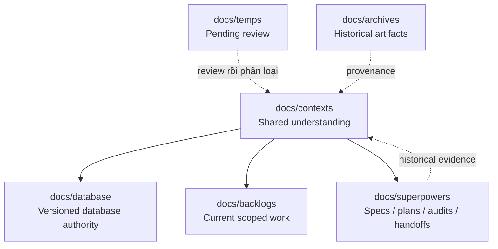

# Context TrọƠi

`docs/contexts/` là điểm vào dành cho developer, agent và reviewer cần hiểu nhanh TrọƠi trước khi đọc code hoặc thay đổi hệ thống.

Mục tiêu của bộ context này là giúp Frontend, Backend và Database dùng cùng một mental model: hiểu project là gì, gồm những phần nào, luồng nghiệp vụ chạy ra sao, layer nào sở hữu trách nhiệm nào và khi có xung đột thì phải đọc authority ở đâu.

> Context là tài liệu định hướng và liên kết. Context không thay thế database contract, API contract, runtime code hoặc backlog hiện hành.

## Đọc nhanh

1. [`project-overview.md`](project-overview.md) — TrọƠi là gì, giải quyết vấn đề gì và phạm vi hiện tại.
2. [`product-domain.md`](product-domain.md) — các domain nghiệp vụ và lifecycle cốt lõi.
3. [`system-map.md`](system-map.md) — toàn bộ hệ thống và trách nhiệm giữa các thành phần.
4. [`end-to-end-flows.md`](end-to-end-flows.md) — các luồng xuyên Frontend → Backend → Database.
5. [`integration-contracts.md`](integration-contracts.md) — contract và ownership giữa các layer.
6. Chọn layer cần làm việc trong [`layers/`](layers/).

## Bản đồ tài liệu

| Tài liệu | Câu hỏi chính |
| --- | --- |
| [`project-overview.md`](project-overview.md) | Project này là gì và đang xây cái gì? |
| [`product-domain.md`](product-domain.md) | Project gồm những domain/nghiệp vụ nào? |
| [`system-map.md`](system-map.md) | Hệ thống gồm những thành phần kỹ thuật nào? |
| [`end-to-end-flows.md`](end-to-end-flows.md) | Một hành động user chạy xuyên hệ thống ra sao? |
| [`integration-contracts.md`](integration-contracts.md) | Frontend, Backend và Database giao tiếp theo luật nào? |
| [`tech-stack.md`](tech-stack.md) | Công nghệ nào đã triển khai, đang dự kiến hay để tương lai? |
| [`source-of-truth.md`](source-of-truth.md) | Khi tài liệu/code mâu thuẫn thì tin nguồn nào? |
| [`glossary.md`](glossary.md) | Các thuật ngữ như Room, Listing, Tenancy khác nhau thế nào? |
| [`layers/frontend.md`](layers/frontend.md) | Frontend sở hữu gì và phụ thuộc contract nào? |
| [`layers/backend.md`](layers/backend.md) | Backend sở hữu domain/application/API gì? |
| [`layers/database.md`](layers/database.md) | Database chịu trách nhiệm persistence/integrity gì? |

## Mental model toàn project

Ba layer không được phát triển ba bộ business semantics riêng. Product/domain vocabulary phải thống nhất; Backend sở hữu business transitions và orchestration; Database bảo vệ persistence integrity; Frontend render và gửi intent theo contract.

## Các vùng tài liệu khác

## Quy tắc sử dụng

- Đọc context trước khi thay đổi một layer mà thay đổi đó tác động tới layer khác.
- Không dùng plan/spec/handoff cũ để override authority hiện tại.
- Không suy ra business rule mới chỉ từ UI hoặc database shape.
- Không để Frontend tự định nghĩa lifecycle khác Backend.
- Không để Backend bypass invariant đã được database contract đóng băng.
- Không coi dashboard, notification, cache hay read model là business source of truth.
- Mục `OPEN` vẫn phải giữ `OPEN`; mục `FUTURE` không tự động trở thành MVP chỉ vì có scaffold/code cũ.

Database contract hiện tại là [`../database/v1/`](../database/v1/). Xem [`source-of-truth.md`](source-of-truth.md) để biết đầy đủ thứ tự authority.
