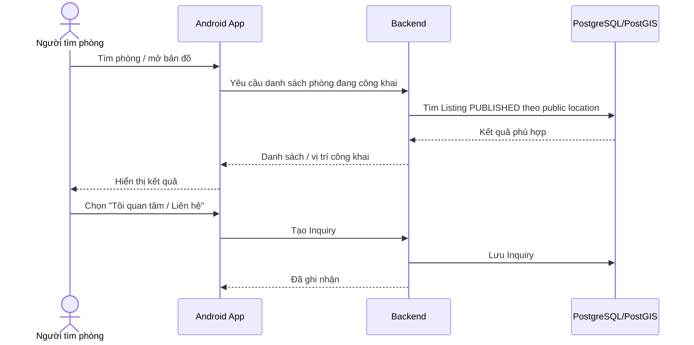
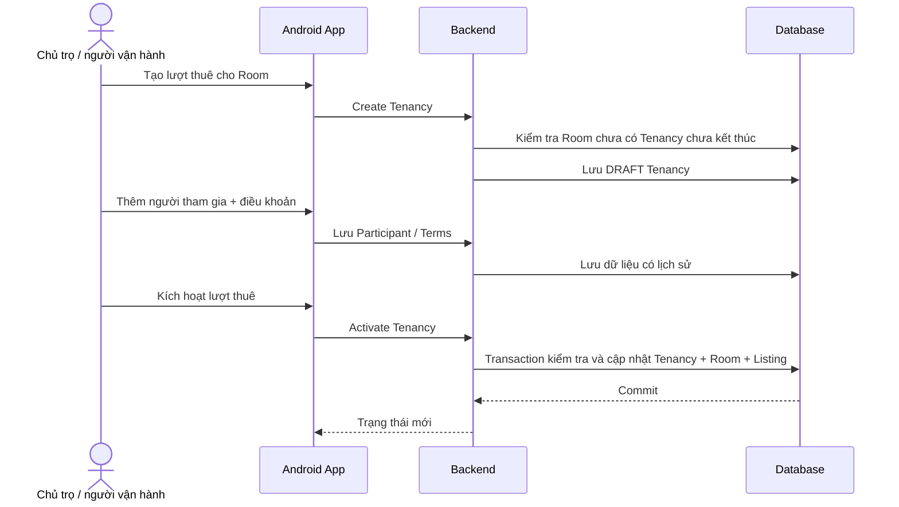
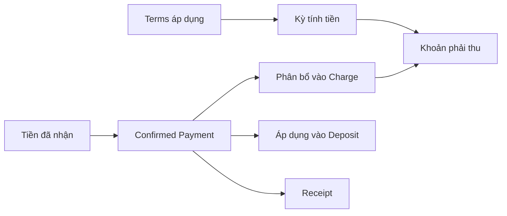
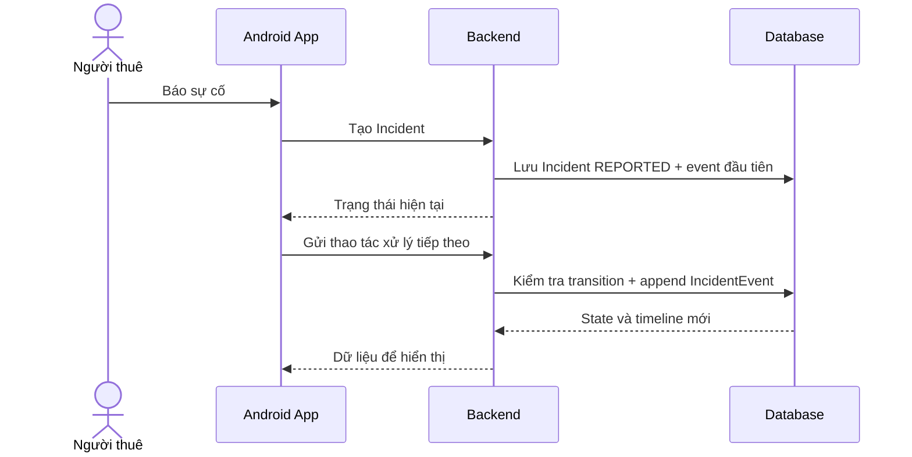
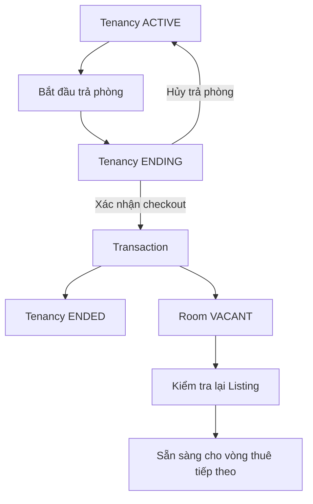
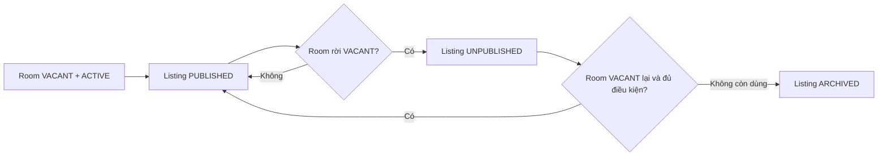
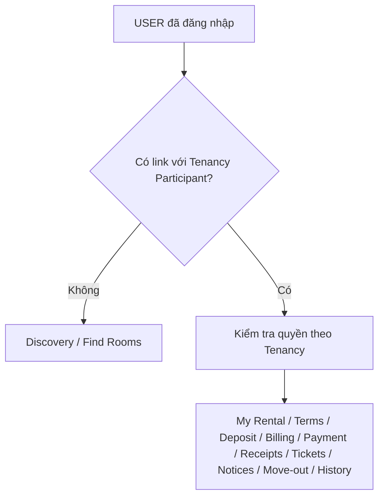

# Các luồng chính từ đầu đến cuối

Tài liệu này kể lại các luồng quan trọng theo cách người dùng nhìn thấy, rồi cho biết thao tác đó đi qua Frontend, Backend và Database như thế nào.

## 1. Tìm phòng và gửi nhu cầu liên hệ

Chỉ Listing `PUBLISHED` được dùng cho discovery. Inquiry giúp nối hai bên nhưng không phải booking và không bắt buộc phải có trước Tenancy.

## 2. Tạo và kích hoạt một lần thuê

Khi activation thành công, Tenancy mới thực sự `ACTIVE`, Room chuyển `OCCUPIED` và Listing đang public phải được xử lý nhất quán. Frontend không tự đổi ba state này trước khi Backend trả kết quả.

## 3. Tạo khoản phải thu, ghi nhận thanh toán và phát hành biên nhận

UI cần giúp người dùng phân biệt rõ: **phải thu**, **đã nhận tiền**, **cọc**, **biên nhận**. Không gom tất cả thành một nút “đã thanh toán” rồi dùng nó như dữ liệu gốc.

## 4. Báo và xử lý sự cố

Lịch sử sự cố không bị ghi đè. Notification có thể được gửi theo sự kiện nhưng không được tự đổi trạng thái Incident.

## 5. Trả phòng

`ENDING` chưa có nghĩa Room đã trống. Chỉ khi checkout được xác nhận thì Tenancy mới `ENDED` và Room mới trở về `VACANT`.

## 6. Room và Listing phải đi cùng nhau

Frontend chỉ hiển thị state hệ thống trả về. Backend kiểm tra/điều phối thay đổi. Database bảo vệ các ràng buộc có thể bị race.

## 7. Tenant Portal và quyền dựa trên quan hệ

Người dùng không có quyền tenant chỉ vì một global role. Quyền đến từ Participant/Tenancy thực tế.

## 8. Review và Trust Report

Review chỉ xuất hiện khi người dùng có lịch sử thuê đủ điều kiện. Trust Report dùng để báo vấn đề với Listing hoặc Review. Một report không tự động xóa nội dung; các policy còn `OPEN` vẫn phải để `OPEN`.

## 9. Nguyên tắc chung

- Frontend gửi **thao tác người dùng muốn làm**, không tự quyết kết quả nghiệp vụ.
- Backend kiểm tra quyền/rule và điều phối những thay đổi liên quan.
- Database là lớp bảo vệ cuối cho các ràng buộc cần transaction hoặc concurrency safety.
- Frontend cập nhật UI từ response/state mới sau khi thao tác hoàn tất.
- Notification và Dashboard đi theo dữ liệu gốc, không trở thành nguồn ghi nghiệp vụ mới.
