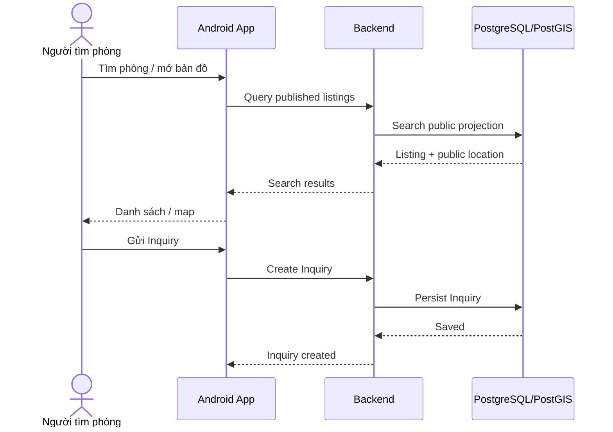
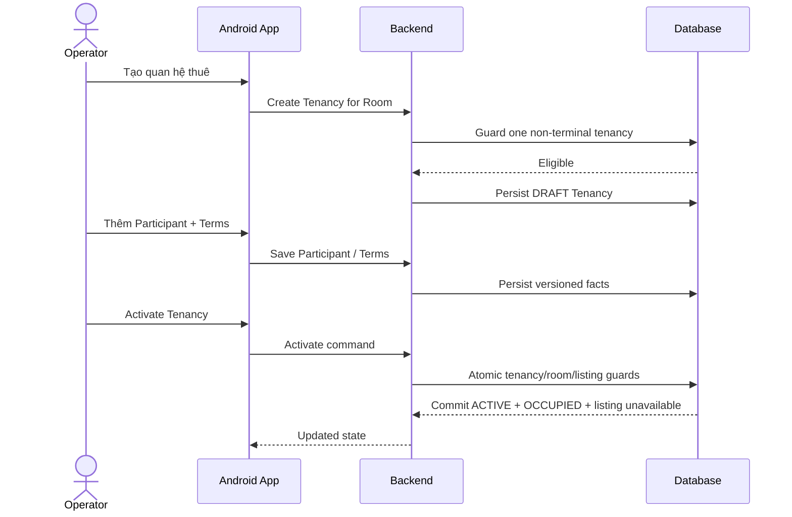
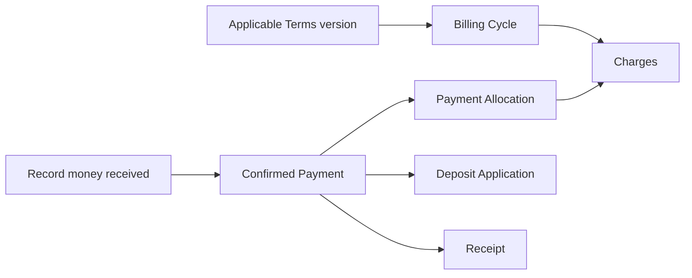
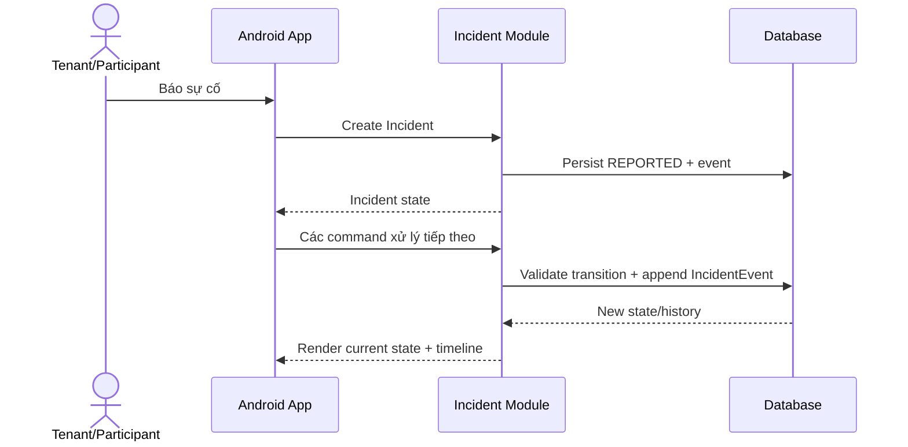
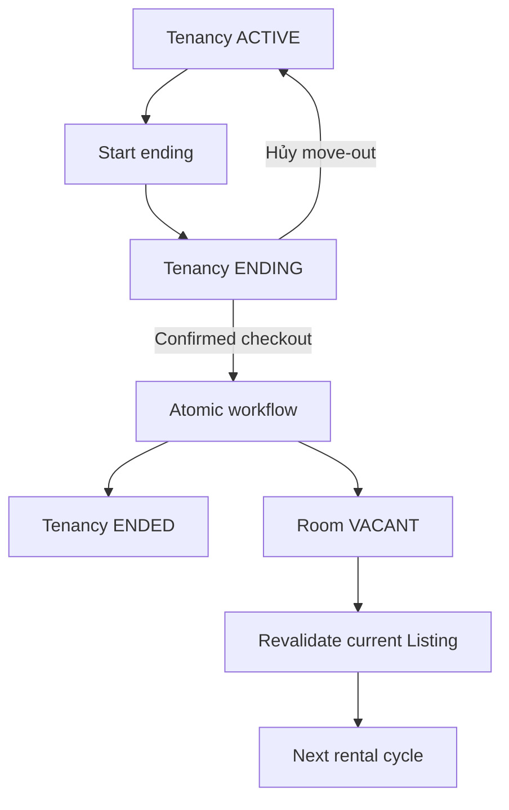
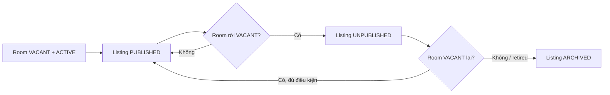
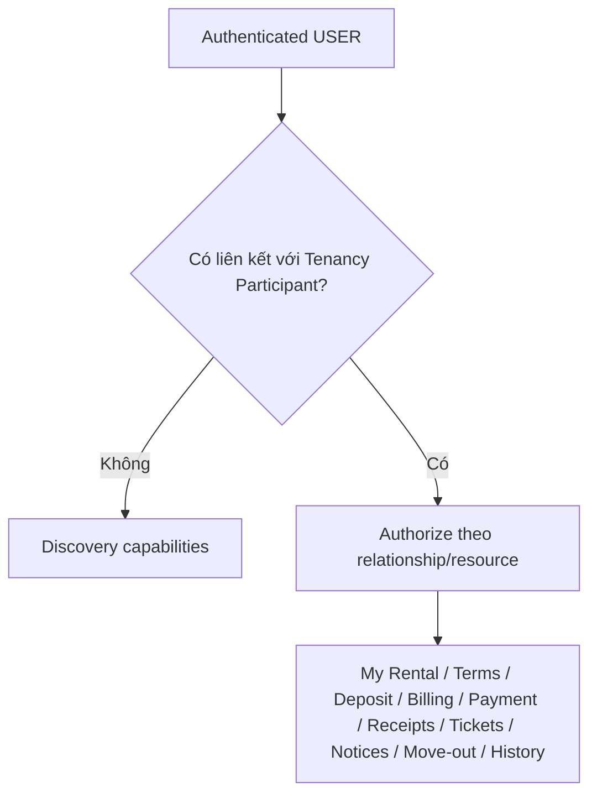

# Luồng End-to-End TrọƠi

Tài liệu này mô tả các luồng đi xuyên Product → Frontend → Backend → Database. Mục đích là để ba layer hiểu cùng một business story và không tự tạo semantics khác nhau.

## 1. Tìm phòng và Inquiry

Chỉ Listing `PUBLISHED` và public location được dùng cho discovery. Inquiry không bắt buộc để tạo Tenancy.

## 2. Tạo và kích hoạt Tenancy

## 3. Billing → Payment → Receipt

Luồng này phải giữ ba khái niệm riêng: nghĩa vụ phải thu (`Charge`), tiền thực nhận (`Payment`) và bằng chứng (`Receipt`). UI không được gom chúng thành một mutable “paid status” rồi coi đó là source of truth.

## 4. Báo và xử lý sự cố

`INCIDENT_EVENT` là append-only history. Notification có thể được trigger bởi sự kiện nhưng không được mutate Incident source state.

## 5. Checkout / Move-out

Không có direct `ACTIVE → ENDED`. Checkout là workflow phối hợp Tenancy và Room.

## 6. Room state ↔ Listing coupling

Frontend chỉ hiển thị state đã được trả về; Backend điều phối transition; Database bảo vệ constraint/current-listing integrity.

## 7. Tenant Portal và relationship-based access

Tenant capability không đến từ `User.role = tenant`.

## 8. Review / Trust Report

Review eligibility đến từ quan hệ thuê đủ điều kiện. Trust Report target đúng một Listing hoặc Review và tách biệt với Incident. Các policy canonical còn `OPEN` không được UI/API tự chọn default.

## 9. Nguyên tắc chung cho mọi flow

- Frontend gửi intent, không gửi “business truth đã quyết định sẵn”.
- Backend validate command và sở hữu orchestration.
- Database là nơi enforcement cuối cho invariant cần transaction/concurrency safety.
- Response/read model quay lại Frontend để render state mới.
- Side effect như Notification chạy theo source fact, không trở thành nguồn fact mới.
